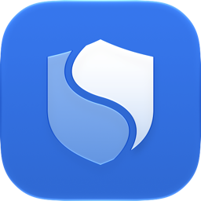
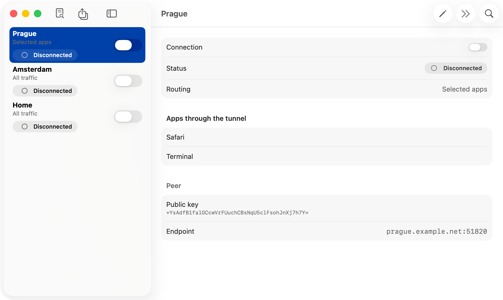

<p align="center"></p>

<h1 align="center">Splitway</h1>

<p align="center"><strong>VPN only for the apps that need it.</strong><br>
A free, open-source WireGuard® client for Mac with per-app split tunneling.</p>

<p align="center">
<a href="https://github.com/facelessdiplomat/splitway/releases/latest/download/Splitway.dmg">Download for Mac</a> ·
<a href="https://facelessdiplomat.github.io/splitway/">Website</a> ·
<a href="README.ru.md">Русский</a>
</p>

<p align="center"></p>

## What it does

Splitway connects to the WireGuard server you bring — your own, on a router, or from a VPN provider. Unlike the official client, it lets you choose which apps go through the tunnel. Everything else stays on your regular connection.

- **Apps, not subnets.** Pick apps and command-line tools. Helpers and processes started by a selected app go with it: commands in a selected Terminal use the tunnel too.
- **DNS follows the app.** Name lookups of selected apps go through the tunnel, so they do not leak.
- **Blocked, not exposed.** If the tunnel drops, selected apps wait for it instead of going direct (configurable per tunnel).
- **All traffic when you need it**, with the option to exclude private networks, like the official client.
- **Your keys stay yours.** No accounts, no analytics, no developer servers. Keys live in the Keychain.
- Menu bar, launch at login, Shortcuts and Siri, English and Russian.

## Install

1. Download the latest [Splitway.dmg](https://github.com/facelessdiplomat/splitway/releases/latest/download/Splitway.dmg). Releases are signed with Developer ID and notarized by Apple.
2. Drag Splitway to Applications — the network extension starts only from there.
3. On first launch, allow the extension in System Settings › General › Login Items & Extensions › Network Extensions.
4. Import your WireGuard configuration, allow the VPN configuration when macOS asks, and connect.

Requires macOS 26 or later on Apple silicon or Intel.

## How it works

A network system extension hosts two providers. A transparent proxy (`NETransparentProxyProvider`) learns which app opened each TCP or UDP flow; flows of selected apps go through WireGuard running on a userspace network stack (wireguard-go with gVisor netstack), and the rest go back to macOS. A packet tunnel provider runs the classic All traffic mode. Only public APIs are used.

The app is Swift 6 with SwiftUI; the engine is Go behind a small C API. The design documents are in Russian: start with [docs/02-architecture.md](docs/02-architecture.md), and see the full list in [README.ru.md](README.ru.md#документация).

## Build from source

You need Xcode 27, Go 1.27, SwiftLint and XcodeGen (`brew install swiftlint xcodegen go`).

```bash
Scripts/bootstrap.sh
```

```bash
Scripts/check.sh
```

`bootstrap.sh` installs the git hooks, builds `TunnelCore.xcframework` and generates `Splitway.xcodeproj`; `check.sh` runs the linters, Go and Swift tests and the macOS build. To run your own signed build, set your team and bundle ID prefix (`DEVELOPMENT_TEAM`, `SPLITWAY_BUNDLE_ID_PREFIX`) in `project.yml`: a network system extension needs a signing identity with the Network Extension and System Extension capabilities, and it activates only from `/Applications`.

## Contributing

Bug reports and pull requests are welcome — see [CONTRIBUTING.md](CONTRIBUTING.md). Report security problems privately as described in [SECURITY.md](SECURITY.md).

## License

Splitway is released under the [GNU General Public License v3.0](LICENSE). Third-party components keep their own licenses, listed in the app under Settings › Licenses.

“WireGuard” is a registered trademark of Jason A. Donenfeld. Splitway is not affiliated with or endorsed by the WireGuard project.
