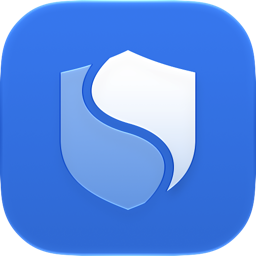
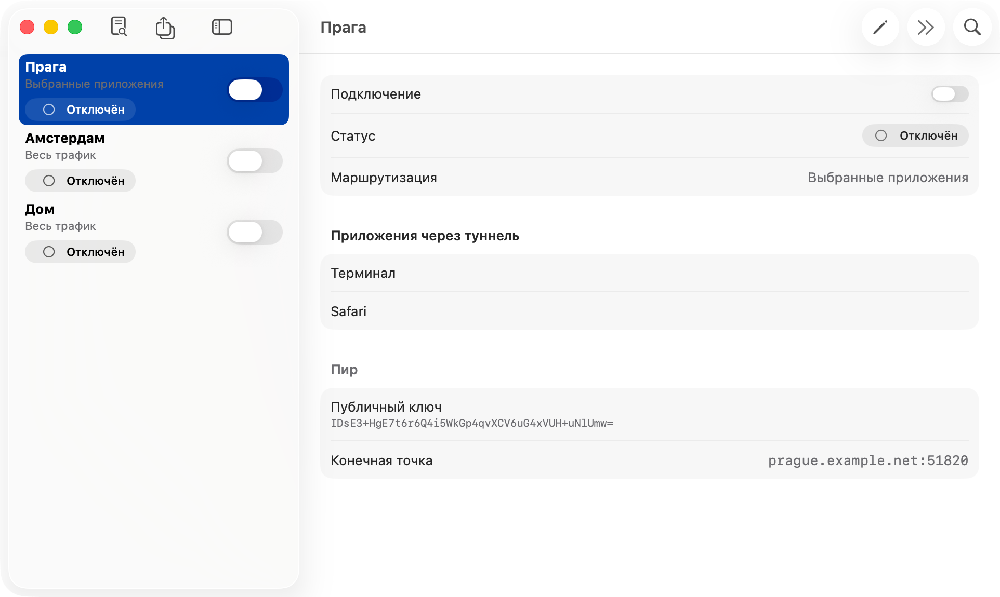

<p align="center"></p>

<h1 align="center">Splitway</h1>

<p align="center"><strong>VPN только для нужных приложений.</strong><br>
Бесплатный клиент WireGuard® для Mac с открытым кодом и выбором приложений для туннеля.</p>

<p align="center">
<a href="https://github.com/facelessdiplomat/splitway/releases/latest/download/Splitway.dmg">Скачать для Mac</a> ·
<a href="https://facelessdiplomat.github.io/splitway/ru/">Сайт</a> ·
<a href="README.md">English</a>
</p>

<p align="center"></p>

## Что это

Splitway подключается к вашему серверу WireGuard — своему, на роутере или у VPN-провайдера. В отличие от официального клиента, он позволяет выбрать приложения, которые идут через туннель. Всё остальное работает через обычное подключение.

- **Приложения, а не подсети.** Выбирайте приложения и утилиты командной строки. Помощники и процессы, которые запускает выбранное приложение, идут вместе с ним: команды в выбранном Терминале тоже пойдут через туннель.
- **DNS вместе с приложением.** DNS-запросы выбранных приложений идут через туннель и не утекают.
- **Туннель упал — трафик не утечёт.** Если туннель недоступен, выбранные приложения ждут его, а не уходят напрямую (настраивается для каждого туннеля).
- **Весь трафик, когда нужно**, с исключением локальных сетей, как в официальном клиенте.
- **Ключи остаются у вас.** Нет учётных записей, аналитики и серверов разработчика. Ключи хранятся в связке ключей.
- Строка меню, запуск при входе, «Команды» и Siri, русский и английский языки.

## Установка

1. Скачайте последний [Splitway.dmg](https://github.com/facelessdiplomat/splitway/releases/latest/download/Splitway.dmg). Выпуски подписаны Developer ID и нотаризованы Apple.
2. Перетащите Splitway в «Программы»: сетевое расширение запускается только оттуда.
3. При первом запуске разрешите расширение в «Системные настройки › Основные › Объекты входа и расширения › Сетевые расширения».
4. Импортируйте конфигурацию WireGuard, разрешите конфигурацию VPN, когда macOS спросит, и подключитесь.

Нужна macOS 26 или новее на Apple silicon или Intel.

## Как это устроено

Сетевое системное расширение содержит два провайдера. Прозрачный прокси (`NETransparentProxyProvider`) узнаёт, какое приложение открыло каждый TCP- или UDP-поток. Потоки выбранных приложений идут через WireGuard на сетевом стеке в пространстве пользователя (wireguard-go и gVisor netstack), остальные возвращаются macOS. Пакетный туннель обслуживает классический режим «Весь трафик». Используются только публичные API.

Приложение написано на Swift 6 и SwiftUI, движок — на Go за небольшим C API. Документация проекта — на русском, начните с [docs/02-architecture.md](docs/02-architecture.md), правила разработки — в [docs/06-development-rules.md](docs/06-development-rules.md), решения — в [журнале](docs/00-decisions.md).

## Документация

| Документ | О чём |
|---|---|
| [00. Журнал решений](docs/00-decisions.md) | Решения владельца и отложенные вопросы |
| [01. Продукт](docs/01-product.md) | Что за продукт, для кого, функции, распространение |
| [02. Архитектура](docs/02-architecture.md) | Стек, фичи и слои, хранение, Go-движок, ADR |
| [03. macOS](docs/03-platform-macos.md) | Системное расширение, прозрачный прокси, выбор приложений, сборка и выпуск |
| [05. План задач](docs/05-tasks/README.md) | Вехи M0–M8 с критериями готовности |
| [06. Правила разработки](docs/06-development-rules.md) | Обязательные правила кода, тестов, коммитов и документации |
| [Безопасность](docs/security.md) | Модель угроз, аудит, принятые риски |
| [CI](docs/ci.md) и [сайт](docs/site.md) | GitHub Actions, раннер, GitHub Pages |
| [Документы фич](docs/features) | Как устроена каждая фича |

## Сборка из исходников

Нужны Xcode 27, Go 1.27, SwiftLint и XcodeGen (`brew install swiftlint xcodegen go`).

```bash
Scripts/bootstrap.sh
```

```bash
Scripts/check.sh
```

`bootstrap.sh` ставит git-хуки, собирает `TunnelCore.xcframework` и генерирует `Splitway.xcodeproj`, `check.sh` запускает линтеры, тесты Go и Swift и сборку macOS. Чтобы собрать свою подписанную копию, укажите в `project.yml` свою команду и префикс bundle ID (`DEVELOPMENT_TEAM`, `SPLITWAY_BUNDLE_ID_PREFIX`): сетевому системному расширению нужна подпись с возможностями Network Extension и System Extension, а активируется оно только из `/Applications`.

## Участие

Сообщения об ошибках и pull request приветствуются — см. [CONTRIBUTING.md](CONTRIBUTING.md). Об уязвимостях сообщайте закрыто, как описано в [SECURITY.md](SECURITY.md).

## Лицензия

Splitway распространяется под лицензией [GNU General Public License v3.0](LICENSE). Сторонние компоненты сохраняют свои лицензии, их список — в приложении, в разделе лицензий настроек.

«WireGuard» — зарегистрированный товарный знак Jason A. Donenfeld. Splitway не связан с проектом WireGuard и не одобрен им.
