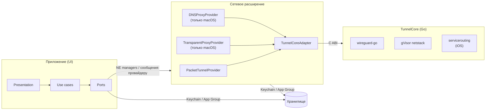

# 02. Общая архитектура

Документ описывает то, что общее для всех платформ. Особенности платформ — в [03-platform-macos.md](03-platform-macos.md) и [04-platform-ios-ipados.md](04-platform-ios-ipados.md).

## 1. Технологический стек

| Область | Выбор | Причина |
|---|---|---|
| Язык приложения | Swift 6 (strict concurrency), инструменты Swift 6.4 / Xcode 27 | Безопасность потоков на уровне компилятора. |
| UI | SwiftUI + Observation (`@Observable`) | Один UI-код для трёх платформ, нативный вид. |
| Тесты | Swift Testing (`import Testing`) для unit и интеграционных тестов, XCUITest только для smoke UI-тестов | Параметризованные тесты, быстрый запуск через `swift test`. |
| VPN-движок | wireguard-go (MIT) + gVisor netstack (Apache-2.0) из `golang.zx2c4.com/wireguard/tun/netstack`, Go 1.27 | Эталонная реализация. Userspace-стек нужен для macOS per-app и для трансляции адресов на iOS. |
| Мост Go ↔ Swift | Свой C ABI (`go build -buildmode=c-archive`) → `TunnelCore.xcframework` | Полный контроль над API, без gomobile и без WireGuardKit. |
| Системные API | NetworkExtension, SystemExtensions (macOS), Security (Keychain, подписи кода), Network, OSLog, AppIntents, WidgetKit | — |
| Проект | XcodeGen (`project.yml`) + локальные SPM-пакеты | XcodeGen уже установлен. Нет конфликтов в `.pbxproj`, весь код живёт в пакетах. |
| Сторонние Swift-зависимости | ZIPFoundation (MIT), только для `.zip`. Sparkle (MIT), только для обновлений macOS вне App Store | Минимум зависимостей; см. ADR-08 и ADR-09. |
| Линтинг | SwiftLint (кастомное правило «нет комментариев» и правила слоёв), `swift format`, `go vet`, `gofmt`, свой чекер комментариев для Go | Правила разработки проверяются автоматически. |
| Проверки | Локально: `Scripts/check.sh` и git-хуки, без CI (решение D-23) | Один скрипт запускает линтеры, тесты и сборку всех платформ. |
| Диагностика | OSLog, кольцевой журнал, MetricKit. Всё хранится локально, отчёт отправляет только сам пользователь (решение D-22) | Обещание «никаких запросов к серверам разработчика». |

## 2. Процессы и компоненты



| Компонент | iOS / iPadOS | macOS |
|---|---|---|
| Приложение | `iOSApp` (универсальное для iPhone и iPad) | `macOSApp` (окно + строка меню) |
| Пакетный туннель («Весь трафик») | `PacketTunnelExtension` (app extension) | `NetworkSystemExtension` (system extension) |
| Выбор приложений | — | `NetworkSystemExtension`, класс `TransparentProxyProvider` |
| DNS выбранных приложений | — | `NetworkSystemExtension`, класс `DNSProxyProvider` |
| Выбор сервисов | `PacketTunnelExtension` + `servicerouting` в Go | Бэклог |
| Виджеты и Controls | `ControlsExtension` | — |

На macOS все три провайдера живут **в одном** системном расширении, и пользователь одобряет одно расширение. Провайдеры работают в одном процессе, поэтому DNS-прокси пользуется тем же экземпляром `usernet`, что и transparent proxy (это проверяет спайк SP-9).

## 3. Структура репозитория

```
/
├── CLAUDE.md, README.md
├── project.yml                      XcodeGen: таргеты, entitlements, Info.plist
├── Apps/                            тонкие оболочки, только точки входа и composition root
│   ├── iOSApp/
│   ├── macOSApp/
│   ├── Shared/                      общий composition root и корневая сцена приложений iOS и macOS
│   ├── PacketTunnelExtension/
│   ├── NetworkSystemExtension/
│   └── ControlsExtension/
├── Packages/
│   ├── SplitwayKit/                 весь Swift-код фич (без Go)
│   │   ├── Package.swift
│   │   ├── Sources/
│   │   │   ├── SharedKernel/
│   │   │   └── Features/<Feature>/{Core,Infrastructure,Presentation}/
│   │   └── Tests/Features/<Feature>/{CoreTests,InfrastructureTests,PresentationTests}/
│   └── TunnelCore/                  Go-движок и его Swift-адаптер
│       ├── Package.swift            binaryTarget TunnelCoreFramework + target TunnelCoreAdapter
│       ├── go/                      go.mod, пакеты по фичам: bridge, fdtunnel, usernet, servicerouting, logbridge
│       └── Scripts/build-xcframework.sh
├── Resources/ServiceCatalog/        каталог сервисов (JSON) для iOS
├── Scripts/                         check.sh, bootstrap, lint, git-хуки, проверка комментариев
└── docs/                            эта документация + docs/features/*.md
```

`SplitwayKit` не зависит от Go. Он объявляет порт `TunnelEngine`, а `TunnelCoreAdapter` реализует его поверх xcframework. Поэтому доменные тесты собираются и проходят без Go-тулчейна (ADR-03).

## 4. Слои внутри фичи

Каждая фича — своя папка `Sources/Features/<Feature>/` и до трёх SPM-таргетов:

| Папка | Таргет | Содержимое | Может импортировать |
|---|---|---|---|
| `Core/Domain` | `<Feature>` | Сущности, value objects, доменные сервисы, доменные ошибки | `Foundation`, `CryptoKit`, `SharedKernel`, `Core` других фич |
| `Core/UseCases` | `<Feature>` | Сценарии приложения, оркестрация домена и портов | то же |
| `Core/Ports` | `<Feature>` | Протоколы внешнего мира (`TunnelRecordRepository`, `SystemTunnelController`…) | то же |
| `Infrastructure` | `<Feature>Infrastructure` | Адаптеры портов: Keychain, NetworkExtension, файлы, Security | `Core` + системные фреймворки |
| `Presentation` | `<Feature>Presentation` | SwiftUI-экраны и `@Observable` модели представления | `Core` + `SwiftUI` |

Правила зависимостей:
1. `Core` не знает ни о UI, ни об инфраструктуре. Компилятор гарантирует это, потому что у таргета нет таких зависимостей.
2. `Presentation` не обращается к `Infrastructure`: только к use cases и доменным типам.
3. Связывание (composition root) выполняется только в `Apps/*`. У каждой фичи есть небольшой `<Feature>Assembly` в таргете `Infrastructure`, который собирает её граф. Общего «контейнера на всё» нет.
4. Расширения линкуют только `Core` и `Infrastructure` нужных фич, **никогда** `Presentation`. SwiftUI не попадает в процесс расширения, что экономит память на iOS.
5. Фичи общаются через публичные типы `Core`. Циклические зависимости между фичами запрещены и ловятся сборкой SPM.
6. Фейки портов для тестов лежат в таргете `<Feature>TestSupport` (`Tests/Features/<Feature>/TestSupport`). Им пользуются тесты самой фичи и зависящих от неё фич.

## 5. Фичи (bounded contexts)

| Фича | Ответственность | Платформы | Используется в расширении |
|---|---|---|---|
| `SharedKernel` | `IPAddress`, `IPNetwork` (CIDR), `IPNetworkSet`, `NetworkPort`, `DomainName`, `ByteCount`, `WallClock` | все | да |
| `DesignSystem` | Общие UI-компоненты: бейдж статуса, строка «ключ–значение», пустое состояние (только слой `Presentation`) | все | нет |
| `TunnelConfiguration` | Модель конфига WireGuard, парсер и сериализатор wg-quick, валидация, ключи, «исключить локальные сети» | все | да |
| `TunnelLibrary` | Коллекция туннелей: создание, импорт, изменение, удаление, дублирование, экспорт; хранение | все | да (чтение) |
| `TunnelImport` | Источники импорта: файл, `.zip`, буфер, QR, «Открыть в…» | все (QR — iOS/iPadOS) | нет |
| `TunnelEditor` | Черновик редактирования с валидацией полей, экран редактора | все | нет |
| `AppRouting` | Политика маршрутизации туннеля, идентичность приложения, решение по потоку, снимок правил для расширения | все (выбор приложений — macOS) | да |
| `ApplicationCatalog` | Поиск установленных приложений и CLI-утилит, чтение подписи кода, иконки | macOS | нет |
| `ServiceCatalog` | Каталог сервисов, свои правила, компиляция в план маршрутизации | iOS/iPadOS | да |
| `TunnelEngine` | Порт движка WireGuard и кодирование конфигурации в UAPI, разбор статистики | все | да |
| `PacketTunnel` | Логика пакетного туннеля: сетевые настройки, резолвинг endpoint, реакция на смену сети | все | да |
| `TransparentProxy` | Перехват потоков, определение приложения-источника, TCP/UDP-ретрансляция | macOS | да |
| `DNSProxy` | DNS-запросы выбранных приложений — через туннель, остальных — к исходному резолверу без изменений | macOS | да |
| `TunnelConnection` | Подключение, отключение, статус, статистика, последняя ошибка | все | нет |
| `ProviderMessaging` | Типизированный протокол сообщений «приложение ↔ расширение» с версионированием | все | да |
| `SystemExtension` | Установка и обновление системного расширения, мастер одобрения | macOS | нет |
| `Diagnostics` | Журнал (кольцевой буфер в App Group), маскирование секретов, экспорт, локальные отчёты MetricKit, ручная отправка отчёта | все | да |
| `Settings` | Настройки приложения: «О приложении», лицензии открытого ПО с проверкой полноты, запуск при входе, иконка в Dock и т. п. | все | нет |
| `MenuBar` | Меню в строке меню | macOS | нет |
| `Shortcuts` | App Intents: подключить, отключить, переключить; сущность туннеля | все | нет |
| `ControlWidgets` | Переключатели Пункта управления / экрана блокировки | iOS/iPadOS | нет |
| `Onboarding` | Первый запуск, объяснение разрешений | все | нет |
| `OnDemand` (v1.x) | Правила автоподключения и их компиляция в `NEOnDemandRule` | все | нет |

## 6. Ключевая доменная модель

```
TunnelConfiguration                     value type, без идентичности
├── InterfaceConfiguration
│   ├── privateKey: PrivateKey
│   ├── addresses: [IPNetwork]
│   ├── listenPort: ListenPort?
│   ├── mtu: MTU?
│   └── dns: DNSConfiguration           servers: [IPAddress], searchDomains: [DomainName]
└── peers: [PeerConfiguration]
    ├── publicKey: PublicKey
    ├── presharedKey: PresharedKey?
    ├── allowedIPs: AllowedIPs          набор IPNetwork с операциями объединения и вычитания
    ├── endpoint: Endpoint?             host (DomainName | IPAddress) + Port
    └── persistentKeepalive: PersistentKeepalive?

Tunnel                                  сущность (aggregate root фичи TunnelLibrary)
├── id: TunnelIdentifier
├── name: TunnelName
├── configuration: TunnelConfiguration
└── routingPolicy: RoutingPolicy        из фичи AppRouting

RoutingPolicy
├── mode: .allTraffic
│       | .selectedApplications(ApplicationSelection)   macOS
│       | .selectedServices(ServiceSelection)           iOS/iPadOS
└── whenTunnelUnavailable: .bypass | .block
```

«Исключить локальные сети» хранится не в политике, а в самих `AllowedIPs` (`PrivateNetworkExclusion`), как в официальном клиенте: так у состояния один источник истины.

Все value objects валидируются при создании (`init` бросает доменную ошибку) и дальше считаются корректными. Невалидное состояние в домене непредставимо.

## 7. Хранение данных и секретов

| Данные | Где хранится | Кто читает |
|---|---|---|
| Метаданные туннелей: id, имя, порядок, политика маршрутизации | JSON в контейнере App Group, атомарная запись, версия схемы с миграциями | приложение; расширение — только активный туннель |
| Конфиг wg-quick целиком, с ключами | Keychain, общая access group. На iOS — `AfterFirstUnlockThisDeviceOnly`. Для системного расширения macOS — см. [03-platform-macos.md](03-platform-macos.md), раздел 5 | приложение, расширение |
| Системная конфигурация VPN | По одному «слоту» на тип провайдера: `NETunnelProviderManager`, на macOS ещё `NETransparentProxyManager` и `NEDNSProxyManager`. В `providerConfiguration` лежит только id активного туннеля и снимок политики маршрутизации, без секретов | система, расширение |
| Журнал | Кольцевой файл в App Group (до 2 МБ) + OSLog | приложение, расширение |
| Настройки приложения | `UserDefaults` с suite App Group | приложение |

**Источник истины — собственный репозиторий** (ADR-04, решение D-17), а не список системных VPN-конфигураций. Системная конфигурация перезаписывается при активации туннеля.

## 8. Связь приложения и расширения

- **Команды** («дай статистику», «примени новую политику маршрутизации»): `NETunnelProviderSession.sendProviderMessage`. Сообщения — `Codable`-конверт `ProviderMessageEnvelope { protocolVersion, request }` в JSON. Неизвестная версия отклоняется с явной ошибкой.
- **Статус**: `NEVPNStatusDidChange` → доменный `ConnectionState`.
- **Ошибки запуска**: `NEVPNConnection.fetchLastDisconnectError`. Запасной вариант — файл последней ошибки в App Group.
- **Изменение конфигурации активного туннеля**: изменение политики маршрутизации применяется на лету сообщением. Изменение параметров WireGuard перезапускает туннель (как в официальном клиенте).
- **macOS**: системное расширение дополнительно публикует XPC-сервис (`NEMachServiceName`) для операций без запущенного туннеля, например для передачи секретов (раздел 5 документа macOS).

## 9. TunnelCore (Go)

Go-модуль разбит на пакеты по фичам:

| Пакет | Назначение |
|---|---|
| `bridge` | Экспортируемые C-функции (`//export`), таблица хэндлов, обратные вызовы в Swift |
| `fdtunnel` | WireGuard поверх файлового дескриптора `utun` (режим «Весь трафик» и выбор сервисов на iOS) |
| `usernet` | WireGuard поверх gVisor netstack: `DialTCP`, UDP-сокеты, DNS через туннель (выбор приложений и DNS-прокси на macOS) |
| `servicerouting` | Пул фиктивных адресов, перехват DNS выбранных доменов, трансляция адресов (выбор сервисов на iOS) |
| `logbridge` | Передача логов wireguard-go в Swift |

Go-пакеты документируются так же, как Swift-фичи: например, `docs/features/ServiceRouting.md` описывает `servicerouting`.

C API (черновик, фиксируется в задаче M2-02):

```
tc_version() -> *char
tc_fd_tunnel_start(engine_kind, uapi_config, tun_fd, log_callback) -> handle
tc_fd_tunnel_set_service_routing(handle, routing_plan_json) -> status
tc_usernet_start(engine_kind, uapi_config, addresses, dns_servers, mtu, log_callback) -> handle
tc_usernet_dial_tcp(handle, host, port, callbacks) -> connection
tc_usernet_open_udp(handle, callbacks) -> socket
tc_connection_write(connection, bytes, length) -> status
tc_connection_close(connection, mode)
tc_tunnel_update_config(handle, uapi_config) -> status
tc_tunnel_get_config(handle) -> *char
tc_tunnel_bump_sockets(handle)
tc_tunnel_stop(handle)
tc_free(pointer)
```

Данные из Go в Swift передаются через C-callback с пулом буферов, из Swift в Go — указателем на байты без лишних копий. Это «горячий путь» (раздел 10).

## 10. Производительность

Горячие пути, где по правилам разрешены осознанные отступления ради скорости (с обоснованием в документе фичи и бенчмарком):

1. Пакетный цикл в Go: `fdtunnel`, `servicerouting`.
2. Ретрансляция потоков на macOS: `TransparentProxy` (`TCPFlowRelay`, `UDPFlowRelay`) и `usernet`.
3. Решение по потоку: `ApplicationMatcher`, `FlowRoutingDecider` (хэш-таблицы, кэш по процессу).
4. Сопоставление доменов и подсетей: суффиксное дерево доменов, префиксное дерево CIDR.

Общие принципы: ни одной блокирующей операции на кооперативном пуле Swift Concurrency; для ретрансляции — выделенные очереди; повторное использование буферов; без лишних `Data` ↔ `[UInt8]`; ограниченные очереди с обратным давлением (backpressure).

## 11. Ошибки, журнал, локализация

- Ошибки — типизированные `enum` на уровне фичи, например `WgQuickParsingError.invalidValue(key:line:)`. Домен ничего не знает о локализации. Текст для пользователя строится в `Presentation` через String Catalog.
- Журнал — `Logger(subsystem:category:)` с категорией по фиче. Сетевые адреса пишутся с `privacy: .private`. `LogRedactor` из `Diagnostics` вырезает ключи из любого текста до записи в файл.
- Локализация — String Catalog в каждом таргете `Presentation`, языки `ru` и `en`.

## 12. Стратегия тестирования

| Уровень | Что тестируем | Чем |
|---|---|---|
| Домен | Парсер и сериализатор (табличные тесты, round-trip), value objects, CIDR-алгебра, «исключить локальные сети», политика маршрутизации, `FlowRoutingDecider`, `ApplicationMatcher`, компиляция плана сервисов, кодирование UAPI, разбор статистики, редактор-черновик, маскирование секретов | Swift Testing, `swift test` |
| Use cases | Сценарии с фейковыми портами: импорт с конфликтами имён, активация при уже активном туннеле, применение политики на лету | Swift Testing + фейки |
| Модели представления | Маппинг состояния в отображение, реакция на действия пользователя | Swift Testing |
| Инфраструктура | Keychain, JSON-репозиторий, миграции, кодек сообщений провайдера, чтение подписи кода | Swift Testing на хосте / в симуляторе |
| Go | Трансляция адресов, перехват DNS, пул адресов, ретрансляция через netstack на паре локальных WireGuard-устройств | `go test`, бенчмарки `go test -bench` |
| Сквозные | Реальные сервер и устройства, тесты утечек, смена сетей | Чек-лист M7 + скрипты |

Не покрываем тестами вёрстку SwiftUI и тонкие обёртки над системными API без собственной логики.

## 13. Архитектурные решения (ADR)

| № | Решение | Альтернативы | Почему так |
|---|---|---|---|
| ADR-01 | macOS: выбор приложений через `NETransparentProxyProvider` и userspace WireGuard (netstack) | Per-app VPN (`NETunnelProviderManager.forPerAppVPN()` + `NEAppRule`); PF + группы процессов; Endpoint Security + доп. интерфейс | Документация Apple называет per-app VPN функцией MDM, а работа без MDM не документирована. Решение D-11: per-app VPN не используем, даже если он заработает без MDM, поэтому спайк SP-1 отменён. PF и Endpoint Security требуют root-хелперов и не видят WebKit. |
| ADR-02 | iOS: выбор сервисов через перехват DNS выбранных доменов, фиктивные адреса и трансляцию в Go | Статические маршруты; динамическое добавление маршрутов после DNS-ответа | Без MDM выбирать приложения нельзя. Динамические маршруты требуют частых `setTunnelNetworkSettings`, что ломает соединения. Трансляция адресов работает без пересоздания интерфейса. |
| ADR-03 | Свой Go-мост над wireguard-go вместо WireGuardKit | WireGuardKit (wireguard-apple) | Нужны два режима (fd и netstack) и трансляция адресов, плюс своя архитектура. Полезные идеи WireGuardKit (MIT) переносятся с сохранением лицензии. |
| ADR-04 | Источник истины — свой репозиторий, одна системная конфигурация на тип провайдера | Одна системная конфигурация на каждый туннель (как в официальном клиенте) | Два типа провайдеров на macOS, единая модель на всех платформах, проще миграции. Минус: в системных настройках VPN виден один пункт, а не список туннелей. |
| ADR-05 | XcodeGen + локальные SPM-пакеты | Ручной `.xcodeproj`, Tuist | XcodeGen уже установлен; проект описывается текстом и воспроизводим. |
| ADR-06 | Swift Testing вместо XCTest для unit-тестов | XCTest | Современный API, параметризация, параллельность. |
| ADR-07 | MVVM + use cases без архитектурных фреймворков | TCA и аналоги | Меньше зависимостей и порог входа, слои и так разделены таргетами. |
| ADR-08 | ZIPFoundation для `.zip` | Своя реализация на Compression | Импорт и экспорт архивов — не ядро продукта. |
| ADR-09 | macOS: Developer ID + системное расширение + Sparkle | Mac App Store | Индивидуальный аккаунт не может публиковать VPN в App Store (правило 5.4). |
| ADR-10 | Минимум macOS 26 / iOS 26 / iPadOS 26 | Поддержка более старых ОС | Свежие API без веток совместимости; к релизу это две последние версии ОС (сейчас актуальны 26 и 27). Решение D-04. |
| ADR-11 | macOS: DNS-прокси (`NEDNSProxyProvider`) в v1 | Принять утечку DNS-запросов в v1 и добавить прокси позже | Решение D-09. DNS-запросы выбранных приложений резолвятся через туннель, остальные без изменений уходят к исходному резолверу. Атрибуцию запросов к приложениям проверяет спайк SP-9. |
| ADR-12 | Только публичные API Apple | Приватные API ради поддержки Safari/WebKit | Решение D-10: надёжность при обновлениях macOS важнее поддержки Safari. |
| ADR-13 | Проверки локально: `Scripts/check.sh` + git-хуки, без CI | GitHub Actions, GitLab CI | Решение D-23. Хук `pre-merge-commit` не даёт слить ветку в `main` без зелёного `check.sh`. |
| ADR-14 | Точка расширения под второй протокол (AmneziaWG) | Ничего не закладывать заранее | Решение D-07. Таблица ключей парсера расширяется наборами ключей; мост Go принимает вид движка (`engine_kind`, в v1 только `wireguard`); поля редактора строятся из описаний полей. |
