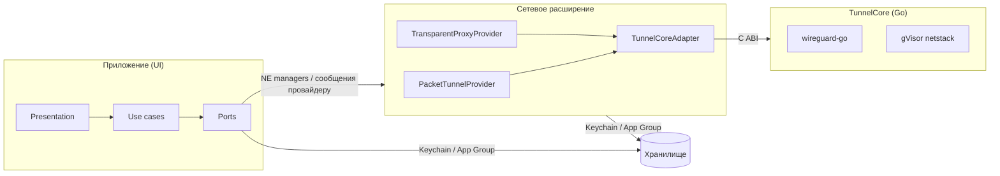

# 02. Общая архитектура

Документ описывает общую архитектуру Splitway. Особенности macOS — в [03-platform-macos.md](03-platform-macos.md). Поддержка iOS и iPadOS снята решением D-45, последнее состояние с ними — тег `ios-final`.

## 1. Технологический стек

| Область | Выбор | Причина |
|---|---|---|
| Язык приложения | Swift 6 (strict concurrency), инструменты Swift 6.4 / Xcode 27 | Безопасность потоков на уровне компилятора. |
| UI | SwiftUI + Observation (`@Observable`) | Нативный вид, декларативный код интерфейса. |
| Тесты | Swift Testing (`import Testing`) | Параметризованные тесты, быстрый запуск через `swift test`. |
| VPN-движок | wireguard-go (MIT) + gVisor netstack (Apache-2.0) из `golang.zx2c4.com/wireguard/tun/netstack`, Go 1.27 | Эталонная реализация. Userspace-стек нужен для выбора приложений. |
| Мост Go ↔ Swift | Свой C ABI (`go build -buildmode=c-archive`) → `TunnelCore.xcframework` | Полный контроль над API, без gomobile и без WireGuardKit. |
| Системные API | NetworkExtension, SystemExtensions (macOS), Security (Keychain, подписи кода), Network, OSLog, AppIntents | — |
| Проект | XcodeGen (`project.yml`) + локальные SPM-пакеты | XcodeGen уже установлен. Нет конфликтов в `.pbxproj`, весь код живёт в пакетах. |
| Сторонние Swift-зависимости | ZIPFoundation (MIT), только для `.zip`; Sparkle 2 (MIT) — автообновление, только в приложении (решение D-52) | Минимум зависимостей; см. ADR-08, ADR-16 и ADR-18. |
| Линтинг | SwiftLint (кастомное правило «нет комментариев» и правила слоёв), `swift format`, `go vet`, `gofmt`, свой чекер комментариев для Go | Правила разработки проверяются автоматически. |
| Проверки | `Scripts/check.sh` и git-хуки; CI на GitHub Actions с раннером на Mac владельца (решение D-47, задача M8-05) | Один скрипт запускает линтеры, тесты и сборку. |
| Диагностика | OSLog, кольцевой журнал, MetricKit. Всё хранится локально, отчёт отправляет только сам пользователь (решение D-22) | Обещание «никаких запросов к серверам разработчика». |

## 2. Процессы и компоненты



| Компонент | Где живёт |
|---|---|
| Приложение | `macOSApp` (окно + строка меню) |
| Пакетный туннель («Весь трафик») | `NetworkSystemExtension` (system extension) |
| Выбор приложений | `NetworkSystemExtension`, класс `TransparentProxyProvider` |
| DNS выбранных приложений | `NetworkSystemExtension`, тот же `TransparentProxyProvider` (решение D-34) |

Оба провайдера живут **в одном** системном расширении, и пользователь одобряет одно расширение. Отдельного DNS-прокси нет: DNS-запросы выбранных приложений приходят в transparent proxy от их имени, и он отправляет их через свой `usernet` (решение D-34, спайки SP-2 и SP-9).

## 3. Структура репозитория

```
/
├── CLAUDE.md, README.md
├── project.yml                      XcodeGen: таргеты, entitlements, Info.plist
├── Apps/                            тонкие оболочки, только точки входа и composition root
│   ├── macOSApp/
│   ├── Shared/                      composition root и корневая сцена приложения
│   ├── SharedTunnelProvider/        провайдер пакетного туннеля и его composition root
│   └── NetworkSystemExtension/
├── Packages/
│   ├── SplitwayKit/                 весь Swift-код фич (без Go)
│   │   ├── Package.swift
│   │   ├── Sources/
│   │   │   ├── SharedKernel/
│   │   │   └── Features/<Feature>/{Core,Infrastructure,Presentation}/
│   │   └── Tests/Features/<Feature>/{CoreTests,InfrastructureTests,PresentationTests}/
│   └── TunnelCore/                  Go-движок и его Swift-адаптер
│       ├── Package.swift            binaryTarget TunnelCoreFramework + target TunnelCoreAdapter
│       ├── go/                      go.mod, пакеты по фичам: bridge, fdtunnel, usernet, udpbind, logbridge
│       └── Scripts/build-xcframework.sh
├── Scripts/                         check.sh, bootstrap, lint, git-хуки, проверка комментариев
└── docs/                            эта документация + docs/features/*.md
```

`SplitwayKit` не зависит от Go. Он объявляет порт `TunnelEngine`, а `TunnelCoreAdapter` реализует его поверх xcframework. Поэтому доменные тесты собираются и проходят без Go-тулчейна (ADR-03).

## 4. Слои внутри фичи

Каждая фича — своя папка `Sources/Features/<Feature>/` и до трёх SPM-таргетов:

| Папка | Таргет | Содержимое | Может импортировать |
|---|---|---|---|
| `Core/Domain` | `<Feature>` | Сущности, value objects, доменные сервисы, доменные ошибки | `Foundation`, `CryptoKit`, `SharedKernel`, `Core` других фич |
| `Core/UseCases` | `<Feature>` | Сценарии приложения, оркестрация домена и портов | то же |
| `Core/Ports` | `<Feature>` | Протоколы внешнего мира (`TunnelRecordRepository`, `SystemTunnelController`…) | то же |
| `Infrastructure` | `<Feature>Infrastructure` | Адаптеры портов: Keychain, NetworkExtension, файлы, Security | `Core` + системные фреймворки |
| `Presentation` | `<Feature>Presentation` | SwiftUI-экраны и `@Observable` модели представления | `Core` + `SwiftUI` |

Правила зависимостей:
1. `Core` не знает ни о UI, ни об инфраструктуре. Компилятор гарантирует это, потому что у таргета нет таких зависимостей.
2. `Presentation` не обращается к `Infrastructure`: только к use cases и доменным типам.
3. Связывание (composition root) выполняется только в `Apps/*`. У каждой фичи есть небольшой `<Feature>Assembly` в таргете `Infrastructure`, который собирает её граф. Общего «контейнера на всё» нет.
4. Сетевые расширения (пакетный туннель, системное расширение) линкуют только `Core` и `Infrastructure` нужных фич, **никогда** `Presentation`. SwiftUI не попадает в их процесс.
5. Фичи общаются через публичные типы `Core`. Циклические зависимости между фичами запрещены и ловятся сборкой SPM.
6. Фейки портов для тестов лежат в таргете `<Feature>TestSupport` (`Tests/Features/<Feature>/TestSupport`). Им пользуются тесты самой фичи и зависящих от неё фич.

## 5. Фичи (bounded contexts)

| Фича | Ответственность | Используется в расширении |
|---|---|---|
| `SharedKernel` | `IPAddress`, `IPNetwork` (CIDR), `IPNetworkSet`, `NetworkPort`, `DomainName`, `ByteCount`, `WallClock` | да |
| `DesignSystem` | Общие UI-компоненты: бейдж статуса, строка «ключ–значение», пустое состояние (только слой `Presentation`) | нет |
| `TunnelConfiguration` | Модель конфига WireGuard, парсер и сериализатор wg-quick, валидация, ключи, «исключить локальные сети» | да |
| `TunnelLibrary` | Коллекция туннелей: создание, импорт, изменение, удаление, дублирование, экспорт; хранение | да (чтение) |
| `TunnelImport` | Источники импорта: файл, `.zip`, буфер, «Открыть в…», перетаскивание | нет |
| `TunnelEditor` | Черновик редактирования с валидацией полей, экран редактора | нет |
| `AppRouting` | Политика маршрутизации туннеля, идентичность приложения, решение по потоку, снимок правил для расширения | да |
| `ApplicationCatalog` | Поиск установленных приложений и CLI-утилит, чтение подписи кода, иконки | нет |
| `TunnelEngine` | Порт движка WireGuard и кодирование конфигурации в UAPI, разбор статистики | да |
| `PacketTunnel` | Логика пакетного туннеля: сетевые настройки, резолвинг endpoint, реакция на смену сети | да |
| `TransparentProxy` | Перехват потоков, определение приложения-источника, TCP/UDP-ретрансляция | да |
| `DNSProxy` | Решения и ответы DNS для transparent proxy: сервер через туннель, ответ `REFUSED` (провайдера DNS-прокси нет, решение D-34) | да |
| `TunnelConnection` | Подключение, отключение, статус, статистика, последняя ошибка | нет |
| `ProviderMessaging` | Типизированный протокол сообщений «приложение ↔ расширение» с версионированием | да |
| `SystemExtension` | Установка и обновление системного расширения, мастер одобрения | нет |
| `SecretDelivery` | Доставка секретов туннелей в системное расширение: требование к подписи клиента XPC, версионированные сообщения, зеркальная копия и доставка перед активацией | да (обработчик запросов) |
| `Diagnostics` | Журнал (кольцевой буфер в App Group), маскирование секретов, экспорт, локальные отчёты MetricKit, ручная отправка отчёта | да |
| `Settings` | Настройки приложения: «О приложении», лицензии открытого ПО с проверкой полноты, запуск при входе, иконка в Dock, удаление Splitway | нет |
| `MenuBar` | Меню в строке меню | нет |
| `Shortcuts` | App Intents: подключить, отключить, переключить; сущность туннеля | нет |
| `Onboarding` | Первый запуск, объяснение разрешений | нет |
| `OnDemand` (v1.x) | Правила автоподключения и их компиляция в `NEOnDemandRule` | нет |

## 6. Ключевая доменная модель

```
TunnelConfiguration                     value type, без идентичности
├── InterfaceConfiguration
│   ├── privateKey: PrivateKey
│   ├── addresses: [IPNetwork]
│   ├── listenPort: ListenPort?
│   ├── mtu: MTU?
│   └── dns: DNSConfiguration           servers: [IPAddress], searchDomains: [DomainName]
└── peers: [PeerConfiguration]
    ├── publicKey: PublicKey
    ├── presharedKey: PresharedKey?
    ├── allowedIPs: AllowedIPs          набор IPNetwork с операциями объединения и вычитания
    ├── endpoint: Endpoint?             host (DomainName | IPAddress) + Port
    └── persistentKeepalive: PersistentKeepalive?

Tunnel                                  сущность (aggregate root фичи TunnelLibrary)
├── id: TunnelIdentifier
├── name: TunnelName
├── configuration: TunnelConfiguration
└── routingPolicy: RoutingPolicy        из фичи AppRouting

RoutingPolicy
├── mode: .allTraffic
│       | .selectedApplications(ApplicationSelection)
└── whenTunnelUnavailable: .bypass | .block
```

«Исключить локальные сети» хранится не в политике, а в самих `AllowedIPs` (`PrivateNetworkExclusion`), как в официальном клиенте: так у состояния один источник истины.

Все value objects валидируются при создании (`init` бросает доменную ошибку) и дальше считаются корректными. Невалидное состояние в домене непредставимо.

## 7. Хранение данных и секретов

| Данные | Где хранится | Кто читает |
|---|---|---|
| Метаданные туннелей: id, имя, порядок, политика маршрутизации | JSON в контейнере App Group, атомарная запись, версия схемы с миграциями | приложение; расширение — только активный туннель |
| Конфиг wg-quick целиком, с ключами | Keychain приложения с общей access group; для системного расширения — см. [03-platform-macos.md](03-platform-macos.md), раздел 5 | приложение, расширение |
| Системная конфигурация VPN | По одному «слоту» на тип провайдера: `NETunnelProviderManager` и `NETransparentProxyManager`. В `providerConfiguration` лежит только id активного туннеля и снимок политики маршрутизации, без секретов | система, расширение |
| Журнал | Кольцевой файл в App Group (до 2 МБ) + OSLog | приложение, расширение |
| Настройки приложения | `UserDefaults` приложения (флаг пройденного онбординга) | приложение |

Модель угроз, границы доверия и итоги аудита хранения секретов — в [security.md](security.md).

**Источник истины — собственный репозиторий** (ADR-04, решение D-17), а не список системных VPN-конфигураций. Системная конфигурация перезаписывается при активации туннеля.

## 8. Связь приложения и расширения

- **Команды** («дай статистику», «примени новую политику маршрутизации»): `NETunnelProviderSession.sendProviderMessage`. Сообщения — `Codable`-конверт `ProviderMessageEnvelope { protocolVersion, request }` в JSON. Неизвестная версия отклоняется с явной ошибкой.
- **Статус**: `NEVPNStatusDidChange` → доменный `ConnectionState`.
- **Ошибки запуска**: `NEVPNConnection.fetchLastDisconnectError`. Запасной вариант — файл последней ошибки в App Group.
- **Изменение конфигурации активного туннеля**: изменение политики маршрутизации применяется на лету сообщением. Изменение параметров WireGuard перезапускает туннель (как в официальном клиенте).
- **XPC**: системное расширение дополнительно публикует XPC-сервис (`NEMachServiceName`) для операций без запущенного туннеля, например для передачи секретов (раздел 5 документа macOS).

## 9. TunnelCore (Go)

Go-модуль разбит на пакеты по фичам:

| Пакет | Назначение |
|---|---|
| `bridge` | Экспортируемые C-функции (`//export`), таблица хэндлов, обратные вызовы в Swift |
| `fdtunnel` | WireGuard поверх файлового дескриптора `utun` (режим «Весь трафик») |
| `usernet` | WireGuard поверх gVisor netstack: `DialTCP`, UDP-сокеты, DNS через туннель (выбор приложений) |
| `udpbind` | UDP-сокеты движка: одна датаграмма за вызов, буферы по 7 МБ (M7-03) |
| `logbridge` | Передача логов wireguard-go в Swift |
| `internal/testpeer`, `testpeer` | Пир WireGuard с эхо-серверами и DNS для тестов: пакет для Go-тестов, утилита — для тестов Swift. В ядро не входит |

Go-пакеты документируются так же, как Swift-фичи: например, [UserspaceNetwork](features/UserspaceNetwork.md) описывает `usernet`.

C API (функции описаны в [TunnelEngine](features/TunnelEngine.md) и [UserspaceNetwork](features/UserspaceNetwork.md)):

```
tc_version() -> *char
tc_fd_tunnel_start(tun_fd, uapi_config, &handle) -> status
tc_usernet_start(uapi_config, addresses, dns_servers, mtu, &handle) -> status
tc_usernet_dial_tcp(handle, address, port, timeout_ms, &connection) -> status
tc_usernet_dial_udp(handle, address, port, &connection) -> status
tc_usernet_lookup_host(handle, name, timeout_ms, &addresses) -> status
tc_connection_start_receiving(connection, callbacks, read_bytes, initial_credit) -> status
tc_connection_write(connection, bytes, length, &written) -> status
tc_connection_grant(connection, bytes) -> status
tc_connection_close(connection, mode) -> status
tc_tunnel_update_config(handle, uapi_config) -> status
tc_tunnel_get_config(handle, &config) -> status
tc_tunnel_bump_sockets(handle) -> status
tc_tunnel_stop(handle) -> status
tc_set_log_callback(callback, context)
tc_free(pointer)
```

Данные из Go в Swift передаются через C-callback из буфера в памяти C, из Swift в Go — указателем на байты без лишних копий. Это «горячий путь» (раздел 10).

## 10. Производительность

Горячие пути, где по правилам разрешены осознанные отступления ради скорости (с обоснованием в документе фичи и бенчмарком):

1. Пакетный цикл в Go: `fdtunnel`, `udpbind`.
2. Ретрансляция потоков на macOS: `TransparentProxy` (`TCPFlowRelay`, `UDPFlowRelay`) и `usernet`.
3. Решение по потоку: `ApplicationMatcher`, `FlowRoutingDecider` (хэш-таблицы, кэш по процессу).

Общие принципы: ни одной блокирующей операции на кооперативном пуле Swift Concurrency; для ретрансляции — выделенные очереди; повторное использование буферов; без лишних `Data` ↔ `[UInt8]`; ограниченные очереди с обратным давлением (backpressure).

## 11. Ошибки, журнал, локализация

- Ошибки — типизированные `enum` на уровне фичи, например `WgQuickParsingError.invalidValue(key:line:)`. Домен ничего не знает о локализации. Текст для пользователя строится в `Presentation` через String Catalog.
- Журнал — `Logger(subsystem:category:)` с категорией по фиче. Сетевые адреса пишутся с `privacy: .private`. `LogRedactor` из `Diagnostics` вырезает ключи из любого текста до записи в файл.
- Локализация — String Catalog в каждом таргете `Presentation`, языки `ru` и `en`.

## 12. Стратегия тестирования

| Уровень | Что тестируем | Чем |
|---|---|---|
| Домен | Парсер и сериализатор (табличные тесты, round-trip), value objects, CIDR-алгебра, «исключить локальные сети», политика маршрутизации, `FlowRoutingDecider`, `ApplicationMatcher`, кодирование UAPI, разбор статистики, редактор-черновик, маскирование секретов | Swift Testing, `swift test` |
| Use cases | Сценарии с фейковыми портами: импорт с конфликтами имён, активация при уже активном туннеле, применение политики на лету | Swift Testing + фейки |
| Модели представления | Маппинг состояния в отображение, реакция на действия пользователя | Swift Testing |
| Инфраструктура | Keychain, JSON-репозиторий, миграции, кодек сообщений провайдера, чтение подписи кода | Swift Testing на хосте |
| Go | Ретрансляция через netstack на паре локальных WireGuard-устройств, UDP-сокеты движка | `go test`, бенчмарки `go test -bench` |
| Сквозные | Реальные сервер и устройства, тесты утечек, смена сетей | Чек-лист M7 + скрипты |

Не покрываем тестами вёрстку SwiftUI и тонкие обёртки над системными API без собственной логики.

## 13. Архитектурные решения (ADR)

| № | Решение | Альтернативы | Почему так |
|---|---|---|---|
| ADR-01 | macOS: выбор приложений через `NETransparentProxyProvider` и userspace WireGuard (netstack) | Per-app VPN (`NETunnelProviderManager.forPerAppVPN()` + `NEAppRule`); PF + группы процессов; Endpoint Security + доп. интерфейс | Документация Apple называет per-app VPN функцией MDM, а работа без MDM не документирована. Решение D-11: per-app VPN не используем, даже если он заработает без MDM, поэтому спайк SP-1 отменён. PF и Endpoint Security требуют root-хелперов и не видят WebKit. |
| ADR-02 | iOS: выбор сервисов через перехват DNS выбранных доменов, фиктивные адреса и трансляцию в Go | Статические маршруты; динамическое добавление маршрутов после DNS-ответа | Без MDM выбирать приложения нельзя. Динамические маршруты требуют частых `setTunnelNetworkSettings`, что ломает соединения. Трансляция адресов работает без пересоздания интерфейса. SP-4 подтвердил подход на iPhone 13 Pro: выбранные домены идут через туннель, остальные напрямую, пик памяти расширения — 12,2 МБ. **Снято вместе с iOS решением D-45.** |
| ADR-03 | Свой Go-мост над wireguard-go вместо WireGuardKit | WireGuardKit (wireguard-apple) | Нужны два режима (fd и netstack) и своя архитектура. Полезные идеи WireGuardKit (MIT) переносятся с сохранением лицензии. |
| ADR-04 | Источник истины — свой репозиторий, одна системная конфигурация на тип провайдера | Одна системная конфигурация на каждый туннель (как в официальном клиенте) | Два типа провайдеров, единая модель, проще миграции. Минус: в системных настройках VPN виден один пункт, а не список туннелей. |
| ADR-05 | XcodeGen + локальные SPM-пакеты | Ручной `.xcodeproj`, Tuist | XcodeGen уже установлен; проект описывается текстом и воспроизводим. |
| ADR-06 | Swift Testing вместо XCTest для unit-тестов | XCTest | Современный API, параметризация, параллельность. |
| ADR-07 | MVVM + use cases без архитектурных фреймворков | TCA и аналоги | Меньше зависимостей и порог входа, слои и так разделены таргетами. |
| ADR-08 | ZIPFoundation для `.zip` | Своя реализация на Compression | Импорт и экспорт архивов — не ядро продукта. |
| ADR-09 | macOS: Developer ID + системное расширение + Sparkle. **Заменено ADR-15 (решение D-39); Developer ID без Sparkle вернул ADR-16 (решение D-48)** | Mac App Store | Индивидуальный аккаунт не может публиковать VPN в App Store (правило 5.4). |
| ADR-10 | Минимум macOS 26 (iOS 26 и iPadOS 26 сняты решением D-45) | Поддержка более старых ОС | Свежие API без веток совместимости; к релизу это две последние версии ОС (сейчас актуальны 26 и 27). Решение D-04. |
| ADR-11 | macOS: DNS выбранных приложений через туннель в v1. **Механизм заменён решением D-34:** вместо `NEDNSProxyProvider` запросы перенаправляет transparent proxy | Принять утечку DNS-запросов в v1 и добавить прокси позже; отдельный `NEDNSProxyProvider` | Решение D-09. DNS-запросы выбранных приложений резолвятся через туннель, остальные без изменений уходят к исходному резолверу. По SP-2 и SP-9 запросы приходят в transparent proxy от имени приложения, а DNS-прокси ничего не добавляет, но при падении оставляет систему без DNS. |
| ADR-12 | Только публичные API Apple | Приватные API ради поддержки Safari/WebKit | Решение D-10: надёжность при обновлениях macOS важнее поддержки Safari. |
| ADR-13 | Проверки локально: `Scripts/check.sh` + git-хуки, без CI. **Заменено ADR-17 (решение D-47)** | GitHub Actions, GitLab CI | Решение D-23. Хук `pre-merge-commit` не даёт слить ветку в `master` (D-31) без зелёного `check.sh`. |
| ADR-14 | Точка расширения под второй протокол (AmneziaWG) | Ничего не закладывать заранее | Решение D-07. Таблица ключей парсера расширяется наборами ключей; мост Go принимает вид движка (`engine_kind`, в v1 только `wireguard`); поля редактора строятся из описаний полей. |
| ADR-15 | Все платформы — только через App Store (решение D-39). **Заменено ADR-16 (решение D-48)**. На macOS остаётся системное расширение, а приложение переходит в App Sandbox | Developer ID с DMG и Sparkle (ADR-09); app extension вместо системного расширения | Владелец распространяет приложение только через App Store. Mac App Store, по ответам DTS Apple, принимает сетевые системные расширения, если и они, и приложение в песочнице. Системное расширение уже проверено вместе с доставкой секретов (D-33), мастером одобрения и заменой при обновлении, а app extension потребовал бы переделать всё это. Переход приложения в песочницу проверен в SP-10 (2026-11-02), подпись App Store на нашей сборке — в M7-09 |
| ADR-16 | Mac-версия — образ DMG с подписью Developer ID и нотаризацией в GitHub Releases (решение D-48). Системное расширение и песочница приложения остаются | App Store (ADR-15) после перевода аккаунта в организацию | App Review отклонил Mac-версию по правилу 5.4, а переводить аккаунт владелец не стал. Developer ID доступен личному аккаунту, нотаризация нужна, чтобы Gatekeeper открыл DMG и система установила расширение. Песочница из SP-10 работает и сужает права приложения |
| ADR-17 | CI на GitHub Actions с собственным раннером на Mac владельца, только для доверенных событий: пуши в `master`, теги выпусков, ручной запуск (решение D-47) | Только облачные раннеры GitHub; все задания на раннере владельца | Сборке нужны Xcode с SDK macOS 26 и сертификаты подписи, которые есть на Mac владельца. PR из форков на этот раннер не попадают, чтобы чужой код не запускался рядом с ключами |
| ADR-18 | Автообновление Mac-версии через Sparkle 2 (решение D-52): лента `appcast.xml` в каждом релизе GitHub, обновление подписано ключом EdDSA и Developer ID, автоматическая проверка только с согласия пользователя. Sparkle — только в приложении; приложение получает `network.client` и исключение `mach-lookup` для установщика Sparkle | Только уведомление о новой версии; без проверки обновлений; XPC-загрузчик Sparkle вместо `network.client` | Стандарт для приложений вне App Store, обновление в одно нажатие. Загрузчик Sparkle работает вне песочницы и показывает заметки устаревшим WebView, поэтому сеть получает само приложение в песочнице. Лента в релизе не требует коммита в `master` при каждом выпуске |
