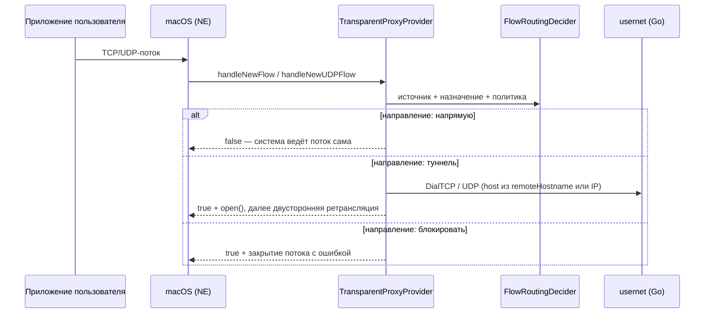

# 03. План реализации: macOS

## 1. Итог

| Параметр | Значение |
|---|---|
| Минимальная ОС | macOS 26 (решение D-04) |
| Дистрибуция | Только Mac App Store: беты — через TestFlight, обновления — через App Store (решение D-39, ADR-15) |
| Приложение | `macOSApp`: окно + `MenuBarExtra` + `Settings` (решение D-12). В App Sandbox, как требует Mac App Store (SP-10): вне своих контейнеров читает системные папки приложений и файлы, которые выбрал человек. Hardened Runtime включён |
| Расширение | `NetworkSystemExtension` — одно системное расширение с двумя провайдерами: `PacketTunnelProvider` и `TransparentProxyProvider` |
| Режим «Весь трафик» | `NETunnelProviderManager` → `PacketTunnelProvider` → `fdtunnel` (wireguard-go поверх `utun`) |
| Режим «Только выбранные приложения» | `NETransparentProxyManager` → `TransparentProxyProvider` → `usernet` (wireguard-go поверх gVisor netstack) |
| DNS выбранных приложений | `TransparentProxyProvider`: запрос к порту 53 уходит через `usernet` на DNS туннеля (решения D-09 и D-34) |

Почему системное расширение, а не app extension: по [TN3134](https://developer.apple.com/documentation/technotes/tn3134-network-extension-provider-deployment) app extension для packet tunnel и transparent proxy на macOS — «App Store only», а Developer ID допускает только system extension. Выпуск теперь только через App Store (решение D-39), где годятся оба, но системное расширение остаётся (ADR-15): оно работает в глобальном контексте и не завершается, когда пользователь выходит из системы, а доставка секретов (D-33), мастер одобрения и замена при обновлении под него уже проверены. App extension — запасной вариант, если ревью не пропустит системное расширение (SP-10).

## 2. Состав бандла и entitlements

```
Splitway.app/
└── Contents/
    ├── MacOS/Splitway
    └── Library/SystemExtensions/
        └── com.facelessdiplomat.splitway.network-extension.systemextension
```

`Info.plist` системного расширения:

```
NetworkExtension
├── NEProviderClasses
│   ├── com.apple.networkextension.packet-tunnel → $(PRODUCT_MODULE_NAME).PacketTunnelProvider
│   └── com.apple.networkextension.app-proxy     → $(PRODUCT_MODULE_NAME).TransparentProxyProvider
└── NEMachServiceName → 8625S77CSU.com.facelessdiplomat.splitway.network-extension.$(CURRENT_PROJECT_VERSION)
NSSystemExtensionUsageDescription → описание для одобрения (без него sysextd не пропускает сетевое расширение)
SplitwayTeamIdentifier, SplitwayClientBundleIdentifier → требование к клиенту XPC доставки секретов
SplitwayAppGroupIdentifier → App Group для журнала
```

Приложение находит Mach-сервис расширения по ключу `SplitwayExtensionMachServiceName` своего `Info.plist`. В обоих именах — номер сборки, чтобы задание `launchd` обновлённого расширения не делило имя со старым ([SecretDelivery](features/SecretDelivery.md)).

| Entitlement | Приложение | Расширение |
|---|---|---|
| `com.apple.developer.system-extension.install` | да | — |
| `com.apple.developer.networking.networkextension` | `packet-tunnel-provider`, `app-proxy-provider` — так их ждут профили разработки и App Store. Суффикс `-systemextension` нужен только подписи Developer ID: с решением D-39 его и настройку, которая добавляла его в Release, убрал SP-10 | то же |
| `com.apple.security.application-groups` | `8625S77CSU.com.facelessdiplomat.splitway` | то же |
| `keychain-access-groups` | `8625S77CSU.com.facelessdiplomat.splitway.shared` | то же |
| `com.apple.security.app-sandbox` | да, как требует Mac App Store (SP-10) | да, сетевые расширения обязаны быть в песочнице |
| `com.apple.security.files.user-selected.read-write` | да: импорт, экспорт туннелей и журнала, «Добавить утилиту…» работают с файлами, которые выбрал человек | — |
| `com.apple.security.network.client`, `com.apple.security.network.server` | — | да: без них песочница не даёт wireguard-go открыть сокет маршрутизации и UDP-сокет (`operation not permitted`), как и сетевому расширению официального WireGuard |

У приложения и системного расширения есть `PrivacyInfo.xcprivacy` (в `Contents/Resources`): без отслеживания и сбора данных, с причинами для API, которые использует бинарник. На macOS Apple эти причины не проверяет, манифесты — для отчёта о приватности и на будущее ([security.md](security.md), раздел 6).

Provisioning-профили выпуска — App Store (Apple Distribution) с возможностями Network Extensions, System Extension и App Groups (M7-08). Отладочные сборки подписываются автоматически профилями разработки: Mac зарегистрирован в аккаунте, а профиль разработки разрешает значения Network Extension только без суффикса `-systemextension`. Системное расширение активируется, только когда приложение лежит в `/Applications`.

## 3. Установка и обновление системного расширения (фича `SystemExtension`)

Состояния (доменная модель `SystemExtensionState`):

```
notInstalled → activationRequested → awaitingUserApproval → activated
                                     ↘ failed(reason)        ↘ requiresReboot
```

1. При первом включении туннеля приложение отправляет `OSSystemExtensionRequest.activationRequest`.
2. `requestNeedsUserApproval` → мастер показывает пошаговую инструкцию: «Системные настройки → Основные → Объекты входа и расширения → Сетевые расширения» и кнопку открытия нужного раздела.
3. `didFinishWithResult` (`.completed`) → сохраняется системная VPN-конфигурация, и система показывает запросы на добавление конфигураций VPN и прокси.
4. Обновление приложения: `actionForReplacingExtension` сравнивает `CFBundleVersion` и возвращает `.replace`. Активный туннель перезапускается автоматически после замены.
5. Удаление: пункт «Удалить Splitway» в настройках останавливает туннель, удаляет системные конфигурации, стирает секреты в Keychain приложения и в System Keychain расширения, выключает открытие при входе, удаляет данные и последним выполняет `deactivationRequest` (macOS спрашивает пароль администратора). Затем приложение предлагает переместить себя в корзину ([Settings](features/Settings.md)).

## 4. Режим «Весь трафик»

- `PacketTunnelProvider.startTunnel`: читает id активного туннеля из `providerConfiguration`, загружает конфиг (раздел 5), строит `TunnelNetworkPlan` (домен фичи `PacketTunnel`: адреса, маршруты из `AllowedIPs`, DNS, MTU) и применяет `NEPacketTunnelNetworkSettings`.
- Дескриптор `utun` находится перебором открытых дескрипторов с проверкой `UTUN_OPT_IFNAME` — тот же подход, что в WireGuardKit. Затем `tc_fd_tunnel_start`.
- Endpoint резолвится в Swift через `getaddrinfo` (с поддержкой NAT64/DNS64) до передачи в Go. При смене сети (`NWPathMonitor`) — повторный резолвинг и `tc_tunnel_bump_sockets`.
- Сон и пробуждение (`sleep`/`wake` у `NEProvider`) — пересоздание сокетов после пробуждения.
- «Исключить локальные сети» — пересчёт `AllowedIPs` в домене (`PrivateNetworkExclusion`).
- Kill switch (`includeAllNetworks`) — в бэклоге: у этой опции много системных побочных эффектов.

## 5. Секреты в системном расширении

Системное расширение работает от root в глобальном контексте и **не видит** пользовательский Keychain приложения. Варианты:

| Вариант | Как | Плюсы | Минусы |
|---|---|---|---|
| A. `passwordReference` | Приложение кладёт конфиг в свой Keychain и передаёт persistent reference в протокол | Как в официальном клиенте | Не подтверждено, что ссылка доступна root-процессу системного расширения |
| **B. XPC + System Keychain (рекомендуется)** | Приложение по XPC (`NEMachServiceName`) передаёт конфиг расширению, расширение хранит его в System Keychain под своим ACL | Секреты никогда не лежат в открытом plist; работает без запущенного туннеля | Нужен XPC-протокол и проверка подписи клиента XPC (только наш Team ID) |
| C. `providerConfiguration` | Конфиг целиком в словаре протокола | Проще всего | Приватный ключ хранится в системных настройках NE в открытом виде |

По итогам спайка **SP-5** (тестовая ВМ, 2026-10-30) выбран вариант B (решение D-33): вариант A не работает (`-25291`, у root-расширения нет Keychain пользователя), вариант C хранит ключ открытым текстом в `/Library/Preferences/com.apple.networkextension.plist`, доступном всем пользователям. Подробности — в [SP-5](features/spikes/SP-5.md). Порт `TunnelSecretStore` в `TunnelLibrary` скрывает выбор. Ядро варианта B уже есть в фиче [SecretDelivery](features/SecretDelivery.md):

- в macOS-сборке приложения порт реализует `MirroredTunnelSecretStore` — своя копия в Keychain пользователя и зеркало в расширении через XPC-канал `ExtensionSecretChannel`;
- в расширении запросы разбирает `SecretDeliveryRequestHandler` поверх `SystemKeychainSecretStore`;
- клиента XPC проверяет требование `ClientCodeRequirement`: только приложение нашей команды.

## 6. Режим «Только выбранные приложения»

### 6.1. Поток обработки



Возврат `false` из `handleNewFlow` и `handleNewUDPFlow(_:initialRemoteFlowEndpoint:)` у transparent proxy отпускает поток напрямую к адресату ([документация](https://developer.apple.com/documentation/networkextension/netransparentproxyprovider)). Это основа режима: невыбранные приложения не платят ничем, кроме принятия решения.

### 6.2. Сетевые настройки провайдера

- `NETransparentProxyNetworkSettings.includedNetworkRules` — исходящие TCP и UDP к сетям из `AllowedIPs` (после «исключить локальные сети»). Туннель, который забирает весь публичный IPv4, но не весь глобальный IPv6, дополнительно получает `2000::/3`, как в решении D-30: IPv6 выбранных приложений не уходит мимо туннеля (раздел 6.6). План строит `TransparentProxyNetworkPlan`. Правило, у которого и адрес, и порт неопределённые (`0.0.0.0/0`, `::/0`, `0.0.0.0/1` с портом 0), NetworkExtension отклоняет при старте. Поэтому туннель с такой сетью получает одно правило без сетей на все исходящие потоки, а потоки к адресам вне туннеля провайдер отпускает решением `.direct`. У туннеля с частью сетей потоки к другим адресам система вообще не отдаёт провайдеру.
- `excludedNetworkRules` (у них приоритет) — loopback, link-local, multicast и адреса endpoint-ов WireGuard. Без последних собственный UDP-трафик движка мог бы снова попасть в перехват.
- DNS-настройки у transparent proxy игнорируются системой (раздел 6.5).

### 6.3. Определение приложения-источника (`SourceApplicationResolver`)

1. Быстрый путь — `flow.metaData.sourceAppSigningIdentifier`, поиск в хэш-таблице `ApplicationMatcher`.
2. Проверка и запасной путь — `sourceAppAuditToken` → `SecCodeCopyGuestWithAttributes` → Team ID и путь исполняемого файла. Результат кэшируется по `(pid, pidversion)` из audit token.
3. `ApplicationIdentity` выбранного приложения содержит: signing identifier главного бандла, Team ID, путь бандла и **signing identifiers всех вложенных бандлов** (`Contents/Frameworks/*.app`, `Contents/XPCServices/*.xpc`, `Contents/Helpers`, `Contents/Library/LoginItems`). Их собирает `ApplicationCatalog` при выборе приложения и пересобирает, если поменялась версия бандла. Так автоматически покрываются Chrome Helper и хелперы Electron-приложений.
4. CLI-утилиты сопоставляются по пути исполняемого файла и (если есть) по signing identifier, например `com.apple.curl`.
5. Защита от подмены: если у выбранного приложения есть Team ID, совпадения одного signing identifier недостаточно, Team ID процесса тоже должен совпасть. Identifier кода без Team ID учитывается, только если код подписан Apple (`anchor apple`); ad-hoc программа узнаётся лишь по пути.
6. Процесс, который запустило выбранное приложение — само или через свои процессы, — идёт вместе с ним (решение D-35). Резолвер поднимается по родителям процесса (`sysctl` `KERN_PROC_PID`) до launchd, не глубже 16 процессов, и проверяет каждого по правилам выше. Так в туннель попадают Claude Code, которого Claude запускает из `~/Library/Application Support` через свой `disclaimer`, и команды в выбранном Терминале. Процесс, который запустила launchd (служба XPC, приложение из Finder), относится к себе самому.

Документация Apple пишет, что метаданные потока есть только у per-app VPN-провайдеров, но на форумах их успешно используют и в transparent proxy ([тред](https://developer.apple.com/forums/thread/763912)). Это главный риск, его проверяет спайк **SP-2**, причём на конкретных приложениях: Safari, WebKit-приложения, Chrome, Firefox, Electron, `curl`, `nsurlsessiond`. Итог SP-2 в ВМ (2026-10-30): у всех проверенных приложений поток приходит с audit token и identifier самого приложения, в том числе потоки WebKit, `mDNSResponder` и `nsurlsessiond` ([SP-2](features/spikes/SP-2.md)). Фоновые загрузки — только пока приложение работает: после его выхода `nsurlsessiond` отправляет их от своего имени, и они идут напрямую (M4-19).

**Safari и WebKit.** Сеть WebKit работает в отдельном процессе `com.apple.WebKit.Networking`. Если система не атрибутирует такие потоки приложению-владельцу, Safari и приложения с `WKWebView` выбрать не получится. Тогда в каталоге они помечаются как «не поддерживается» с объяснением. Mullvad и vpnonly прямо называют это ограничением своих решений. Приватные API для обхода не используются (решение D-10).

### 6.4. Ретрансляция (`TCPFlowRelay`, `UDPFlowRelay`) — горячий путь

- **TCP**: `flow.open` → `tc_usernet_dial_tcp` → два насоса: `flow.readData` → `tc_connection_write`, а callback из Go → `flow.write`. Поддерживаются полузакрытие (half-close), ошибки и таймауты.
- **UDP**: для каждого потока — сокет в netstack. `readDatagrams` → отправка, входящие датаграммы → `writeDatagrams`. Закрытие по таймауту простоя. QUIC и HTTP/3 работают как обычный UDP.
- **Буферы**: пул буферов фиксированного размера, ограниченная очередь на поток, backpressure (не читать из flow, пока Go не принял предыдущий блок).
- **Потоки выполнения**: выделенная `DispatchQueue` на группу потоков, без блокировок на кооперативном пуле Swift Concurrency.
- Цель по скорости — по итогам спайка SP-3 ([итоги](features/spikes/SP-3.md)): не меньше 90 % скорости режима «Весь трафик» одним потоком и не больше 1,25 × его CPU на гигабайт. Она проверяется бенчмарком перед каждым релизом (`Scripts/check.sh --bench`).

### 6.5. DNS (решения D-09 и D-34)

- Запросы, которые `mDNSResponder` отправляет за приложение, приходят в transparent proxy UDP-потоками к порту 53 с audit token и signing identifier этого приложения, а `remoteHostname` у них — запрашиваемое имя (SP-2). Приложения со своим резолвером (Chrome, Electron) отправляют запросы сами, тоже от своего имени.
- Запрос выбранного приложения transparent proxy отправляет через `usernet` на DNS-сервер из конфига туннеля (`DNSQueryRedirection` поверх `DNSUpstreamSelection`). Если туннель не несёт ни одного сервера из конфига, запрос идёт на запасной `1.1.1.1` через туннель, а если не несёт и его — к исходному резолверу. Ответ возвращается от исходного резолвера.
- Туннель с частью сетей дополнительно забирает в прокси порт 53 любых адресов: так до прокси доходит и запрос к резолверу вне сетей туннеля.
- Запрос любого другого приложения прокси отпускает (`false`), и запрос уходит к исходному резолверу.
- При недоступном туннеле и `whenTunnelUnavailable = .block` выбранное приложение получает ответ `REFUSED` (`DNSRefusalResponseBuilder`), а при `.bypass` его запрос уходит к исходному резолверу.
- Если приложение подключается по имени (`URLSession`, Network.framework), у потока заполнен `remoteHostname`. Transparent proxy резолвит имя ещё раз **через туннель** и подключается к полученному адресу.
- Отдельного `NEDNSProxyProvider` нет (решение D-34). По SP-9 он видит те же приложения, а запросы выбранных приложений transparent proxy получает раньше него. Его падение оставляло бы всю систему без DNS примерно на минуту.
- Не покрыто: запросы к link-local резолверу (они входят в исключения правил прокси) и собственные запросы `mDNSResponder`, которые не отнести к приложению.

### 6.6. Поведение при недоступном туннеле и IPv6

- `whenTunnelUnavailable = .block`: пока движок не готов или рукопожатие не проходит, потоки выбранных приложений закрываются с ошибкой. При `.bypass` они отпускаются напрямую.
- У туннеля нет IPv6-адреса, а адресат — IPv6 внутри сетей туннеля (`AllowedIPs` и `2000::/3` по разделу 6.2) → `.block`. Приложение уйдёт на IPv4 (Happy Eyeballs), и утечки по IPv6 не будет.

### 6.7. Изменение выбора на лету

Новая `RoutingPolicySnapshot` приходит сообщением провайдеру и атомарно подменяет `ApplicationMatcher`. Существующие потоки продолжают работать, новые решаются по новой политике. Перезапуск не нужен.

### 6.8. Совместимость с другими прокси и VPN

Если в системе есть другой transparent proxy (корпоративный агент, другой VPN), порядок их работы не управляется ([тред](https://developer.apple.com/forums/thread/763912)), и атрибуция может ломаться. При старте приложение показывает предупреждение, если находит чужие активные VPN/прокси-конфигурации. Сессия прокси пишет в журнал предупреждение, если источник потока — системное расширение (исполняемый файл в `/Library/SystemExtensions/`): так выглядит трафик приложений, который пересылает другой прокси.

## 7. Каталог приложений (фича `ApplicationCatalog`)

- Источники: `/Applications`, `/Applications/Utilities`, `/System/Applications`, `/Applications/Setapp`, запущенные приложения (`NSWorkspace.runningApplications`). `~/Applications`, `/opt/homebrew/bin` и `/usr/local/bin` песочница не читает (SP-10): приложения и утилиты оттуда человек добавляет сам.
- Для каждого: отображаемое имя, иконка (`NSWorkspace.icon(forFile:)`), bundle ID, signing identifier и Team ID (`SecStaticCodeCreateWithPath` + `SecCodeCopySigningInformation`), вложенный код.
- Ручное добавление: drag & drop `.app` и выбор приложения или исполняемого файла кнопкой «Добавить утилиту…» (панель открытия); доступ к выбранному файлу открыт, пока собирается его идентичность.
- Сканирование асинхронное, с кэшем по пути и поколению `Info.plist` (`generationIdentifierKey`); иконки грузятся лениво.
- Приложения с пометками: «Apple-приложение — ограниченная поддержка», «Не подписано — сопоставление по пути».

## 8. Интерфейс

- **Окно**: `NavigationSplitView` — слева список туннелей со статусом, справа детали: статус, статистика, режим маршрутизации, выбранные приложения, кнопки.
- **Редактор**: форма полей с валидацией на лету и режим «сырого» текста wg-quick с подсветкой ошибок по строкам.
- **Выбор приложений**: лист со списком, поиском, фильтрами («Выбранные», «Все», «CLI») и drag & drop.
- **Строка меню**: иконка отражает состояние; список туннелей с переключателем; режим маршрутизации активного туннеля; «Открыть Splitway»; «Настройки…»; «Выйти» с вопросом, отключать ли туннель ([MenuBar](features/MenuBar.md)).
- **Настройки**: запуск при входе (`SMAppService.mainApp`), удаление расширения, журнал.
- **Dock**: иконка видна, пока открыто окно, и скрывается после его закрытия (`NSApp.setActivationPolicy`, решение D-12).
- **Мастер первого запуска**: объяснение двух системных запросов (расширение и VPN/прокси-конфигурация) до того, как система их покажет.
- Горячие клавиши ([TunnelLibrary](features/TunnelLibrary.md)): ⌘N (новый туннель), ⌘O (импорт), ⇧⌘V (вставить из буфера), ⌘⏎ (подключить/отключить), ⌘E (изменить), ⌘D (дублировать), ⇧⌘E (экспорт), ⌘⌫ (удалить), ⌘F (поиск), ⌥⌘L (журнал), ⌘, (настройки). Esc закрывает листы, ⏎ подтверждает импорт. Окно не меньше 640 × 440 точек.

## 9. Сборка, подпись, выпуск

1. `Scripts/build-xcframework.sh` собирает `TunnelCore` для `macos-arm64` и `macos-x86_64` (+ iOS, см. документ iOS).
2. Archive с профилями App Store (Apple Distribution), App Sandbox у приложения и расширения (SP-10), Hardened Runtime, без get-task-allow.
3. Экспорт способом `app-store-connect` и загрузка в App Store Connect (M7-08). Беты — TestFlight, обновления — App Store: нотаризация, DMG, Sparkle и свой хостинг не нужны (решение D-39).
4. App Store переподписывает приложение и расширение своим сертификатом (Apple Mac OS Application Signing). Всё, что сверяет подпись, — требование к клиенту XPC ([SecretDelivery](features/SecretDelivery.md)) и ACL элемента System Keychain — проверяется на сборке из TestFlight.
5. Проверка установки из TestFlight на чистой системе (ВМ): первый запуск, одобрение расширения, обновление со старой версии, удаление (M7-09).

## 10. Спайки и риски macOS

| ID | Что проверить | Критерий готовности | Что делаем при провале |
|---|---|---|---|
| SP-9 | `NEDNSProxyProvider`: видно ли в метаданных DNS-потока приложение-источник; работают ли все провайдеры в одном процессе (общий `usernet`); что происходит с DNS системы при сбое прокси | Таблица атрибуции для приложений из SP-2, подтверждён общий процесс | Итог в ВМ: DNS-прокси видит то же, что transparent proxy; выбран вариант без DNS-прокси (решение D-34, [SP-9](features/spikes/SP-9.md)) |
| SP-2 | Атрибуция потоков в transparent proxy: Safari, WKWebView, Chrome, Firefox, Electron, `curl`, `nsurlsessiond`; заполнение `remoteHostname`; поведение возврата `false` | Таблица «приложение → что видим в метаданных» в документе фичи | Итог в ВМ: поток приходит от имени приложения, которое его начало, даже когда сеть ведут WebKit, `mDNSResponder` или `nsurlsessiond`; помечать приложения неподдерживаемыми не нужно ([SP-2](features/spikes/SP-2.md)) |
| SP-3 | Скорость ретрансляции TCP через netstack | Замер скорости и задержки против режима «Весь трафик»; профиль CPU | Итог в ВМ: 70–90 % скорости «Весь трафик» одним потоком при 1,3–1,5 × CPU на гигабайт; буферы и насосы скорость не ограничивают, цель M4-16 — в [SP-3](features/spikes/SP-3.md) |
| SP-5 | Доставка секретов в системное расширение (варианты A/B/C) | Работающий вариант, ADR в документе фичи | Итог: вариант B — XPC и System Keychain (решение D-33), проверен в ВМ и на Mac владельца с включённым SIP ([SP-5](features/spikes/SP-5.md)) |
| SP-6 | UDP/QUIC через `handleNewUDPFlow` | HTTP/3 в Chrome и голосовой звонок в Discord через туннель | Итог: UDP выбранных приложений идёт через перехват — HTTP/3 Safari и URLSession в ВМ, звонок на Mac владельца; QUIC в Chrome при включённом прокси не работает из-за ядра, и Chrome открывает страницы по HTTP/2 ([SP-6](features/spikes/SP-6.md)) |
| SP-10 | Mac-приложение в App Sandbox: каталог приложений и утилит, подписи чужих приложений, импорт и экспорт, вход при запуске, установка расширения, XPC к расширению; подпись App Store у требования к клиенту XPC и у ACL System Keychain | Все функции Mac-версии работают в песочнице в ВМ; сборка из TestFlight ставит расширение и подключает туннель | Итог в ВМ: все функции работают в песочнице без временных исключений. Найдено и исправлено: требование к клиенту XPC не принимало подпись App Store, утилиту с Рабочего стола и приложения вне системных папок нельзя было добавить, «Move to Trash» не работает в песочнице (теперь «Show in Finder»), на Mac не было видно «Добавить утилиту…» и действий журнала ([SP-10](features/spikes/SP-10.md)). Сборка из TestFlight — M7-09; если ревью не пропустит системное расширение — app extension с новой записью в журнале решений |

Прочие риски: ревью Mac App Store может не пропустить системное расширение с прозрачным прокси — по ответам DTS Apple на форуме разработчиков такие расширения в App Store допустимы, но подтвердит это только первая отправка (M7-11); изменения поведения Network Extension в новых macOS (регресс-прогон на бета-версиях каждое лето); пользователь не одобрил расширение (мастер и понятный статус); конфликт с другими VPN (раздел 6.8); на пути с потерями TCP netstack отправляет медленнее TCP macOS; на Mac владельца отправка через прокси в пределах цели (M4-16).

## 11. Тестирование на macOS

- Тестовый туннель: готовый конфиг провайдера вне репозитория, путь в `SPLITWAY_TEST_TUNNEL_CONFIG` (см. `Scripts/test-tunnel/README.md`, решение D-29).
- Тесты утечек режима выбора приложений: `Scripts/leak-test-macos.sh` с утилитой RoutingProbe ([Scripts/RoutingProbe](../Scripts/RoutingProbe/README.md), M4-17), вручную перед каждым релизом.
- Тестовая ВМ macOS 26 (`Scripts/macos-vm.sh`, решение D-32): сборка разработки с одобренным один раз системным расширением и VPN-конфигурацией, чистое состояние диска между проверками. В ней же замеряется скорость и проверяются выводы спайков, а на настоящем Mac — только то, чего ВМ не может: сон, смена Wi-Fi и Ethernet, включённый SIP, macOS 27, звонки и приложения с учётной записью (решение D-36).
- `RoutingProbe` — маленькая подписанная CLI-утилита: печатает свой внешний IP, результат резолвинга и то, какой резолвер ответил на DNS-запрос. Её выбирают в туннеле и сравнивают с невыбранным `curl`. Основа автоматических тестов утечек.
- Ручная матрица: Safari, Chrome, Firefox, Telegram, Slack, Discord, `curl`, `ssh`, `git`; смена Wi-Fi ↔ Ethernet; сон и пробуждение; обновление приложения при активном туннеле.
