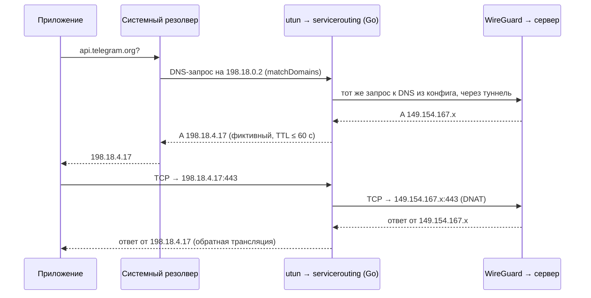

# 04. План реализации: iOS и iPadOS

iOS и iPadOS используют одно приложение (универсальный таргет) и одно сетевое расширение. Различается только интерфейс, поэтому особенности iPadOS вынесены в раздел 7.

Решение D-45 сняло iOS и iPadOS, решение D-53 вернуло их личной сборкой без распространения (раздел 9). Код вернулся из тега `ios-final` вехой [M9](05-tasks/M9-ios-personal-build.md), и документ описывает нынешнюю личную сборку: её проверяют на iPhone владельца (раздел 11), а iPad не проверяется (решение D-55, раздел 7).

## 1. Итог

| Параметр | Значение |
|---|---|
| Минимальная ОС | iOS 26 / iPadOS 26 (решение D-04) |
| Дистрибуция | Нет: владелец ставит сборку разработки на свои устройства из Xcode (решение D-53, раздел 9) |
| Таргеты | `iOSApp` (iPhone + iPad), `PacketTunnelExtension` (app extension), `ControlsExtension` (widget extension) |
| Режим «Весь трафик» | `NETunnelProviderManager` → `PacketTunnelProvider` → `fdtunnel` |
| Режим «Только выбранные сервисы» | тот же провайдер, плюс `servicerouting` в Go: перехват DNS выбранных доменов, фиктивные адреса, трансляция (решение D-01, раздел 4) |
| Выбор приложений | Недоступен без MDM ([TN3134](https://developer.apple.com/documentation/technotes/tn3134-network-extension-provider-deployment): per-app mode требует managed device). Режим совместимости с MDM — бэклог (раздел 6) |

## 2. Entitlements и возможности

| Entitlement | `iOSApp` | `PacketTunnelExtension` | `ControlsExtension` |
|---|---|---|---|
| `com.apple.developer.networking.networkextension` = `packet-tunnel-provider` | да | да | да (intent контрола сам запускает туннель, SP-8) |
| App Groups `group.com.facelessdiplomat.splitway` | да | да | да |
| Keychain Sharing `8625S77CSU.com.facelessdiplomat.splitway.shared` | да | да | да (конфигурация туннеля для записи в слот) |

Право `com.apple.developer.networking.wifi-info` понадобится приложению только для автоподключения по SSID (после v1, решение D-08), сейчас его нет.

Network Extension доступен индивидуальному платному аккаунту Apple Developer Program, а бесплатному Apple ID (Personal Team) — нет. Сборка подписывается сертификатом разработки, права — без суффикса `-systemextension`: он нужен только подписи Developer ID на Mac.

У каждого таргета есть `PrivacyInfo.xcprivacy`, как у Mac-версии: без отслеживания и сбора данных, с причинами для API, которые использует его бинарник ([security.md](security.md), раздел 6).

## 3. Режим «Весь трафик»

- Провайдер общий с macOS (фича [PacketTunnel](features/PacketTunnel.md)): `TunnelNetworkPlan` → `NEPacketTunnelNetworkSettings`, поиск дескриптора `utun`, `tc_fd_tunnel_start`.
- **NAT64/DNS64**: в сотовых сетях только с IPv6 endpoint с IPv4-адресом синтезируется через `getaddrinfo`. Без этого туннель не поднимется у части операторов. Проверка в сети только с IPv6 отложена ([отложенные проверки](05-tasks/deferred-checks.md)).
- Смена сети (`NWPathMonitor`): Wi-Fi ↔ сотовая, переход в авиарежим → повторный резолвинг endpoint, `tc_tunnel_bump_sockets`. На iPhone смена сетей пройдена по подтверждению владельца (M9-15).
- **Память**: лимит расширения около 50 МБ. Меры: `debug.SetMemoryLimit` в Go (30 МиБ, `fdtunnel/memory_limit_ios.go`), буферы wireguard-go для iOS по 1700 байт и не больше 1024 в пуле (`queueconstants_ios.go`), ограниченные таблицы `servicerouting`, отсутствие SwiftUI в расширении. Цель — пик не выше 35 МБ под нагрузкой, проверка в Instruments (задачи M5-09 и M9-15). На iPhone 13 Pro 2026-11-25 пик — 11,4–12,0 МиБ в «Весь трафик» и 14,3 МиБ в режиме сервисов ([бенчмарки](benchmarks.md)); час работы без роста памяти владелец отложил ([отложенные проверки](05-tasks/deferred-checks.md)).
- **Скорость** на том же iPhone: 99,5 % скорости официального клиента WireGuard одним потоком и 111 % двумя на длинном пути, CPU на гигабайт — 0,89× ([бенчмарки](benchmarks.md)).
- Ключи читаются из общей Keychain access group с доступностью `AfterFirstUnlockThisDeviceOnly`, поэтому туннель может переподключиться на заблокированном устройстве.

## 4. Режим «Только выбранные сервисы»

### 4.1. Идея

Сервис — это набор правил: суффиксы доменов и подсети. Например, Telegram — `telegram.org`, `t.me`… и опубликованные диапазоны IP. Система отправляет в туннель **только DNS-запросы выбранных доменов** (`matchDomains`). Расширение отвечает на них фиктивными адресами из служебной подсети. Пакеты к этим адресам приходят в туннель, где Go-движок подменяет фиктивный адрес на реальный и отправляет пакет в WireGuard. Весь остальной трафик устройства в туннель не попадает вовсе.

### 4.2. Сетевые настройки

Настройки строит `SelectedServicesNetworkPlanner` ([PacketTunnel](features/PacketTunnel.md)) из плана компилятора ([ServiceCatalog](features/ServiceCatalog.md)).

| Параметр | Значение |
|---|---|
| `includedRoutes` | подсети выбранных сервисов внутри `AllowedIPs` и фиктивные сети: `198.18.0.0/15`, а если у туннеля есть IPv6 — ещё `2001:2::/48` |
| Маршрут по умолчанию | **не** включается |
| `dnsSettings.servers` | `198.18.0.2` (виртуальный DNS внутри служебной подсети) |
| `dnsSettings.matchDomains` | суффиксы доменов выбранных сервисов, `matchDomainsNoSearch = true`; без доменов DNS не настраивается |
| DNS для пересылки | первый IPv4-адрес DNS из конфига туннеля, без него — `1.1.1.1`; запросы к нему идут через туннель |

Диапазон `198.18.0.0/15` (RFC 2544) не маршрутизируется в интернете и обычно применяется для фиктивных адресов. Если он пересекается с адресами из конфига, компилятор плана берёт свободную половину диапазона и предупреждает о конфликте.

### 4.3. Компоненты

- [ServiceCatalog](features/ServiceCatalog.md) — встроенный каталог, свои сервисы и компилятор плана: выбор сервисов и конфигурация туннеля превращаются в маршруты, домены, фиктивные сети, резолверы и предупреждения. Там же экраны выбора.
- [PacketTunnel](features/PacketTunnel.md) — сетевые настройки из плана и сессия, которая передаёт план движку.
- [TunnelEngine](features/TunnelEngine.md) — план в JSON и его передача в Go (`tc_fd_tunnel_set_service_routing`).
- [ServiceRouting](features/ServiceRouting.md) — Go-пакет `servicerouting`: перехват DNS, пул фиктивных адресов и трансляция адресов в обёртке `TranslatingDevice` над utun.

План передаётся в Go при старте, а новый выбор сервисов — сообщением провайдеру, без переподключения. Если изменились маршруты или домены, расширение заново вызывает `setTunnelNetworkSettings`. Это происходит только при действии пользователя, а не на каждый DNS-ответ.

### 4.4. Правила поведения

- **DNS и фиктивные адреса** ([ServiceRouting](features/ServiceRouting.md)): адреса в ответе на выбранное имя заменяются одной записью с фиктивным адресом, цепочка CNAME разворачивается в имя из вопроса, а записи HTTPS и SVCB удаляются: в их подсказках настоящие адреса ([SP-4](features/spikes/SP-4.md)). TTL — не больше 60 с. AAAA получает фиктивный адрес из `2001:2::/48`, только если у туннеля есть IPv6, иначе ответ пустой, и приложение уходит на IPv4.
- **Недоступность туннеля**: трафик выбранных сервисов маршрутизирован в туннель, поэтому, пока туннель включён, он не может уйти мимо. На iOS поведение всегда «блокировать», и вопроса о нём в интерфейсе нет ([AppRouting](features/AppRouting.md)).
- **Пересечения**: если домен входит в два выбранных сервиса, правило одно; если подсеть сервиса не входит в `AllowedIPs`, она не маршрутизируется, а пользователь видит предупреждение ([ServiceCatalog](features/ServiceCatalog.md)).

### 4.5. Ограничения (показываются в интерфейсе)

Их показывает экран «Как это работает и ограничения» в листе выбора сервисов ([ServiceCatalog](features/ServiceCatalog.md)).

- Приложения со своим DNS (DoH/DoT внутри приложения) обходят `matchDomains`. Их трафик попадёт в туннель только по подсетям из каталога.
- Приложения с зашитыми IP-адресами работают через туннель, только если эти адреса есть в подсетях каталога.
- Звонки и видеочаты часто подключаются к адресам, которые приложение узнаёт во время звонка, и могут идти мимо туннеля.
- После выключения VPN система сразу перестаёт отдавать фиктивные ответы, а соединения к фиктивным адресам обрываются, и приложение переподключается напрямую. Приложения со своим DNS-кэшем могут ещё до 60 с (TTL ответа) обращаться к фиктивным адресам ([SP-4](features/spikes/SP-4.md)).
- Сервисы на общих CDN нельзя выделить по IP, только по доменам.

### 4.6. Каталог сервисов

- Стартовый набор (решение D-15): Telegram, WhatsApp, Signal, Instagram, Facebook, Threads, YouTube, X, Discord, ChatGPT, Claude, Spotify, Netflix, LinkedIn, GitHub. Иконки нейтральные: монограмма в цвете сервиса, без логотипов (решение D-16).
- Свои сервисы пользователь создаёт сам: название, домены и подсети с проверкой на лету.
- Формат каталога, источники доменов и сетей каждого сервиса, их сверка (последняя — 2026-11-25, M9-08) и тесты описаны в [ServiceCatalog](features/ServiceCatalog.md).
- Каталог встроен в приложение и обновляется только новой сборкой. Обновление по сети (подписанный JSON) — бэклог: так в продукте появился бы сетевой запрос к серверу разработчика, а это противоречит принципу «никаких запросов».

## 5. Интерфейс iPhone

- **Туннели**: список в `NavigationSplitView`, который на iPhone сворачивается в стек: переключатель в строке, смахивание (удалить, дублировать), меню «+» — импорт файла, системная кнопка «Вставить», сканер QR и создание вручную ([TunnelLibrary](features/TunnelLibrary.md), [TunnelImport](features/TunnelImport.md)).
- **Детали туннеля**: подключение и статус, режим маршрутизации, «Сервисы через туннель» и статистика пиров, которая обновляется раз в секунду, пока экран открыт.
- **Выбор сервисов**: лист из редактора туннеля со списком, поиском и категориями; у каждого сервиса — экран с перечнем правил и ограничений, там же добавляются свои сервисы ([ServiceCatalog](features/ServiceCatalog.md)).
- **Импорт по QR**: камера (`DataScannerViewController` из VisionKit), а также выбор изображения из «Фото» с распознаванием через Vision ([TunnelImport](features/TunnelImport.md)).
- **Редактор**: форма с валидацией на лету и режим «сырого» текста ([TunnelEditor](features/TunnelEditor.md)).
- **Настройки и журнал**: лист настроек с версией и лицензиями открытого ПО ([Settings](features/Settings.md)), журнал с фильтром и экспортом в файл ([Diagnostics](features/Diagnostics.md)).
- **Первый запуск**: полноэкранный онбординг из трёх страниц — выбор сервисов, приватность и запрос iOS на добавление конфигурации VPN ([Onboarding](features/Onboarding.md)).

## 6. Режим совместимости с MDM (бэклог, вне вехи M9)

На управляемых устройствах MDM может назначить приложения в per-app VPN через payload `com.apple.vpn.managed.applayer`, указав наш провайдер. Для этого:
- провайдер должен принимать конфигурацию из `VendorConfig` / `providerConfiguration`, созданную MDM, а не нашим приложением;
- нужно проверить работу на тестовом MDM (например, open-source NanoMDM) и написать инструкцию для администраторов.

В этом режиме на iOS работает **настоящий** выбор приложений, но управляет им администратор устройства, а не наше приложение.

## 7. Особенности iPadOS

Приложение универсальное, но iPad не проверяется ни в симуляторе, ни на устройстве (решение D-55). Код на iPad тот же, что на iPhone и частично на Mac: `NavigationSplitView`, перетаскивание `.conf` и `.zip` в окно, команды с клавиатуры, одно окно (`UIApplicationSupportsMultipleScenes` = NO). Особенности iPadOS из `ios-final` — Split View, Slide Over и Stage Manager при любых размерах окна, сочетания клавиш iPad, сканер QR с учётом поворота — не проверяются и отдельно не доводятся: задача M9-14 снята, UI-тест сочетаний `KeyboardShortcutTests` остался в теге `ios-final`.

## 8. Controls и Команды

- «Команды» и Siri (фича [Shortcuts](features/Shortcuts.md)): «Подключить туннель», «Отключить туннель» и «Переключить туннель» с выбором туннеля. Типы App Intents общие с Mac (`Apps/Shared/Shortcuts`).
- Контрол «Туннель Splitway» (фича [ControlWidgets](features/ControlWidgets.md), расширение `ControlsExtension`) в Пункте управления, на экране блокировки и на кнопке действия подключает и отключает туннель, не открывая приложение. Туннель выбирается в настройках контрола.
- Спайк **SP-8**: intent контрола выполняется в процессе расширения виджетов, а не приложения. Расширение само загружает `NETunnelProviderManager`, записывает туннель в слот и запускает его, приложение не открывается ([итоги](features/spikes/SP-8.md)). Новый `NETunnelProviderProtocol` из расширения система не сохраняет, поэтому запись меняет поля загруженного протокола; первую VPN-конфигурацию создаёт только приложение.

## 9. Дистрибуция

iOS-версия не распространяется (решение D-53). App Store по правилу 5.4 принимает VPN-приложения только от организаций, а TestFlight, Ad Hoc и IPA в релизах — тоже выпуск, которого у iOS нет. DMG, сайт и обновления остаются только у Mac-версии.

| Что | Как |
|---|---|
| Установка | `Scripts/install-ios-app.sh [устройство]`: Release-сборка с подписью разработки ставится на подключённый iPhone или iPad через `devicectl`. Или из Xcode: схема `iOSApp`, своё устройство, Run |
| Аккаунт | Платный Apple Developer Program: бесплатному Apple ID (Personal Team) Network Extension недоступен |
| Устройства | Сопряжены с Mac, режим разработчика включён. Новое устройство регистрируют в аккаунте разработчика сами Xcode и скрипт (`-allowProvisioningDeviceRegistration`) |
| Срок жизни | Профиль разработки живёт до года и действует, пока оплачено членство; потом сборку ставят заново, туннели и настройки сохраняются |
| Обновление | Новая сборка поверх прежней тем же способом; Sparkle и проверки обновлений на iOS нет |

Собрать для себя может любой со своим платным аккаунтом: в `project.yml` задаются свои `DEVELOPMENT_TEAM` и `SPLITWAY_BUNDLE_ID_PREFIX`. Сборок и поддержки для других нет.

## 10. Спайки и риски iOS/iPadOS

| ID | Что проверить | Критерий готовности | При провале |
|---|---|---|---|
| SP-4 | Прототип `servicerouting`: `matchDomains` + фиктивные адреса + трансляция на реальном устройстве; пиковая память | Telegram и YouTube работают через туннель, остальной трафик идёт мимо; память ≤ 35 МБ | Итог на iPhone 13 Pro: выбранные домены идут через туннель, остальные напрямую, пик памяти 12,2 МБ при 250–430 Мбит/с ([итоги](features/spikes/SP-4.md)); запасной режим только статических подсетей не нужен, сервисы каталога проверялись в M5-01, а их приложения владелец проверил на iPhone в M9-15 |
| SP-7 | Поиск дескриптора `utun` и запуск wireguard-go в расширении iOS 26 | Рукопожатие и трафик в режиме «Весь трафик» | Итог на iPhone 13 Pro и в системном расширении macOS в тестовой ВМ: рукопожатие и трафик проходят, расширение iOS после старта занимает 5–7 МБ ([итоги](features/spikes/SP-7.md)); чтение пакетов через `packetFlow` не нужно |
| SP-8 | Запуск VPN из Control / App Intent без открытия приложения | Переключатель работает на заблокированном экране | Итог на iPhone 13 Pro и в симуляторе (iOS 27.2): intent выполняется в расширении виджетов, расширение само записывает туннель в слот (меняя загруженный протокол) и запускает его ([итоги](features/spikes/SP-8.md)). Работает и с экрана блокировки (M6-04). Запасной вариант с `openAppWhenRun` не понадобился |

## 11. Тестирование

- Устройства: iPhone владельца; iPad не проверяется (решение D-55). Сеть только с IPv6 — оператор с NAT64 или общий доступ к интернету с NAT64 на Mac.
- `Scripts/check.sh` перед каждым слиянием собирает `iOSApp` и прогоняет `iOSIntegrationTests` (связка ключей, поиск утечек ключей) в симуляторе iPhone; без симулятора шаг пропускается с сообщением (M9-06).
- `Scripts/check.sh --ui` прогоняет UI-тесты `iOSUITests` в симуляторе iPhone на английском и русском: дымовой сценарий импорта и редактирования, выбор сервисов, переводы подписей и аудит доступности главных экранов (M9-13).
- Проверки на iPhone — [список](05-tasks/ios-checks.md): живые UI-тесты на устройстве (`Scripts/live-tunnel-test.sh`, `Scripts/live-benchmark.sh`) и ручные проверки владельца (M9-15).
- Сценарии: смена Wi-Fi ↔ сотовая, авиарежим, блокировка экрана на час, низкий заряд (Low Power Mode), выключение VPN из системных настроек.
- Проверка маршрутизации сервисов: внешний IP внутри выбранного сервиса и в браузере (невыбранный), DNS-утечки выбранных доменов.
- Профилирование памяти и CPU расширения в Instruments под нагрузкой (видео 4K в YouTube через туннель).
