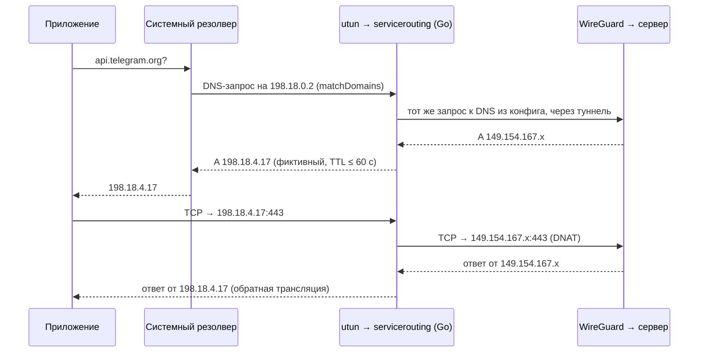

# 04. План реализации: iOS и iPadOS

iOS и iPadOS используют одно приложение (универсальный таргет) и одно сетевое расширение. Различается только интерфейс, поэтому особенности iPadOS вынесены в раздел 7.

## 1. Итог

| Параметр | Значение |
|---|---|
| Минимальная ОС | iOS 26 / iPadOS 26 (решение D-04) |
| Дистрибуция сейчас | Development и Ad Hoc (индивидуальный аккаунт). App Store — только после перехода на аккаунт организации (раздел 9) |
| Таргеты | `iOSApp` (iPhone + iPad), `PacketTunnelExtension` (app extension), `ControlsExtension` (widget extension) |
| Режим «Весь трафик» | `NETunnelProviderManager` → `PacketTunnelProvider` → `fdtunnel` |
| Режим «Только выбранные сервисы» | тот же провайдер, плюс `servicerouting` в Go: перехват DNS выбранных доменов, фиктивные адреса, трансляция (решение D-01) |
| Выбор приложений | Недоступен без MDM ([TN3134](https://developer.apple.com/documentation/technotes/tn3134-network-extension-provider-deployment): per-app mode требует managed device). Режим совместимости с MDM — бэклог (раздел 6) |

## 2. Entitlements и возможности

| Entitlement | `iOSApp` | `PacketTunnelExtension` | `ControlsExtension` |
|---|---|---|---|
| `com.apple.developer.networking.networkextension` = `packet-tunnel-provider` | да | да | да (intent контрола сам запускает туннель, SP-8) |
| App Groups `group.com.facelessdiplomat.splitway` | да | да | да |
| Keychain Sharing `8625S77CSU.com.facelessdiplomat.splitway.shared` | да | да | да (конфигурация туннеля для записи в слот) |
| `com.apple.developer.networking.wifi-info` (v1.x, автоподключение по SSID) | да | — | — |

Network Extension доступен и индивидуальному аккаунту: ограничение 5.4 касается только публикации в App Store.

У каждого таргета есть `PrivacyInfo.xcprivacy`: без отслеживания и сбора данных, с причинами для API, которые использует его бинарник. Без них App Store Connect не примет сборку ([security.md](security.md), раздел 6).

## 3. Режим «Весь трафик»

- Провайдер общий с macOS (фича `PacketTunnel`): `TunnelNetworkPlan` → `NEPacketTunnelNetworkSettings`, поиск дескриптора `utun`, `tc_fd_tunnel_start`.
- **NAT64/DNS64**: в сотовых сетях только с IPv6 endpoint с IPv4-адресом синтезируется через `getaddrinfo`. Без этого туннель не поднимется у части операторов.
- Смена сети (`NWPathMonitor`): Wi-Fi ↔ сотовая, переход в авиарежим → повторный резолвинг endpoint, `tc_tunnel_bump_sockets`.
- **Память**: лимит расширения около 50 МБ. Меры: `debug.SetMemoryLimit` в Go (около 25 МБ на кучу Go), уменьшенные очереди wireguard-go (`queueconstants_ios.go`), ограниченные таблицы `servicerouting`, отсутствие SwiftUI в расширении. Цель — пик не выше 35 МБ под нагрузкой, проверка в Instruments (задача M7-04).
- Ключи читаются из общей Keychain access group с доступностью `AfterFirstUnlockThisDeviceOnly`, поэтому туннель может переподключиться на заблокированном устройстве.

## 4. Режим «Только выбранные сервисы»

### 4.1. Идея

Сервис — это набор правил: суффиксы доменов и подсети. Например, Telegram — `telegram.org`, `t.me`… и опубликованные диапазоны IP. Система отправляет в туннель **только DNS-запросы выбранных доменов** (`matchDomains`). Расширение отвечает на них фиктивными адресами из служебной подсети. Пакеты к этим адресам приходят в туннель, где Go-движок подменяет фиктивный адрес на реальный и отправляет пакет в WireGuard. Весь остальной трафик устройства в туннель не попадает вовсе.

### 4.2. Сетевые настройки

| Параметр | Значение |
|---|---|
| `includedRoutes` | подсети выбранных сервисов ∩ `AllowedIPs` + служебная подсеть `198.18.0.0/15` |
| Маршрут по умолчанию | **не** включается |
| `dnsSettings.servers` | `198.18.0.2` (виртуальный DNS внутри служебной подсети) |
| `dnsSettings.matchDomains` | суффиксы доменов выбранных сервисов, `matchDomainsNoSearch = true` |
| DNS для пересылки | DNS из конфига туннеля; если его нет, настраиваемый адрес через туннель (по умолчанию `1.1.1.1`) |

Диапазон `198.18.0.0/15` (RFC 2544) не маршрутизируется в интернете и обычно применяется для фиктивных адресов. Если он пересекается с адресами из конфига, компилятор плана сообщает о конфликте и выбирает запасной диапазон.

### 4.3. Компоненты

| Где | Компонент | Ответственность |
|---|---|---|
| Swift, `ServiceCatalog` Core | `ServiceProfile`, `ServiceRule`, `CustomServiceRules` | Модель каталога и своих правил |
| Swift, `ServiceCatalog` Core | `ServiceRoutingPlanCompiler` | Выбранные сервисы + конфиг → `ServiceRoutingPlan`: маршруты, домены, пул, DNS для пересылки; конфликты и дедупликация |
| Swift, `ServiceCatalog` Infrastructure | `BundledServiceCatalogRepository` | Чтение и валидация JSON каталога из ресурсов |
| Go, `servicerouting` | `FakeAddressPool` | Выдача адресов по доменам, TTL, LRU, удержание адресов с активными соединениями |
| Go, `servicerouting` | `DNSInterceptor` | Разбор запроса, пересылка в туннель, переписывание A/AAAA-ответа, разворачивание CNAME-цепочек в имя из вопроса |
| Go, `servicerouting` | `AddressTranslator` | Таблица соединений (conntrack), DNAT/SNAT, инкрементальный пересчёт контрольных сумм |
| Go, `servicerouting` | `TranslatingDevice` | Обёртка над `tun.Device` для wireguard-go: прогоняет каждый пакет через транслятор |

План передаётся в Go при старте (`tc_fd_tunnel_set_service_routing`), а при изменении выбора — сообщением провайдеру. Если изменились маршруты или домены, расширение заново вызывает `setTunnelNetworkSettings`. Это происходит только при действии пользователя, а не на каждый DNS-ответ.

### 4.4. Правила поведения

- **AAAA-запросы**: если у туннеля есть IPv6-адрес, используется IPv6-пул `2001:2::/48` (пара к `198.18.0.0/15`, выбор описан в [ServiceCatalog](features/ServiceCatalog.md)); если нет — пустой ответ `NOERROR`, и приложение использует IPv4.
- **Записи HTTPS и SVCB** удаляются из ответа: в их подсказках `ipv4hint` и `ipv6hint` настоящие адреса, и по ним приложение подключилось бы мимо туннеля ([SP-4](features/spikes/SP-4.md)).
- **Истечение адресов**: TTL в ответе не больше 60 секунд. Фиктивный адрес живёт, пока у него есть соединения в conntrack, и освобождается по LRU.
- **Недоступность туннеля**: трафик выбранных сервисов маршрутизирован в туннель, поэтому, пока туннель включён, он не может уйти мимо. На iOS поведение всегда «блокировать», и опция `whenTunnelUnavailable` в интерфейсе не показывается.
- **Ответы с флагом TC** (усечённые): в v1 возвращается то, что поместилось (один A-адрес почти всегда помещается). Повторный запрос по TCP — бэклог.
- **Пересечения**: если домен входит в два выбранных сервиса, правило одно; если подсеть сервиса не входит в `AllowedIPs`, она не маршрутизируется, а пользователь видит предупреждение.

### 4.5. Ограничения (показываются в интерфейсе)

- Приложения со своим DNS (DoH/DoT внутри приложения) обходят `matchDomains`. Их трафик попадёт в туннель только по подсетям из каталога.
- Приложения с зашитыми IP-адресами работают через туннель, только если эти адреса есть в подсетях каталога.
- После выключения VPN система сразу перестаёт отдавать фиктивные ответы, а соединения к фиктивным адресам обрываются, и приложение переподключается напрямую. Приложения со своим DNS-кэшем могут ещё до 60 с (TTL ответа) обращаться к фиктивным адресам ([SP-4](features/spikes/SP-4.md)).
- Сервисы на общих CDN нельзя выделить по IP, только по доменам.

### 4.6. Каталог сервисов

- Формат: `Resources/ServiceCatalog/catalog.json` с версией схемы. Запись: `id`, `displayName`, `category`, `iconAsset`, `domainSuffixes`, `ipv4Networks`, `ipv6Networks`, `notes`.
- Стартовый набор (решение D-15): Telegram, WhatsApp, Signal, Instagram, Facebook, Threads, YouTube, X, Discord, ChatGPT, Claude, Spotify, Netflix, LinkedIn, GitHub.
- Иконки нейтральные: монограмма или SF Symbol в цвете сервиса, без логотипов (решение D-16).
- Свои правила: пользователь создаёт «свой сервис» со списком доменов и подсетей. Валидация — доменными value objects (`DomainName`, `IPNetwork`).
- Тест каталога в `Scripts/check.sh`: JSON валиден, домены и подсети корректны, нет дубликатов `id`.
- Обновление каталога по сети (подписанный JSON) — бэклог: так в продукте появился бы сетевой запрос к серверу разработчика, а это противоречит принципу «никаких запросов».

## 5. Интерфейс iPhone

- **Туннели**: `NavigationStack`, список с переключателем в строке, свайп-действия (удалить, дублировать), кнопка «+» (импорт файла, QR, буфер, создать вручную).
- **Детали туннеля**: статус, статистика (обновляется раз в 1–2 с, пока экран открыт), секция «Маршрутизация»: режим, выбранные сервисы, свои правила.
- **Выбор сервисов**: список с иконками, поиском и категориями; у каждого сервиса — экран с перечнем правил и ограничений.
- **Импорт по QR**: камера (`DataScannerViewController` из VisionKit), а также выбор изображения из Фото с распознаванием через Vision.
- **Редактор**: форма с валидацией на лету и режим «сырого» текста.
- **Настройки и журнал**: журнал с фильтром и экспортом через share sheet, лицензии открытого ПО, «О приложении».

## 6. Режим совместимости с MDM (бэклог)

На управляемых устройствах MDM может назначить приложения в per-app VPN через payload `com.apple.vpn.managed.applayer`, указав наш провайдер. Для этого:
- провайдер должен принимать конфигурацию из `VendorConfig` / `providerConfiguration`, созданную MDM, а не нашим приложением;
- нужно проверить работу на тестовом MDM (например, open-source NanoMDM) и написать инструкцию для администраторов.

В этом режиме на iOS работает **настоящий** выбор приложений, но управляет им администратор устройства, а не наше приложение.

## 7. Особенности iPadOS

- `NavigationSplitView` (боковая панель → список → детали), корректная работа в Split View, Slide Over и Stage Manager при любых размерах окна.
- Drag & drop файлов `.conf` и `.zip` в окно (`dropDestination`), контекстные меню.
- Горячие клавиши для внешней клавиатуры ([TunnelLibrary](features/TunnelLibrary.md)): ⌘N, ⇧⌘O (импорт файла: ⌘O занят системным пунктом «Открыть…»), ⇧⌘V, ⌘⏎, ⌘E, ⌘D, ⇧⌘E, ⌘⌫, ⌘F (поиск), ⌥⌘L (журнал), ⌘, (настройки). Esc закрывает листы.
- Эффекты наведения указателя и фокус с клавиатуры — системные, своих эффектов нет.
- QR-сканер с учётом расположения камеры и поворота устройства.
- v1 — одно окно (`UIApplicationSupportsMultipleScenes` = NO). Несколько окон — только если появится реальный сценарий.

## 8. Controls и Команды

- `Shortcuts` (App Intents): `ConnectTunnelIntent`, `DisconnectTunnelIntent`, `ToggleTunnelIntent`, `TunnelEntity` с запросом из репозитория App Group; фразы Siri.
- `ControlWidgets`: `ControlWidgetToggle` для Пункта управления, экрана блокировки и кнопки действия, статус через `NEVPNStatus`, выбор туннеля в настройках контрола ([ControlWidgets](features/ControlWidgets.md)).
- Спайк **SP-8**: intent контрола выполняется в процессе расширения виджетов, а не приложения. Расширение само загружает `NETunnelProviderManager`, записывает туннель в слот и запускает его, приложение не открывается ([итоги](features/spikes/SP-8.md)). Новый `NETunnelProviderProtocol` из расширения система не сохраняет, поэтому запись меняет поля загруженного протокола; первую VPN-конфигурацию создаёт только приложение.

## 9. Дистрибуция

| Этап | Канал | Условие |
|---|---|---|
| Разработка | Development-сборки на своих устройствах | Есть сейчас |
| Закрытый тест | Ad Hoc, до 100 устройств каждого типа в год | Есть сейчас; UDID тестеров регистрируются вручную |
| Публичный релиз | App Store | Аккаунт организации (юрлицо + D-U-N-S; решение о переходе — до M7-11, D-03), политика конфиденциальности с обязательствами по правилу 5.4, заметки для ревью с тестовым конфигом, ответы по экспортному контролю шифрования |

Риски App Store: отказ по правилу 5.4 при индивидуальном аккаунте (гарантированный), региональные ограничения на VPN-приложения (Китай, Россия и др.), вопросы ревью к формулировке «выбор сервисов».

## 10. Спайки и риски iOS/iPadOS

| ID | Что проверить | Критерий готовности | При провале |
|---|---|---|---|
| SP-4 | Прототип `servicerouting`: `matchDomains` + фиктивные адреса + трансляция на реальном устройстве; пиковая память | Telegram и YouTube работают через туннель, остальной трафик идёт мимо; память ≤ 35 МБ | Итог на iPhone 13 Pro: выбранные домены идут через туннель, остальные напрямую, пик памяти 12,2 МБ при 250–430 Мбит/с ([итоги](features/spikes/SP-4.md)); запасной режим только статических подсетей не нужен, сервисы каталога проверяются в M5-01 |
| SP-7 | Поиск дескриптора `utun` и запуск wireguard-go в расширении iOS 26 | Рукопожатие и трафик в режиме «Весь трафик» | Итог на iPhone 13 Pro и в системном расширении macOS в тестовой ВМ: рукопожатие и трафик проходят, расширение iOS после старта занимает 5–7 МБ ([итоги](features/spikes/SP-7.md)); чтение пакетов через `packetFlow` не нужно |
| SP-8 | Запуск VPN из Control / App Intent без открытия приложения | Переключатель работает на заблокированном экране | Итог на iPhone 13 Pro и в симуляторе (iOS 27.2): intent выполняется в расширении виджетов, расширение само записывает туннель в слот (меняя загруженный протокол) и запускает его ([итоги](features/spikes/SP-8.md)). Работает и с экрана блокировки (M6-04). Запасной вариант с `openAppWhenRun` не понадобился |

## 11. Тестирование

- Устройства: iPhone с оператором, у которого IPv6-only + NAT64; iPad только с Wi-Fi; одно устройство на предыдущей минорной версии ОС.
- Сценарии: смена Wi-Fi ↔ сотовая, авиарежим, блокировка экрана на час, низкий заряд (Low Power Mode), выключение VPN из системных настроек.
- Проверка маршрутизации сервисов: внешний IP внутри выбранного сервиса и в браузере (невыбранный), DNS-утечки выбранных доменов.
- Профилирование памяти и CPU расширения в Instruments под нагрузкой (видео 4K в YouTube через туннель).
