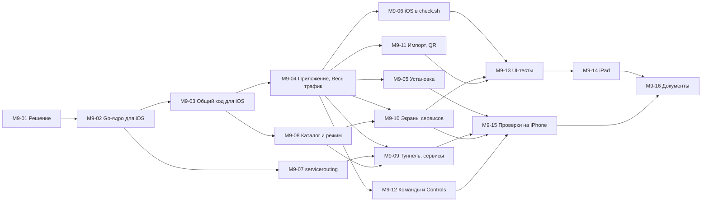

# M9. iOS для своих устройств

Цель: Splitway снова работает на iPhone и iPad владельца в режимах «Весь трафик» и «Только выбранные сервисы». Сборка ставится только из Xcode с подписью разработки на свои устройства (решение D-53). App Store, TestFlight и IPA в релизах не используются, поэтому правило 5.4, из-за которого iOS сняли (D-45), больше не мешает. Код возвращается из тега `ios-final`, где iOS-версия была готова и проверена на iPhone 13 Pro, и приводится к нынешнему `master`. Mac-версия, её выпуск, сайт и обновления не меняются.

## Что переносится на iPhone

| На Mac | На iPhone | Почему так |
|---|---|---|
| «Весь трафик» | То же: общий пакетный туннель и `fdtunnel` | Общий код фичи `PacketTunnel` |
| «Только выбранные приложения»: прозрачный прокси и DNS через туннель | «Только выбранные сервисы»: домены и подсети, фиктивные адреса и трансляция в Go (D-01, ADR-02) | На iOS нет `NETransparentProxyProvider`, а per-app VPN работает только на устройствах под MDM ([TN3134](https://developer.apple.com/documentation/technotes/tn3134-network-extension-provider-deployment)) |
| Системное расширение, XPC и System Keychain (D-33) | Расширение приложения и общая группа связки ключей | Расширение iOS лежит в бандле приложения и читает ту же связку ключей |
| Импорт файлом, из буфера, перетаскиванием | То же, плюс QR камерой и из Фото, «Открыть в…» и AirDrop | Так туннели переезжают с Mac и от провайдера |
| Строка меню | Controls в Пункте управления и на экране блокировки, Команды | — |
| Sparkle (D-52), вход при запуске, удаление | Нет: новая версия ставится из Xcode, удаление — системное | — |

## Как возвращаем код

- iOS убрали два коммита задачи M8-02: `8396bf3` (таргеты iOS, фичи `ServiceCatalog` и `ControlWidgets`, режим сервисов, Go-пакет `servicerouting`, QR, платформенные ветки) и `97689a5` (код, до которого доходила только iOS). После них общий код почти не менялся: добавилась фича `Updates` со Sparkle, были две правки `SecretDelivery` и интеграционные тесты на Mac (M8-07). Поэтому iOS не пишется заново, а возвращается по срезам.
- Каждая задача возвращает свой срез: удалённые файлы — `git checkout ios-final -- <пути>`, изменённые — обратным применением своей части этих коммитов (`git show 8396bf3 -- <файл> | git apply -R --3way`), затем код приводится к `master`.
- Цикл TDD сохраняется: сначала возвращаются тесты среза и падают или не собираются, затем код. То, чего в `ios-final` не было, пишется обычным циклом.
- Материалы App Store не возвращаются: `capture-materials.sh`, `StoreMaterialsTests`, `docs/app-store`, шаги TestFlight и App Review.
- После каждой задачи `Scripts/check.sh` проходит, а Mac-версия ведёт себя как прежде.

## Решения владельца

Владелец принял ответы по умолчанию 2026-11-24, они записаны в D-53.

| Вопрос | Решение | Отклонённый вариант |
|---|---|---|
| Режимы на iPhone | «Весь трафик» и «Только выбранные сервисы»: каталог из 15 сервисов (D-15, D-16) и свои сервисы | Только «Весь трафик»: не нужны M9-07…M9-10, работы меньше примерно на неделю |
| iPad | Универсальное приложение, как в `ios-final`; iPad проверяется в симуляторе | Только iPhone: не нужна M9-14 |
| Controls и Команды | Вернуть (M9-12) | Отложить |
| Где живёт код | `master` публичного репозитория: `check.sh` собирает iOS и гоняет тесты в симуляторе (CI нет, D-54); собрать для себя может любой со своим платным аккаунтом, но сборок и поддержки для других нет | Отдельная ветка или приватный форк: `master` не растёт, но ветка отстаёт от каждого изменения Mac-версии |
| Выбор приложений на iPhone | Не делаем (раздел «Вне плана») | Спайк со своим MDM после M9 |

## Статус

- [x] M9-01 Решение D-53 и план — D-53 в журнале с ответами владельца (2026-11-24), пометки у D-01, D-02, D-04, D-15, D-16, D-37 и D-45, идентификаторы iOS; документ платформы `04-platform-ios-ipados.md` и спайки SP-4 и SP-8 возвращены из `ios-final` без App Store; `CLAUDE.md`, `01-product.md`, `02-architecture.md` и формат задач обновлены
- [x] M9-02 Go-ядро и пакеты для iOS — в xcframework срезы `ios-arm64`, `ios-arm64-simulator` и `macos-arm64_x86_64`; в срезах iOS нет `usernet` (у моста снова тег `!ios`, Swift-части адаптера — только для macOS) и есть лимит памяти Go 30 МиБ. `TunnelCoreAdapter` собирается для `generic/platform=iOS` и симулятора, все восемь функций C API, которые ему нужны, есть в срезах iOS; `check.sh` проходит (2026-11-24)
- [x] M9-03 Общий код собирается для iOS — из `ios-final` вернулись платформенные ветки общих фич: буфер обмена на UIKit, лист настроек с кнопкой в списке и командой ⌘,, кнопка «Изменить», полноэкранный онбординг с текстами iOS, «Открыть Настройки» при запрете VPN, кнопки журнала в панели, отчёты MetricKit о запуске, `#if os(macOS)` у слота прозрачного прокси, входа при запуске и удаления. Все 23 продукта приложения и расширения собираются для симулятора iOS без ошибок и предупреждений; фичи только для Mac в iOS-сборку не входят и целиком не оборачиваются, Sparkle туда не попадает: раздел «Обновления» в настройках необязателен. `check.sh` проходит (2026-11-24)
- [x] M9-04 Приложение и пакетный туннель iOS: «Весь трафик» — таргеты `iOSApp` (iPhone и iPad), `PacketTunnelExtension` и `iOSIntegrationTests` из `ios-final`; приложение и расширение хранят секреты в общей группе связки ключей без XPC, на iOS нет мастера системного расширения, входа при запуске, удаления и Sparkle, настройки открываются листом. `RoutingPlatform`: на iOS только «Весь трафик», выбор поведения при недоступном туннеле — только на Mac. Камера и типы документов в `Info.plist` ждут M9-11. Линтеры снова проверяют `IntegrationTests` и `IntegrationTestHost`. 11 интеграционных тестов проходят в симуляторе iOS 27.2; сборка с подписью разработки (профиль до 2027-11-24) на iPhone 13 Pro подключает «Весь трафик» к тестовому туннелю — подтверждение владельца; `check.sh` проходит (2026-11-25)
- [x] M9-05 Установка на iPhone — `Scripts/install-ios-app.sh [устройство]` собирает `iOSApp` в Release с подписью разработки и ставит через `devicectl`. Без аргумента берёт единственный подключённый iPhone или iPad и пропускает часы, симуляторы и недоступные устройства; при нескольких перечисляет их, без режима разработчика говорит, где его включить. Выбор устройства покрыт тестом `Scripts/tests/ios-devices-test.sh` в `check.sh`. Разделы о сборке для iPhone в `README.md` и `README.ru.md`, шаг владельца 18. На iPhone 13 Pro Release-сборка встала поверх сборки разработки за 22 с, открывается без Xcode, туннель сохранился и подключается — подтверждение владельца; `check.sh` проходит (2026-11-25)
- [x] M9-06 iOS в `check.sh` — шаг «iOS build and integration tests» собирает `iOSApp` и прогоняет `iOSIntegrationTests` в симуляторе iPhone. Симулятор выбирает `Scripts/lib/ios-simulators.sh`: iPhone с самой новой средой iOS, первый по имени; если симулятор был выключен, после тестов он выключается снова. Выбор покрыт тестом `Scripts/tests/ios-simulators-test.sh`. Без симулятора шаг пропускается с сообщением, и итоговая строка говорит об этом. Пробные запуски на Mac владельца: 11 тестов на iPhone 17 с iOS 27.2, `check.sh` идёт 88 с вместо 35; без симуляторов (подменённый `simctl list`) — 37 с с пропуском шага; ошибка, которая ломает только iOS-сборку, останавливает `check.sh` (2026-11-25)
- [ ] M9-07 Go: `servicerouting`
- [ ] M9-08 Каталог сервисов и режим сервисов в домене
- [ ] M9-09 Пакетный туннель в режиме сервисов
- [ ] M9-10 Экраны выбора сервисов
- [ ] M9-11 Импорт на iPhone: QR, AirDrop, вставка
- [ ] M9-12 Команды и Controls
- [ ] M9-13 UI-тесты iOS в симуляторе
- [ ] M9-14 iPad
- [ ] M9-15 Проверки на iPhone
- [ ] M9-16 Документы фич и безопасность

## Порядок

- Минимальный путь — M9-01…M9-05: после него на iPhone работает «Весь трафик».
- M9-07 (Go) не зависит от Swift-задач M9-03…M9-06 и может идти параллельно с ними.
- После M9-07…M9-10 появляется выбор сервисов; остальное — удобство, тесты и проверки.
- Оценка для одного разработчика — 3–4 недели, минимальный путь — около 1,5 недели: большая часть кода возвращается из тега, а не пишется.

## Задачи

### M9-01. Решение D-53 и план
`iOS` · S · зависит от: —

**Сделать:**
- запись D-53 в журнале решений: личная сборка для iOS и iPadOS без распространения, режимы, ответы владельца на вопросы выше; отклонённые варианты — не возвращать iOS (D-45), IPA в релизах для AltStore и SideStore, только «Весь трафик», отдельная ветка или форк, свой MDM ради выбора приложений;
- пометки о возврате у D-01, D-02, D-04, D-15, D-16, D-37 и D-45, идентификаторы iOS в журнале;
- `CLAUDE.md`, `01-product.md` (платформы, личная сборка, раздел «Вне рамок продукта»), `02-architecture.md` (введение, ADR-02, ADR-10), формат задачи в `05-tasks/README.md` (платформы `iOS` и `iPadOS` снова в ходу);
- документ платформы `docs/04-platform-ios-ipados.md` и спайки SP-4 и SP-8 из `ios-final` без App Store: раздел «Дистрибуция» описывает только сборки разработки, риски App Review уходят.

**Тесты сначала:** не требуются (документы).
**Готово, когда:** журнал, документы и этот план описывают новый курс, а ответы владельца записаны в D-53.

### M9-02. Go-ядро и пакеты для iOS
`iOS` · M · зависит от: M9-01

**Сделать:**
- срезы `iphoneos` и `iphonesimulator` (arm64) в `Packages/TunnelCore/Scripts/build-xcframework.sh`, минимальная версия iOS в отпечатке исходников;
- `fdtunnel/memory_limit_ios.go`: лимит памяти Go под предел пакетного туннеля iOS (около 50 МБ на всё расширение);
- теги `!ios` у файлов моста userspace-сети, а её Swift-части в `TunnelCoreAdapter` — только для macOS: она нужна только прозрачному прокси Mac;
- `.iOS(.v26)` в платформах пакетов `SplitwayKit` и `TunnelCore`, iOS 26 в `deploymentTarget` и исключение `x86_64` для симулятора в `project.yml`.

**Тесты сначала:** не требуются: скрипт сборки и теги без логики; Go- и Swift-тесты ядра проходят как раньше.
**Готово, когда:** `TunnelCoreFramework.xcframework` содержит срезы iPhone, симулятора и Mac, а `TunnelCoreAdapter` собирается для `generic/platform=iOS` и `generic/platform=iOS Simulator`.

### M9-03. Общий код собирается для iOS
`shared` · M · зависит от: M9-02

**Сделать:**
- вернуть платформенные ветки (`#if os(macOS)`, `#if os(iOS)`), которые сняла M8-02, в фичах, нужных приложению и расширению iOS: `TunnelLibrary`, `TunnelImport`, `TunnelConnection`, `TunnelEditor`, `AppRouting`, `Diagnostics`, `Settings`, `Onboarding`, `SystemExtension` (Core и Presentation), `ApplicationCatalog` (Presentation), `DesignSystem`. Возвращается и лист настроек iOS из `97689a5`;
- фичи и слои только для Mac — `TransparentProxy`, `SecretDelivery`, `MenuBar`, Infrastructure у `ApplicationCatalog`, `SystemExtension` и `Updates` — iOS-приложение не подключает. Если iOS-сборка проходит без этого, они не оборачиваются в ветки целиком, как было в `ios-final`;
- новое после `ios-final`: `SettingsPresentation` зависит от `UpdatesPresentation`. Раздел «Обновления» показывается только на Mac, Sparkle в iOS-сборку не попадает.

**Тесты сначала:** поведение Mac не меняется — `swift test` проходит без правок тестов; iOS-ветки с логикой получают свои тесты из `ios-final` раньше кода.
**Готово, когда:** продукты, которые нужны приложению и расширению iOS, собираются для симулятора iOS (`xcodebuild -scheme <продукт> -destination 'generic/platform=iOS Simulator'`), а сборка и тесты Mac не изменились.

### M9-04. Приложение и пакетный туннель iOS: «Весь трафик»
`iOS` · L · зависит от: M9-03

**Сделать:**
- таргеты `iOSApp` (iPhone и iPad) и `PacketTunnelExtension` в `project.yml` из `ios-final`, пока без `ControlsExtension` (M9-12). `Info.plist` и `PrivacyInfo.xcprivacy` — как у Mac-версии. Права для подписи разработки: `packet-tunnel-provider`, App Group `group.com.facelessdiplomat.splitway`, группа связки ключей `8625S77CSU.com.facelessdiplomat.splitway.shared`. Bundle ID — как в `ios-final` (`com.facelessdiplomat.splitway` и `….packet-tunnel`), профили — автоматической подписью;
- секреты на iOS: приложение и расширение читают общую группу связки ключей (`KeychainTunnelSecretStore`, доступность `AfterFirstUnlockThisDeviceOnly`, чтобы туннель переподключался на заблокированном iPhone). XPC и System Keychain нужны только системному расширению Mac (D-33);
- платформенные ветки сборки приложения и расширения: `AppComposition`, `AppTunnelServices`, `AppConfiguration`, `SplitwayRootScene`, `PacketTunnelComposition`. На iOS нет мастера системного расширения, входа при запуске, удаления и обновлений;
- `RoutingPlatform`: на iOS режим «Только выбранные приложения» не показывается, до M9-08 доступен только «Весь трафик».

**Тесты сначала:** таргет `iOSIntegrationTests` с хостом-приложением в симуляторе на тех же исходниках `IntegrationTests`, что у `macOSIntegrationTests` (`KeychainTunnelSecretStoreTests`, `SecretLeakScanTests`); тесты `RoutingPlatform` и выбора режима по платформе из `ios-final`.
**Готово, когда:** приложение запускается на iPhone владельца из Xcode, импортирует туннель файлом и из буфера, подключает «Весь трафик» к тестовому туннелю (D-29) и показывает статус, статистику и журнал.

### M9-05. Установка на iPhone
`iOS` · S · зависит от: M9-04

**Сделать:**
- `Scripts/install-ios-app.sh [устройство]`: собирает `iOSApp` в конфигурации Release с подписью разработки (`-allowProvisioningUpdates`) и ставит на подключённый iPhone через `xcrun devicectl device install app`. Без аргумента выбирает единственное подключённое устройство, при нескольких просит указать;
- раздел о сборке для iPhone в `README.md` и `README.ru.md`: нужен платный аккаунт Apple Developer Program (бесплатному Apple ID Network Extension недоступен), режим разработчика на iPhone, свои `DEVELOPMENT_TEAM` и префикс bundle ID; установка из Xcode (схема `iOSApp`, своё устройство, Run) или скриптом. Профиль разработки живёт до года — потом сборку нужно поставить заново, туннели и настройки сохраняются;
- шаг владельца в `05-tasks/README.md`: iPhone зарегистрирован в аккаунте разработчика и сопряжён с Mac (было сделано для M2-14, проверить, что регистрация не истекла).

**Тесты сначала:** не требуются (скрипт и документы).
**Готово, когда:** одна команда ставит свежую Release-сборку на iPhone, приложение запускается без Xcode, а установка поверх прежней сохраняет туннели.

### M9-06. iOS в `check.sh`
`iOS` · S · зависит от: M9-04

**Сделать:** шаг «iOS build and integration tests» в `Scripts/check.sh`: сборка `iOSApp` и `iOSIntegrationTests` в симуляторе iPhone. Если среды выполнения симулятора iPhone нет, шаг пропускается с заметным сообщением, чтобы Mac-версию можно было проверить без iOS. Линтеры уже проверяют `Apps/`, `IntegrationTests/` и `IntegrationTestHost/` (M9-04). `Scripts/release.sh` по-прежнему собирает только Mac. CI нет (D-54), поэтому `check.sh` с хуком `pre-merge-commit` — единственная проверка и для iOS-кода.
**Тесты сначала:** не требуются (скрипты); пробный запуск на Mac с симулятором iPhone и без него.
**Готово, когда:** `check.sh` на Mac владельца собирает iOS и проходит интеграционные тесты в симуляторе, а на Mac без симулятора iOS проходит с пропуском шага.

### M9-07. Go: `servicerouting`
`iOS` · M · зависит от: M9-02

**Сделать:**
- пакет `servicerouting` из `ios-final`: разбор IPv4, IPv6, TCP и UDP без аллокаций, инкрементальные контрольные суммы (RFC 1624), таблица соединений на 4096 записей с DNAT и SNAT, пул фиктивных адресов `198.18.0.0/15` и `2001:2::/48`, перехват DNS с разворачиванием CNAME и удалением записей HTTPS и SVCB, обёртка `TranslatingDevice`;
- мост: `tc_fd_tunnel_set_service_routing` в `TunnelCore.h` и `bridge`, `RouteServices` в `fdtunnel`. В `ios-final` `fdtunnel` оборачивал `utun` всегда, и до первого плана обёртка пропускала пакеты насквозь; сейчас «Весь трафик» отдаёт `utun` wireguard-go напрямую. Рекомендация — включать обёртку только при старте в режиме сервисов: тогда «Весь трафик» на Mac и iPhone не меняется. Если обёртка остаётся всегда, скорость «Весь трафик» на Mac сверяется с замерами M7-03 (`Scripts/macos-vm.sh relay-benchmark`, [benchmarks.md](../benchmarks.md));
- Swift: документ плана `ServiceRoutingTranslation` в `TunnelEngine`, порт `RunningTunnelInterfaceDevice` и адаптер в `TunnelCoreAdapter`.

**Тесты сначала:** из `ios-final`: табличные и golden-тесты, fuzz-тесты разбора пакетов и DNS (с датаграммой, на которой упал прототип SP-4), сквозной тест «DNS → фиктивный адрес → SYN → DNAT» на `tuntest`, контракт плана с общей JSON-фикстурой Swift и Go, бенчмарки с базовой линией `servicerouting/testdata/benchmark-baseline.txt` — пакет снова в списке `Scripts/benchmark.sh` и проверяется `Scripts/check.sh --bench`.
**Готово, когда:** Go- и Swift-тесты проходят, трансляция не выделяет память на пакет, бенчмарк `servicerouting` отстаёт от базовой линии не больше чем на 10 %, а «Весь трафик» не медленнее, чем сейчас.

### M9-08. Каталог сервисов и режим сервисов в домене
`iOS` · M · зависит от: M9-03

**Сделать:**
- фича `ServiceCatalog` (Core и Infrastructure) из `ios-final`: профили сервисов и правила, свои сервисы с проверкой доменов и сетей, `DomainSuffixSet` с минимизацией вложенных суффиксов, `ServiceRoutingPlanCompiler`, встроенный `catalog.json` на 15 сервисов (D-15) и файл своих сервисов в App Group;
- в `AppRouting`: режим `.selectedServices`, `ServiceSelection`, `ServiceIdentifier`. На iOS доступны «Весь трафик» и «Только выбранные сервисы», на Mac — как сейчас; выбор каждого режима помнится (D-37);
- кодек политики снова читает режим сервисов как режим сервисов: после M8-02 он читается как «Весь трафик»;
- сверить домены и подсети каталога с источниками из поля `notes` и обновить устаревшие.

**Тесты сначала:** из `ios-final`: содержимое каталога (схема, разбор доменов и подсетей, уникальные `id`, у каждой записи есть правило), минимизация (`t.me` поглощает `a.t.me`), отказ своему сервису с неверным доменом, компилятор плана (каждое правило и предупреждение, детерминированность), кодек политики в обе стороны для файлов Mac и iOS.
**Готово, когда:** сценарии покрыты тестами на фейках, план однозначно сериализуется в JSON для Go, а тесты Mac-версии проходят без правок.

### M9-09. Пакетный туннель в режиме сервисов
`iOS` · M · зависит от: M9-04, M9-07, M9-08

**Сделать:** `SelectedServicesNetworkPlanner`: маршруты выбранных подсетей внутри `AllowedIPs` и служебная подсеть без маршрута по умолчанию, `dnsSettings` с виртуальным DNS и `matchDomains` (область DNS выбранных доменов, убранная в `97689a5`). `PlanTunnelRoutingUseCase` и `PacketTunnelComposition` получают каталог и свои сервисы. Сессия передаёт план в Go при старте и при смене выбора, а `setTunnelNetworkSettings` вызывает, только если изменились маршруты или домены. Пока туннель включён, трафик выбранных сервисов мимо него не уходит: на iOS при недоступном туннеле всегда «блокировать».
**Тесты сначала:** из `ios-final`: `SelectedServicesNetworkPlannerTests`, `PacketTunnelSessionServiceRoutingTests`, сообщения провайдеру о смене выбора, `matchDomains` в `NetworkSettingsMapperTests`.
**Готово, когда:** на iPhone выбранный сервис идёт через туннель, остальной трафик — напрямую, а смена выбора применяется без переподключения.

### M9-10. Экраны выбора сервисов
`iOS` · M · зависит от: M9-04, M9-08

**Сделать:** Presentation фичи `ServiceCatalog` из `ios-final`: лист выбора с поиском и категориями, экран сервиса с правилами и ограничениями, редактор своего сервиса с проверкой на лету, экран «Как это работает и ограничения». Лист сервисов в редакторе туннеля, режим и сервисы в списке и деталях туннеля. Строки `ru` и `en`, которые M8-02 убрала из каталогов, и подписи доступности.
**Тесты сначала:** из `ios-final`: `ServicePickerModelTests`, `CustomServiceEditorModelTests`, `TunnelEditorServicePickerTests`, режим сервисов в `RoutingSectionModelTests`.
**Готово, когда:** на iPhone сервисы выбираются, свой сервис создаётся без чтения документации, а предупреждения компилятора плана видны в интерфейсе.

### M9-11. Импорт на iPhone: QR, AirDrop, вставка
`iOS` · M · зависит от: M9-04

**Сделать:** QR камерой (`DataScannerViewController` из VisionKit) и с картинки из Фото (Vision): порты `CameraAccess` и `QRCodeDecoder`, `VisionQRCodeDecoder`, экран сканера, `NSCameraUsageDescription`. Файлы, открытые в Splitway из «Файлов» и AirDrop, с очисткой папки входящих: типы документов (`CFBundleDocumentTypes`, `LSSupportsOpeningDocumentsInPlace`) возвращаются в `Info.plist` только вместе с очисткой; системная кнопка «Вставить». Так туннели переезжают с Mac: экспорт в Mac-версии и AirDrop на iPhone.
**Тесты сначала:** из `ios-final`: `VisionQRCodeDecoderTests` на сгенерированных QR, импорт QR в `PrepareImportUseCaseTests`, входящие файлы в `SecurityScopedFileReaderTests`, модель сканера.
**Готово, когда:** на iPhone туннель импортируется QR-кодом камерой, картинкой из Фото и архивом экспорта Mac-версии, присланным по AirDrop.

### M9-12. Команды и Controls
`iOS` · M · зависит от: M9-04

**Сделать:** фича `ControlWidgets` и таргет `ControlsExtension` из `ios-final` по итогам SP-8: intent контрола сам записывает туннель в системный слот и запускает его, приложение не открывается; обновление контрола при смене состояния и `ReadSlotStateUseCase`. Команды фичи `Shortcuts` («Подключи», «Отключи», «Переключи туннель») и фразы Siri на iOS. В документе спайка SP-8 — ссылка на вернувшуюся фичу.
**Тесты сначала:** из `ios-final`: сценарии контрола (чтение, установка и обновление состояния), `ReadSlotStateUseCaseTests`.
**Готово, когда:** контрол подключает и отключает туннель из Пункта управления и с экрана блокировки, а команды работают в приложении «Команды» на iPhone.

### M9-13. UI-тесты iOS в симуляторе
`iOS` · M · зависит от: M9-06, M9-10, M9-11

**Сделать:** таргет `iOSUITests` из `ios-final` без `StoreMaterialsTests`: дымовые тесты, выбор сервисов, переводы подписей и аудит доступности на `en` и `ru`; флаг `--ui` в `Scripts/check.sh` для симуляторов iPhone и iPad. В `06-development-rules.md` (раздел 4) — UI-тесты снова есть, но только для iOS в симуляторе: курсор Mac они не забирают (D-32).
**Тесты сначала:** сами тесты.
**Готово, когда:** `Scripts/check.sh --ui` проходит на симуляторах iPhone и iPad на обоих языках.

### M9-14. iPad
`iPadOS` · S · зависит от: M9-13

**Сделать:** то, что было в `ios-final`: `NavigationSplitView`, перетаскивание `.conf` и `.zip` в окно, горячие клавиши внешней клавиатуры (⌘N, ⇧⌘O, ⇧⌘V, ⌘⏎, ⌘F, Esc и другие), сканер QR с учётом поворота, одно окно. Проверка — в симуляторе iPad, на устройстве — если у владельца есть iPad.
**Тесты сначала:** UI-тест `KeyboardShortcutTests` из `ios-final` в симуляторе iPad.
**Готово, когда:** основные действия доступны с клавиатуры, а окно любого размера не обрезает список, детали и редактор.

### M9-15. Проверки на iPhone
`iOS` · M · зависит от: M9-05, M9-09, M9-10, M9-12

**Сделать:** список `docs/05-tasks/ios-checks.md` по образцу [проверок Mac](mac-checks.md) и живые тесты из `ios-final` (`LiveTunnelTests`, `LiveServiceRoutingTests`, `LiveControlCenterTests`, `LiveBenchmarkTests`) со скриптами `Scripts/live-tunnel-test.sh` и `Scripts/live-benchmark.sh`. Проверить:
- «Весь трафик»: внешний адрес, DNS, блокировку IPv6 у туннеля только с IPv4 (D-30);
- каждый сервис каталога в его приложении — Telegram, YouTube и других: в `ios-final` проверено только основное имя каждого сервиса (M5-01);
- внешний адрес и резолвер внутри выбранного сервиса и в невыбранном браузере; DNS выбранных доменов только через туннель;
- выключение VPN, блокировку экрана на час, смену Wi-Fi ↔ сотовая, сеть только с IPv6 (NAT64, например общий доступ к интернету с NAT64 на Mac);
- память расширения в Instruments: пик не выше 35 МБ под нагрузкой и без роста за час (в `ios-final` — 14,3–15,0 МиБ в прогонах по 1,5–3 минуты);
- Controls с экрана блокировки, VoiceOver на главных экранах.

**Тесты сначала:** не требуются (живые и ручные проверки).
**Готово, когда:** все пункты пройдены или явно отложены владельцем, а цифры записаны в документы фич.

### M9-16. Документы фич и безопасность
`iOS` · S · зависит от: M9-01…M9-15

**Сделать:** вернуть из `ios-final` и обновить `ServiceCatalog.md`, `ServiceRouting.md` и `ControlWidgets.md`, а в документе платформы iOS заменить упоминания этих фич ссылками; iOS-части в документах `PacketTunnel`, `TunnelEngine`, `TunnelImport`, `TunnelLibrary`, `AppRouting`, `Shortcuts`, `Settings` и `Onboarding` и в `02-architecture.md` (стек, таргеты, процессы, хранение). В `docs/security.md` — модель угроз iOS: общая группа связки ключей вместо XPC и System Keychain, сборка разработки без проверки обновлений. В `docs/localization.md` — термины режима сервисов, в разделах README о сборке для iPhone (M9-05) — режим «Только выбранные сервисы». Сайт и политика конфиденциальности не меняются: iOS-версия не распространяется.
**Тесты сначала:** не требуются (документы).
**Готово, когда:** документы фич описывают iOS-версию, и ни один документ не утверждает, что iOS не поддерживается.

## Вне плана

- **Выбор приложений на iPhone.** Без MDM система не сообщает туннелю, какое приложение открыло соединение, а per-app VPN назначает только MDM ([TN3134](https://developer.apple.com/documentation/technotes/tn3134-network-extension-provider-deployment)). Для личного iPhone это свой MDM-сервер (например, NanoMDM) с push-сертификатом MDM, регистрация iPhone в нём, управляемые приложения и провайдер, который принимает конфигурацию от MDM (документ платформы iOS в `ios-final`, раздел 6). Если понадобится — отдельный спайк после M9.
- **Распространение для других:** App Store, TestFlight, Ad Hoc, AltStore и SideStore, IPA в релизах.
- **Синхронизация туннелей между Mac и iPhone через iCloud.** Туннели переносятся экспортом, AirDrop и QR (M9-11).
- **Автоподключение по правилам сети** — после v1, как и на Mac (D-08, M6-06).
- **Обновление каталога сервисов по сети:** запрос к серверу разработчика противоречит принципу «никаких сетевых запросов».

## Риски

- Профиль разработки живёт не больше года и действует, пока оплачено членство в Apple Developer Program: потом сборку ставят заново (M9-05). Бесплатный Apple ID не подойдёт: ему недоступен Network Extension.
- Платформенные ветки возвращаются примерно в 80 файлов общего кода. Каждое изменение Mac-версии должно собираться и для iOS: это ловит шаг iOS в `check.sh` (M9-06), но поддержка дорожает.
- Подсети и домены сервисов в каталоге устаревают, а выпусков iOS-версии нет: каталог сверяет сам владелец (M9-08, M9-15).
- Ограничения режима сервисов остаются: приложения со своим DNS (DoH, DoT) и с зашитыми IP-адресами обходят `matchDomains`, сервисы на общих CDN не выделить по IP (документ платформы iOS, раздел 4.5).
- Новые версии iOS меняют поведение Network Extension; последние живые проверки на iPhone были 2026-11-01.
