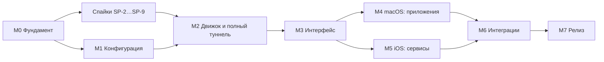

# 05. Позадачный план реализации

План разбит на вехи (milestones). У каждой вехи свой файл со всеми задачами. Каждая задача достаточно мала, чтобы закончить её за 0,5–5 дней и закрыть одним или несколькими коммитами.

| Веха | Файл | Результат | Платформы |
|---|---|---|---|
| M0 | [M0-foundation.md](M0-foundation.md) | Репозиторий, проект, линтеры, локальные проверки, сборка Go-ядра, **спайки** SP-2…SP-9 | все |
| M1 | [M1-configuration.md](M1-configuration.md) | Домен конфигурации, хранение, импорт/экспорт, журнал (без UI) | все |
| M2 | [M2-engine-full-tunnel.md](M2-engine-full-tunnel.md) | Go-движок, пакетный туннель, подключение, статус, статистика — режим «Весь трафик» работает из кода | все |
| M3 | [M3-app-ui.md](M3-app-ui.md) | Интерфейс: список, детали, импорт, QR, редактор, экспорт, журнал, онбординг | все |
| M4 | [M4-macos-per-app.md](M4-macos-per-app.md) | Выбор приложений и DNS-прокси на macOS | macOS |
| M5 | [M5-ios-service-routing.md](M5-ios-service-routing.md) | Выбор сервисов на iOS/iPadOS | iOS, iPadOS |
| M6 | [M6-integrations.md](M6-integrations.md) | Строка меню, настройки, Команды, Controls, iPadOS-полировка, автоподключение | все |
| M7 | [M7-release.md](M7-release.md) | Безопасность, производительность, тесты утечек, выпуск | все |

## Порядок и параллельность



- Спайки идут параллельно с M1: доменный код от них не зависит.
- M4 и M5 независимы и могут идти параллельно, если разработчиков двое.
- **Очерёдность выпусков** (решение D-02, с учётом индивидуального аккаунта):
  1. **macOS 1.0** через Developer ID: M0–M4, macOS-часть M6, macOS-часть M7.
  2. **iOS/iPadOS бета** через Ad Hoc: M5, iOS-часть M6.
  3. **iOS/iPadOS в App Store** — после перехода на аккаунт организации (решение D-03), задача M7-11.

## Формат задачи

```
### M1-06. Короткое название
`платформа` · размер · зависит от: M1-04, M1-05

**Сделать:** что именно реализовать и где (фича, слой).
**Тесты сначала:** какие тесты пишутся до кода (TDD). Для задач без логики — «не требуются» и почему.
**Готово, когда:** проверяемые критерии приёмки.
```

- Платформа: `shared`, `macOS`, `iOS`, `iPadOS`, `iOS+iPadOS`.
- Размер: **S** — до 0,5 дня, **M** — 1–2 дня, **L** — 3–5 дней. Задачи крупнее L при взятии в работу разбиваются.
- ID задачи пишется в теле коммита и в названии ветки (`feature/M1-06-wg-quick-parser`).
- Статус задач — чекбоксы в разделе «Статус» в начале файла вехи (решение D-27). Коммит, закрывающий задачу, ставит отметку.

## Определение готовности (Definition of Done) для любой задачи

1. Код соответствует [правилам разработки](../06-development-rules.md); линтеры (`Scripts/lint.sh`) проходят без исключений.
2. Тесты из пункта «Тесты сначала» написаны **до** реализации и проходят; `Scripts/check.sh` проходит.
3. Нет предупреждений компилятора Swift 6 (strict concurrency) и `go vet`.
4. Пользовательские строки есть в String Catalog на `ru` и `en`.
5. Если задача **завершает фичу**, создан или обновлён `docs/features/<Feature>.md` по [шаблону](../features/_TEMPLATE.md).
6. Ни один коммит не указывает ИИ-ассистента автором или соавтором.
7. Чекбокс задачи отмечен в файле вехи.

## Оценка объёма

Ориентир для одного разработчика на полный день, без учёта ревью Apple:

| Веха | Задач | Оценка |
|---|---|---|
| M0 + спайки | 18 | 3–4 недели |
| M1 | 19 | 2–3 недели |
| M2 | 15 | 3 недели |
| M3 | 17 | 3 недели |
| M4 | 18 | 5–6 недель |
| M5 | 11 | 3–4 недели |
| M6 | 7 | 2 недели |
| M7 | 12 | 2–3 недели |
| **Итого** | **117** | **≈ 6 месяцев** |

Оценки пересматриваются после спайков: SP-2, SP-3, SP-4 и SP-9 сильнее всего влияют на M4 и M5.
