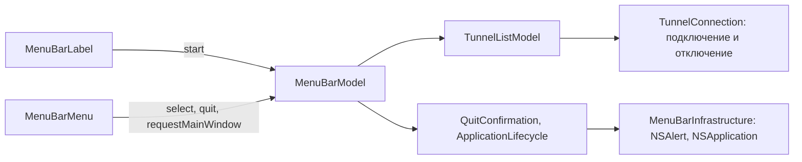

# MenuBar

| | |
|---|---|
| Статус | завершена: проверена в тестовой ВМ macOS 26.6 (2026-10-31), по решению D-36 проверки в ВМ достаточно |
| Платформы | macOS |
| Задачи | M6-01, M6-02 (иконка в Dock) |
| Таргеты | `MenuBar`, `MenuBarInfrastructure`, `MenuBarPresentation` |

## Назначение

Строка меню macOS (решение D-12). Значок показывает состояние туннеля, а из меню можно подключить, отключить и переключить туннель, открыть окно и настройки и выйти из приложения — всё без открытия окна.

## Зависимости

| Тип | Что | Зачем |
|---|---|---|
| Фичи проекта | `TunnelLibrary` (`TunnelListModel`, `TunnelRow`, `TunnelRowStatus`), `TunnelConnection`, `AppRouting` (`RoutingModeKind.title`), `DesignSystem` | состояние туннелей и сценарии подключения — общие с окном |
| Системные фреймворки | SwiftUI (`MenuBarExtra`, `SettingsLink`, `openWindow`), AppKit (`NSAlert`, `NSApplication`) | строка меню, окно настроек, главное окно, вопрос при выходе |
| Сторонние библиотеки | нет | |

## Принцип работы

- `MenuBarModel` построен поверх `TunnelListModel` окна: те же строки, статусы и сценарии подключения, поэтому меню и окно не расходятся. `start()` загружает туннели и наблюдает за слотом. Его вызывает метка в строке меню, которая живёт всё время работы приложения, поэтому меню работает и при закрытом окне.
- `MenuBarIcon`: «подключён», если какой-то туннель подключён; «подключается», если туннель подключается, переподключается или отключается; «ошибка», если подключение не удалось; иначе «отключён». Символы — `shield`, `shield.lefthalf.filled`, `checkmark.shield.fill`, `exclamationmark.shield.fill`. Подпись доступности: «Splitway, туннель подключён» и так далее.
- Меню: строка состояния («cz-prg: Connected» или «Not connected»), режим маршрутизации активного туннеля, туннели переключателями (галочка у активного), «Open Splitway», «Settings…» (⌘,), «Quit Splitway» (⌘Q).
- Выбор неактивного туннеля подключает его; если активен другой, `ConnectionCoordinator` сначала его останавливает. Выбор активного туннеля его отключает.
- Если перед первым системным запросом VPN нужно объяснение (как в окне), модель просит открыть главное окно, и объяснение показывается там.
- **Иконка в Dock** видна, пока открыто окно (решение D-12). `DockVisibilityPolicy` по состоянию окон `AppWindowState` решает, показывать ли её: считаются окна с заголовком, которые видны или свёрнуты; окна строки меню и закрывающееся окно не считаются. `AppKitDockPresence` слушает события окон (стало ключевым, видимость на экране, свернулось, развернулось, закрывается) и переключает `NSApplication.ActivationPolicy` между `.regular` и `.accessory`.
- «Quit Splitway» без активного туннеля завершает приложение сразу. С активным — вопрос `NSAlert`: «Disconnect and Quit», «Quit» (туннель продолжит работать) или «Cancel».

## Публичный API

| Тип | Что делает |
|---|---|
| `MenuBarModel(tunnels:quitConfirmation:lifecycle:)` | состояние меню и действия поверх `TunnelListModel` |
| `SplitwayMenuBar(model:mainWindowIdentifier:)` | сцена `MenuBarExtra` (только macOS) |
| `MenuBarIcon`, `MenuBarTunnel` | состояние значка и пункт туннеля |
| `QuitConfirmation`, `ApplicationLifecycle`, `QuitDecision` (Core) | вопрос при выходе, активация и завершение приложения |
| `AppKitQuitConfirmation`, `AppKitApplicationLifecycle` (Infrastructure) | реализации на AppKit |

Главное окно — `WindowGroup(id: SplitwayRootScene.mainWindowIdentifier)`, по нему меню его открывает.

## Решения

- Модель меню использует `TunnelListModel`, а не повторяет сценарии подключения: строки, объяснение системного запроса и обработка ошибок одни и те же для окна и меню. Зависимость Presentation от Presentation другой фичи уже есть у `TunnelLibraryPresentation`.
- Состояние показывается одной строкой «имя: состояние», а не отдельными пунктами с именем туннеля. В ВМ SwiftUI отключал переключатель активного туннеля и убирал его галочку, когда над ним был текстовый пункт с тем же заголовком. Строка состояния есть всегда, поэтому число пунктов при подключении не меняется.
- Вопрос при выходе задаёт `NSAlert`: у меню строки нет окна, к которому можно привязать диалог SwiftUI.
- Объяснение перед первым системным запросом показывается в окне: в меню для него нет места.
- Свёрнутое окно оставляет иконку в Dock: иначе его нельзя развернуть.
- Появление окна ловится и по изменению его видимости (`didChangeOcclusionState`): в режиме `.accessory` окно, открытое из строки меню, не становится ключевым, и без этого события иконка не возвращалась (найдено в ВМ).

## Спорные решения

| Решение | Альтернативы | Почему так | Когда пересмотреть |
|---|---|---|---|
| Загрузку и наблюдение запускает метка в строке меню | запуск из composition root | метка живёт всё время работы приложения; окно наблюдает отдельно, второе наблюдение ничего не ломает | если двойное наблюдение даст заметную нагрузку |
| ⌘Q из меню приложения не спрашивает о туннеле | тот же вопрос в `applicationShouldTerminate` | M6-01 требует вопроса в строке меню; системное расширение продолжает работать и после выхода | в M6-02 вместе с Dock и запуском при входе |

## Отступления от правил разработки

Нет.

## Ограничения и известные проблемы

- ⌘Q из меню приложения (при открытом окне) завершает приложение без вопроса, туннель продолжает работать.
- Иконка в Dock проверена в тестовой ВМ (2026-11-01, `lsappinfo`): окно открыто — `Foreground`, закрыто — `UIElement`, снова открыто из строки меню — `Foreground`, окно свёрнуто или открыто окно настроек — `Foreground`.

## Тесты

- 5 тестов `DockVisibilityPolicyTests`: открытое окно, свёрнутое окно, нет окон или все скрыты, окна строки меню, закрывающееся последнее окно.
- `MenuBarIconTests`: значок для каждого сочетания состояний туннелей.
- `MenuBarModelTests`: список с активным туннелем; режим маршрутизации; строка состояния при ошибке; подключение, отключение и переключение на другой туннель с остановкой текущего; открытие окна перед первым системным запросом; активация приложения для окна; пустая библиотека; выход без активного туннеля, с отключением, без отключения и отмена выхода.
- Вёрстка меню и метки не покрыта тестами (вёрстка SwiftUI), адаптеры AppKit — тонкие обёртки. В тестовой ВМ macOS 26.6 при закрытом окне проверены: пункты меню, подключение, отключение и переключение туннелей, галочка активного туннеля, заголовок доступности значка («Splitway, connected», «Splitway, connection failed»), «Open Splitway», «Settings…» и вопрос при выходе с «Cancel» и «Disconnect and Quit».

Запуск: `swift test --package-path Packages/SplitwayKit --filter MenuBar`.

## История изменений

| Дата | Изменение | Задача |
|---|---|---|
| 2026-10-31 | Строка меню: значок, туннели, режим маршрутизации, окно, настройки и вопрос при выходе | M6-01 |
| 2026-11-01 | Иконка в Dock видна, только пока открыто окно | M6-02 |
