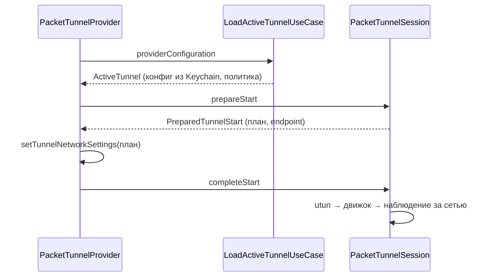

# PacketTunnel

| | |
|---|---|
| Статус | в работе: туннель поднимается в системном расширении macOS (M2-12); на Mac пройдены все пункты M2-14 — в тестовой ВМ (2026-10-31) и на Mac владельца (сон и смена Wi-Fi, 2026-11-01) |
| Платформы | macOS |
| Задачи | M2-05, M2-06, M2-08, M2-13, M4-08 (`IPv6LeakProtection.applying(to:)`) |
| Таргеты | `PacketTunnel`, `PacketTunnelInfrastructure`; провайдер и composition root — `Apps/SharedTunnelProvider`, их собирает системное расширение macOS (`Apps/NetworkSystemExtension`) |

## Назначение

Пакетный туннель режима «Весь трафик». Фича строит сетевые настройки из конфигурации и политики и запускает движок на дескрипторе utun. Она переживает смену сети и сон, отвечает приложению на сообщения и сообщает, почему туннель остановился.

## Зависимости

| Тип | Что | Зачем |
|---|---|---|
| Фичи проекта | `TunnelConfiguration`, `AppRouting`, `TunnelEngine`, `TunnelLibrary`, `ProviderMessaging`, `SharedKernel` | конфигурация, политика, движок, секреты, контракт с приложением, сети |
| Системные фреймворки | NetworkExtension, Network, Darwin | настройки туннеля, `NWPathMonitor`, `getaddrinfo` и `getsockopt` |
| Сторонние библиотеки | нет | |

## Принцип работы

1. **План.** `PlanTunnelRoutingUseCase` синхронно строит план по режиму политики и отдаёт `TunnelRouting`: режим и `TunnelNetworkPlan`.
   - «Весь трафик» — `TunnelNetworkPlanner`:
     - адреса и маршруты по семействам — объединение `AllowedIPs` всех пиров и подсетей адресов интерфейса;
     - DNS: `matchDomains = [""]`, без серверов DNS остаётся системным;
     - MTU из конфига или `tunnelOverheadBytes = 80`.
   - «Выбранные приложения» — `routingModeNotSupported`: этот режим обслуживает прозрачный прокси.
2. **IPv6 (решение D-30).** `IPv6LeakProtection` добавляет `2000::/3` туннелю, который забирает весь публичный IPv4, но не весь глобальный IPv6. Если у интерфейса нет IPv6, он получает адрес-заглушку ULA `fdc6:3a2b:91e4::1/128`. wireguard-go отбрасывает такие пакеты, потому что их не принимает ни один пир. То же правило `IPv6LeakProtection.applying(to:)` использует план прозрачного прокси (`TransparentProxy`).
3. **Старт сессии.** `PacketTunnelSession` (actor) проходит шаги:
   - `prepareStart`: план и резолвинг всех endpoint;
   - `setTunnelNetworkSettings` выполняет провайдер;
   - `completeStart`: дескриптор utun через `UtunDescriptorLocator`, запуск устройства, наблюдение за сетью.

   `stop()` в любой момент старта прерывает его до запуска устройства (`cancelled`).
4. **Смена сети и сон.** Когда сеть возвращается, сессия заново резолвит endpoint (NAT64 мог измениться), применяет только `public_key` и `endpoint` пиров (`UAPIConfigurationEncoder.endpointUpdate`) и вызывает `bumpSockets`. Пиры не пересоздаются, поэтому их сеансы и рукопожатия сохраняются: монитор сети присылает состояние и сразу после старта, и полная конфигурация с `replace_peers=true` сбрасывала бы пира каждый раз (найдено на iPhone 2026-10-30). Пробуждение тоже вызывает `bumpSockets`.
5. **Резолвинг.** `ResolveTunnelEndpointsUseCase` резолвит endpoint-ы всех пиров: `allEndpoints(of:)` при старте (любая неудача — `EndpointResolutionError`) и `reachableEndpoints(of:)` при смене сети (пиры без ответа пропускаются). Им же пользуется сессия прозрачного прокси (`TransparentProxy`). `SystemEndpointResolver` вызывает `getaddrinfo` с `AI_DEFAULT` на отдельной очереди GCD, чтобы блокирующий вызов не занимал кооперативный пул. Система синтезирует NAT64-адрес, IPv4 предпочтительнее.
6. **Ответы приложению.** `PacketTunnelMessageHandler` отдаёт статистику и `health(isTunnelRunning:)` и применяет новую политику того же режима без переподключения:
   - провайдер создаёт обработчик на каждое сообщение и передаёт ему себя как порт `NetworkSettingsApplier`;
   - `session.routingChange(to:)` строит план новой политики для той же конфигурации; другой режим — `routingModeChangeNeedsRestart`, и приложение предлагает перезапуск;
   - если изменился план сетевых настроек, обработчик применяет его через провайдера (`setTunnelNetworkSettings`), иначе настройки не трогает. План «Весь трафик» зависит только от конфигурации, поэтому новая политика того же режима настроек не меняет;
   - `session.complete(_:)` запоминает новый план;
   - если система отклонила настройки, остаётся прежний план, и ответ — `routingPolicyRejected`; у остановленного туннеля — `tunnelNotRunning`.
7. **Причина остановки.** Ошибки старта превращаются в `TunnelStopReason(packetTunnelError:)` и уходят в `cancelTunnelWithError`.
8. **Системное расширение.** `PacketTunnelProvider` и `PacketTunnelComposition` лежат в `Apps/SharedTunnelProvider` и собираются в системное расширение macOS. Секреты оно читает из `SystemKeychainSecretStore` (фича `SecretDelivery`): системное расширение работает от root и получает конфигурацию по XPC (решение D-33). Песочнице расширения нужны права `com.apple.security.network.client` и `network.server`: без второго wireguard-go не может принимать пакеты на UDP-сокете ([SystemExtension](SystemExtension.md)).

## Публичный API

`TunnelNetworkPlanner`, `TunnelNetworkPlan`, `TunnelAddressFamilyPlan`, `TunnelDNSPlan`, `TunnelMTU`, `TunnelNetworkPlanError`, `IPv6LeakProtection`, `PlanTunnelRoutingUseCase`, `TunnelRouting`, `TunnelRoutingChange`, `PacketTunnelSession`, `PreparedTunnelStart`, `PacketTunnelError`, `LoadActiveTunnelUseCase`, `ActiveTunnel`, `ResolveTunnelEndpointsUseCase`, `PacketTunnelMessageHandler`, порты `EndpointResolver`, `TunnelInterfaceLocator`, `NetworkPathMonitor`, `NetworkPathStatus`, `NetworkSettingsApplier`; адаптеры `NetworkSettingsMapper`, `SystemEndpointResolver`, `UtunDescriptorLocator`, `NetworkPathObserver`.

## Решения

- Режим выбора приложений даёт `routingModeNotSupported`: его обслуживает прозрачный прокси.
- Маршруты IPv4 без адреса IPv4 — ошибка плана `missingInterfaceAddress(.ipv4)`, а не непонятный отказ NetworkExtension.
- Последнюю ошибку приложение получает через `fetchLastDisconnectError` (минимальная ОС 26), поэтому файл ошибки в App Group не нужен.
- Журнал расширения и движка пишется в `Library/Logs/Splitway` контейнера App Group. Идентификатор группы задаёт ключ `SplitwayAppGroupIdentifier` в Info.plist.

## Спорные решения

| Решение | Альтернативы | Почему так | Когда пересмотреть |
|---|---|---|---|
| Старт сессии разделён на `prepareStart` и `completeStart`, настройки применяет провайдер | Порт настроек внутри сессии | `NEPacketTunnelProvider` не `Sendable` и не может попасть в домен изоляции actor без `@unchecked Sendable`, а правила это запрещают. Порядок и отмена остались в сессии | Если Apple пометит провайдер как `Sendable` |
| Живую смену политики ведёт обработчик сообщений, а не сессия: порт `NetworkSettingsApplier` реализует сам провайдер | Перезапуск туннеля при каждой новой политике | Обработчик и `ProviderMessageDispatcher` работают как `nonisolated(nonsending)` внутри `handleAppMessage`, поэтому провайдер никуда не передаётся, а к сессии уходят только `Sendable` значения. Перезапуск рвал бы все соединения туннеля | Если Apple пометит провайдер как `Sendable` |
| Настройки сети применяются, только если изменился их план | Применять при каждой новой политике | `setTunnelNetworkSettings` на время применения прерывает трафик туннеля, а план «Весь трафик» от политики не зависит | Нет |
| Блокировка IPv6 — маршрут `2000::/3`, а не `::/0` | `::/0` | ULA и link-local остаются локальными, принтеры и NAS в сети продолжают работать | Если появятся утечки через не-глобальный IPv6 |
| Пакеты заблокированного IPv6 отбрасываются молча | Ответ ICMPv6 unreachable | Отбрасывание не требует обработки пакетов; адрес ULA отодвигает IPv6 в выборе адреса (RFC 6724), и приложения сразу идут на IPv4 | Если задержки соединений станут заметны |
| `tunnelRemoteAddress = 127.0.0.1` | Endpoint первого пира | У туннеля может быть несколько пиров; адрес для системных настроек задаёт `serverAddress` слота (M2-10) | Нет |

## Отступления от правил разработки

Нет.

## Ограничения и известные проблемы

- Журнал системного расширения macOS пишется в контейнер App Group пользователя root, и экран журнала приложения его пока не показывает; системный журнал (`log show`) видит обе стороны.
- Сеть только с IPv6 (NAT64) ещё не проверена: проверка отложена ([отложенные проверки](../05-tasks/deferred-checks.md)).
- Ошибки повторного резолвинга и `bumpSockets` при смене сети пока не пишутся в журнал.

## Тесты

- 37 тестов в `PacketTunnelTests`:
  - планировщик сетевых настроек (десять сценариев, включая IPv6 по D-30);
  - выбор плана по режиму: «Весь трафик» — план конфигурации, выбор приложений отклоняется;
  - сессия: порядок старта, смена сети с NAT64, пропажа сети, остановка во время старта и между шагами, ошибки резолвинга, utun и движка, пробуждение, статистика, `isRunning`;
  - загрузка активного туннеля;
  - причины остановки;
  - обработчик сообщений: статистика и состояние туннеля, та же политика «Весь трафик» не меняет настройки, смена режима, остановленный туннель.
- 9 тестов в `PacketTunnelInfrastructureTests`: поля `NEPacketTunnelNetworkSettings`, включая `matchDomains` для всех доменов и для списка доменов, резолвинг адресных литералов и `localhost` без сети, процесс без utun.

Composition root по правилам не тестируется.

## История изменений

| Дата | Изменение | Задача |
|---|---|---|
| 2026-10-29 | План сетевых настроек, блокировка утечек IPv6 | M2-05 |
| 2026-10-29 | Сессия и системные адаптеры | M2-06 |
| 2026-10-29 | Расширение iOS, разделённый старт, загрузка активного туннеля | M2-08 |
| 2026-10-29 | Журнал расширения и движка | M2-13 |
| 2026-10-30 | При смене сети обновляются только endpoint-ы, сеансы пиров сохраняются | M2-06 |
| 2026-10-30 | `IPv6LeakProtection.applying(to:)` для плана прозрачного прокси | M4-08 |
| 2026-10-30 | Общий провайдер для iOS и системного расширения macOS, секреты из System Keychain, права на сеть в песочнице macOS | M2-12 |
| 2026-10-30 | Резолвинг endpoint-ов вынесен в `ResolveTunnelEndpointsUseCase`, общий с прозрачным прокси | M4-11 |
| 2026-10-31 | Живой тест читает внешний адрес через `URLSession`, а не в Safari: возврат из Safari в приложение съедал нажатие на переключатель, а Safari мог показать прежний адрес до загрузки страницы | M2-14 |
| 2026-11-01 | Сон и смена Wi-Fi на Mac владельца: на Mac пройдены все пункты M2-14 | M2-14 |
| 2026-11-01 | Режим «Только выбранные сервисы»: план из каталога, трансляция в движке, живая смена выбора | M5-07 |
| 2026-11-01 | Живой тест режима «Только выбранные сервисы» на iPhone через настоящий интерфейс | M5-10 |
| 2026-11-03 | Убраны iOS и iPadOS: расширение iOS, режим «Только выбранные сервисы» с каталогом и трансляцией в движке, живые тесты на iPhone; `PlanTunnelRoutingUseCase` синхронный, у плана DNS нет области выбранных доменов, провайдер собирает только системное расширение macOS | M8-02 |
