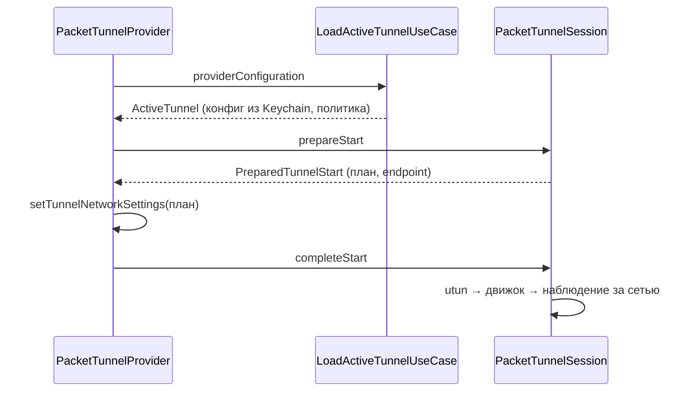

# PacketTunnel

| | |
|---|---|
| Статус | в работе: туннель поднимается на iPhone (M2-14) и в системном расширении macOS (M2-12); на Mac пройдены все пункты M2-14 — в тестовой ВМ (2026-10-31) и на Mac владельца (сон и смена Wi-Fi, 2026-11-01); журнал расширения на iPhone проверен (M2-13); остальные проверки M2-14 — на iPhone и iPad. Режим «Только выбранные сервисы» собран (M5-07), на устройствах проверяется в M5-09 и M5-10 |
| Платформы | shared |
| Задачи | M2-05, M2-06, M2-08, M2-13, M4-08 (`IPv6LeakProtection.applying(to:)`), M5-07 |
| Таргеты | `PacketTunnel`, `PacketTunnelInfrastructure`; провайдер и composition root `Apps/SharedTunnelProvider` — общие для расширения iOS (`Apps/PacketTunnelExtension`) и системного расширения macOS (`Apps/NetworkSystemExtension`) |

## Назначение

Пакетный туннель режимов «Весь трафик» и «Только выбранные сервисы» (iOS, iPadOS). Фича строит сетевые настройки из конфигурации и политики и запускает движок на дескрипторе utun. Она переживает смену сети и сон, отвечает приложению на сообщения и сообщает, почему туннель остановился.

## Зависимости

| Тип | Что | Зачем |
|---|---|---|
| Фичи проекта | `TunnelConfiguration`, `AppRouting`, `TunnelEngine`, `TunnelLibrary`, `ProviderMessaging`, `ServiceCatalog`, `SharedKernel`; в composition root ещё `ServiceCatalogInfrastructure` | конфигурация, политика, движок, секреты, контракт с приложением, каталог сервисов и компилятор плана, сети |
| Системные фреймворки | NetworkExtension, Network, Darwin | настройки туннеля, `NWPathMonitor`, `getaddrinfo` и `getsockopt` |
| Сторонние библиотеки | нет | |

## Принцип работы

1. **План.** `PlanTunnelRoutingUseCase` выбирает план по режиму политики и отдаёт `TunnelRouting`: режим, `TunnelNetworkPlan` и для выбора сервисов — `ServiceRoutingTranslation` для движка ([TunnelEngine](TunnelEngine.md)).
   - «Весь трафик» — `TunnelNetworkPlanner`:
     - адреса и маршруты по семействам — объединение `AllowedIPs` всех пиров и подсетей адресов интерфейса;
     - DNS: `matchDomains = [""]`, без серверов DNS остаётся системным;
     - MTU из конфига или `tunnelOverheadBytes = 80`.
   - «Только выбранные сервисы» — каталог (`LoadServiceCatalogUseCase`: встроенный `catalog.json` и свои сервисы из `Library/Application Support/Splitway/custom-services.json` контейнера App Group), компилятор `ServiceRoutingPlanCompiler` ([ServiceCatalog](ServiceCatalog.md)) и `SelectedServicesNetworkPlanner`:
     - IPv4: адреса интерфейса, маршруты — подсети выбранных сервисов внутри `AllowedIPs` и фиктивная сеть, маршрута по умолчанию нет; без адреса IPv4 — `missingInterfaceAddress(.ipv4)`, потому что виртуальный DNS работает по IPv4;
     - IPv6 — только если есть маршруты IPv6 (подсети сервисов или фиктивная сеть IPv6). Без адреса IPv6 у интерфейса берётся заглушка ULA, и пакеты к подсетям сервисов отбрасываются, а не уходят мимо туннеля;
     - DNS: сервер — виртуальный DNS, `matchDomains` — домены выбранных сервисов, `matchDomainsNoSearch = true`; если доменов нет, DNS не настраивается;
     - MTU — как в «Весь трафик».
   - «Выбранные приложения» — `routingModeNotSupported`: на macOS этот режим обслуживает прозрачный прокси.
   - Каталог не читается — `serviceCatalogUnavailable`.
2. **IPv6 (решение D-30).** `IPv6LeakProtection` добавляет `2000::/3` туннелю, который забирает весь публичный IPv4, но не весь глобальный IPv6. Если у интерфейса нет IPv6, он получает адрес-заглушку ULA `fdc6:3a2b:91e4::1/128`. wireguard-go отбрасывает такие пакеты, потому что их не принимает ни один пир. То же правило `IPv6LeakProtection.applying(to:)` использует план прозрачного прокси (`TransparentProxy`).
3. **Старт сессии.** `PacketTunnelSession` (actor) проходит шаги:
   - `prepareStart`: план и резолвинг всех endpoint;
   - `setTunnelNetworkSettings` выполняет провайдер;
   - `completeStart`: дескриптор utun через `UtunDescriptorLocator`, запуск устройства, для выбора сервисов — `applyServiceRouting` с трансляцией плана, наблюдение за сетью. Если движок отклонил трансляцию, устройство останавливается, а старт завершается ошибкой `engineFailed`.

   `stop()` в любой момент старта прерывает его до запуска устройства (`cancelled`).
4. **Смена сети и сон.** Когда сеть возвращается, сессия заново резолвит endpoint (NAT64 мог измениться), применяет только `public_key` и `endpoint` пиров (`UAPIConfigurationEncoder.endpointUpdate`) и вызывает `bumpSockets`. Пиры не пересоздаются, поэтому их сеансы и рукопожатия сохраняются: монитор сети присылает состояние и сразу после старта, и полная конфигурация с `replace_peers=true` сбрасывала бы пира каждый раз (найдено на iPhone 2026-10-30). Пробуждение тоже вызывает `bumpSockets`.
5. **Резолвинг.** `ResolveTunnelEndpointsUseCase` резолвит endpoint-ы всех пиров: `allEndpoints(of:)` при старте (любая неудача — `EndpointResolutionError`) и `reachableEndpoints(of:)` при смене сети (пиры без ответа пропускаются). Им же пользуется сессия прозрачного прокси (`TransparentProxy`). `SystemEndpointResolver` вызывает `getaddrinfo` с `AI_DEFAULT` на отдельной очереди GCD, чтобы блокирующий вызов не занимал кооперативный пул. iOS синтезирует NAT64-адрес, IPv4 предпочтительнее.
6. **Ответы приложению.** `PacketTunnelMessageHandler` отдаёт статистику и `health(isTunnelRunning:)` и применяет новую политику того же режима без переподключения:
   - провайдер создаёт обработчик на каждое сообщение и передаёт ему себя как порт `NetworkSettingsApplier`;
   - `session.routingChange(to:)` строит план новой политики для той же конфигурации; другой режим — `routingModeChangeNeedsRestart`, и приложение предлагает перезапуск;
   - если изменился план сетевых настроек (маршруты или домены), обработчик применяет его через провайдера (`setTunnelNetworkSettings`), иначе настройки не трогает;
   - `session.complete(_:)` передаёт трансляцию движку и запоминает план. План движка зависит только от конфигурации, поэтому фиктивные адреса сохраняются;
   - если система отклонила настройки, остаётся прежний план, и ответ — `routingPolicyRejected`; у остановленного туннеля — `tunnelNotRunning`.
7. **Причина остановки.** Ошибки старта превращаются в `TunnelStopReason(packetTunnelError:)` и уходят в `cancelTunnelWithError`. Нечитаемый каталог сервисов — `configurationUnavailable`.
8. **Две платформы.** `PacketTunnelProvider` и `PacketTunnelComposition` лежат в `Apps/SharedTunnelProvider` и собираются в оба расширения. Отличается только хранилище секретов: на iOS — `KeychainTunnelSecretStore` с общей группой Keychain, на macOS — `SystemKeychainSecretStore` (фича `SecretDelivery`): системное расширение работает от root и получает конфигурацию по XPC (решение D-33). Песочнице расширения macOS нужны права `com.apple.security.network.client` и `network.server`, иначе wireguard-go не откроет сокет маршрутизации и UDP-сокет.

## Публичный API

`TunnelNetworkPlanner`, `SelectedServicesNetworkPlanner`, `TunnelNetworkPlan`, `TunnelAddressFamilyPlan`, `TunnelDNSPlan`, `TunnelDNSScope`, `TunnelMTU`, `TunnelNetworkPlanError`, `IPv6LeakProtection`, `PlanTunnelRoutingUseCase`, `TunnelRouting`, `TunnelRoutingChange`, `PacketTunnelSession`, `PreparedTunnelStart`, `PacketTunnelError`, `LoadActiveTunnelUseCase`, `ActiveTunnel`, `ResolveTunnelEndpointsUseCase`, `PacketTunnelMessageHandler`, порты `EndpointResolver`, `TunnelInterfaceLocator`, `NetworkPathMonitor`, `NetworkPathStatus`, `NetworkSettingsApplier`; адаптеры `NetworkSettingsMapper`, `SystemEndpointResolver`, `UtunDescriptorLocator`, `NetworkPathObserver`.

## Решения

- Режим выбора приложений даёт `routingModeNotSupported`: на macOS его обслуживает прозрачный прокси.
- Свои сервисы расширение читает из того же файла, куда их пишет приложение: `Library/Application Support/Splitway/custom-services.json` в контейнере App Group.
- Маршруты IPv4 без адреса IPv4 — ошибка плана `missingInterfaceAddress(.ipv4)`, а не непонятный отказ NetworkExtension.
- Последнюю ошибку приложение получает через `fetchLastDisconnectError` (минимальная ОС 26), поэтому файл ошибки в App Group не нужен.
- Журнал расширения и движка пишется в `Library/Logs/Splitway` контейнера App Group. Идентификатор группы задаёт ключ `SplitwayAppGroupIdentifier` в Info.plist.

## Спорные решения

| Решение | Альтернативы | Почему так | Когда пересмотреть |
|---|---|---|---|
| Старт сессии разделён на `prepareStart` и `completeStart`, настройки применяет провайдер | Порт настроек внутри сессии | `NEPacketTunnelProvider` не `Sendable` и не может попасть в домен изоляции actor без `@unchecked Sendable`, а правила это запрещают. Порядок и отмена остались в сессии | Если Apple пометит провайдер как `Sendable` |
| Живую смену политики ведёт обработчик сообщений, а не сессия: порт `NetworkSettingsApplier` реализует сам провайдер | Перезапуск туннеля при каждом новом выборе сервисов | Обработчик и `ProviderMessageDispatcher` работают как `nonisolated(nonsending)` внутри `handleAppMessage`, поэтому провайдер никуда не передаётся, а к сессии уходят только `Sendable` значения. Перезапуск рвал бы все соединения выбранных сервисов | Если Apple пометит провайдер как `Sendable` |
| Настройки сети применяются, только если изменился их план | Применять при каждом новом выборе | `setTunnelNetworkSettings` на время применения прерывает трафик туннеля, а выбор влияет на настройки только маршрутами и доменами: сервис, домены которого уже покрыты, их не меняет | Нет |
| Подсети сервисов IPv6 без адреса IPv6 у туннеля идут в заглушку ULA | Не маршрутизировать их | Иначе IPv6 выбранного сервиса шёл бы мимо туннеля; с отброшенными пакетами приложение уходит на IPv4, как в D-30 | Если сервисы перестанут работать без IPv6 |
| Смена режима на работающем туннеле требует перезапуска | Включать и выключать трансляцию на ходу | Обёртка движка умеет включить план, но не выключить, а смена режима редка | Если понадобится переключать режим из «Команд» |
| Блокировка IPv6 — маршрут `2000::/3`, а не `::/0` | `::/0` | ULA и link-local остаются локальными, принтеры и NAS в сети продолжают работать | Если появятся утечки через не-глобальный IPv6 |
| Пакеты заблокированного IPv6 отбрасываются молча | Ответ ICMPv6 unreachable | Отбрасывание не требует обработки пакетов; адрес ULA отодвигает IPv6 в выборе адреса (RFC 6724), и приложения сразу идут на IPv4 | Если задержки соединений станут заметны |
| `tunnelRemoteAddress = 127.0.0.1` | Endpoint первого пира | У туннеля может быть несколько пиров; адрес для системных настроек задаёт `serverAddress` слота (M2-10) | Нет |
| Симулятор собирается только для arm64 | Слайс ядра x86_64 для симулятора | Xcode 27 работает только на Apple silicon, лишний слайс удлинил бы сборку Go | Нет |

## Отступления от правил разработки

Нет.

## Ограничения и известные проблемы

- Журнал системного расширения macOS пишется в контейнер App Group пользователя root, и экран журнала приложения его пока не показывает; системный журнал (`log show`) видит обе стороны.
- На реальном устройстве проверяются старт, смена Wi-Fi и сотовой сети, NAT64 и журнал в App Group (M2-14).
- Ошибки повторного резолвинга и `bumpSockets` при смене сети пока не пишутся в журнал.
- Выбор сервисов на устройствах ещё не проверен (M5-09, M5-10).
- Системное расширение macOS работает от root и читает свои сервисы из контейнера root, где их нет. На macOS режим выбора сервисов не предлагается (D-01).

## Тесты

- 51 тест в `PacketTunnelTests`:
  - планировщик сетевых настроек (одиннадцать сценариев, включая IPv6 по D-30);
  - план выбора сервисов: подсети и фиктивная сеть без маршрута по умолчанию, только выбранные домены на виртуальный DNS, без доменов DNS не настраивается, IPv6 через адрес туннеля и через заглушку, нет адреса IPv4, MTU;
  - выбор плана по режиму: «Весь трафик» без трансляции, сервисы через фиктивные адреса, выбор приложений отклоняется, нечитаемый каталог;
  - старт с выбором сервисов: трансляция после запуска устройства, «Весь трафик» без неё, отказ движка останавливает устройство;
  - сессия: порядок старта, смена сети с NAT64, пропажа сети, остановка во время старта и между шагами, ошибки резолвинга, utun и движка, пробуждение, статистика, `isRunning`;
  - загрузка активного туннеля;
  - причины остановки;
  - обработчик сообщений: живая смена выбора с новыми настройками, без них, когда маршруты и домены те же, смена режима, остановленный туннель, отказ системы в настройках.
- 9 тестов в `PacketTunnelInfrastructureTests`: поля `NEPacketTunnelNetworkSettings`, включая `matchDomains` выбранных доменов, резолвинг адресных литералов и `localhost` без сети, процесс без utun.

- Живой UI-тест `LiveTunnelTests` на iPhone (`Scripts/live-tunnel-test.sh <устройство>`): подключает импортированный тестовый туннель, сравнивает внешний адрес без туннеля и через него (`api.ipify.org` через эфемерную `URLSession` процесса теста, сами адреса не печатаются) и отключает туннель. Прошёл 2026-10-30 и 2026-10-31 на iPhone 13 Pro. Журнал этой сессии: рукопожатие есть, после старта пир ни разу не пересоздавался.

- Живой UI-тест `LiveServiceRoutingTests` на iPhone (`Scripts/live-tunnel-test.sh <устройство>`) проверяет режим «Только выбранные сервисы» через настоящий интерфейс:
  - дублирует тестовый туннель под именем «Splitway live check», включает все 15 сервисов каталога и свой сервис «Live check» с `api.ipify.org`, `proof.ovh.net` и `o-o.myaddr.l.google.com` и подключается;
  - сравнивает внешний адрес выбранного `api.ipify.org` и невыбранного `icanhazip.com` с туннелем и без него;
  - сравнивает ответ `o-o.myaddr.l.google.com` (TXT с адресом резолвера, который спросил Google): DNS выбранных доменов уходит через туннель;
  - разбирает ответы системного резолвера для основного имени каждого сервиса: только фиктивные IPv4, ни одного настоящего адреса;
  - открывает `NWConnection` к каждому из них и проверяет, что соединение встало на фиктивный адрес, то есть идёт в туннель;
  - смотрит адрес клиента в `/cdn-cgi/trace` ChatGPT и Claude, качает 2 ГиБ через туннель двумя потоками, выключает туннель посреди загрузки и ждёт возврата выбранного домена на прямой путь;
  - в конце удаляет свой сервис и копию туннеля; остатки прерванного прогона убирает следующий.
  Адреса в отчёт не попадают: тест записывает только итоги сравнений, байты и секунды.
- Прогоны на iPhone 13 Pro (iOS 27.2, Wi-Fi с IPv4 и IPv6, туннель только IPv4) 2026-11-01:
  - выбранный домен идёт через туннель, невыбранный — напрямую, DNS выбранных доменов — через туннель;
  - первые прогоны нашли утечку: `open.spotify.com` и `www.linkedin.com` получали настоящие адреса через CNAME на чужие CDN. После исправления в [ServiceRouting](ServiceRouting.md) все 17 имён получают только фиктивные IPv4, и все соединения встают на фиктивные адреса, в том числе у двустековых ChatGPT, Claude, YouTube, Facebook, Instagram, Spotify и LinkedIn;
  - `getaddrinfo` с `AF_INET6` возвращает для фиктивного IPv4 отображённый адрес `::ffff:198.18.x.y`: это свойство системной библиотеки, а не ответ виртуального DNS;
  - 2 ГиБ через туннель — за 80–175 с (100–210 Мбит/с, зависит от прогона);
  - выключение туннеля обрывает загрузку через 1,2 с (`NSURLErrorNetworkConnectionLost`); в одном прогоне соединение не оборвалось и висело до тайм-аута. Первый запрос после выключения идёт напрямую через 0,2 с;
  - прямые соединения при включённом туннеле устанавливаются по IPv4. Прямая загрузка 1 ГБ с `nbg1-speed.hetzner.com` трижды обрывалась через 0,4 с с `-1005`, хотя TCP-соединение к нему открывается, а адрес не входит в подсети сервисов; через расширение такой трафик не идёт, причина не найдена, и прямую загрузку из теста убрали.

Composition root по правилам не тестируется.

## История изменений

| Дата | Изменение | Задача |
|---|---|---|
| 2026-10-29 | План сетевых настроек, блокировка утечек IPv6 | M2-05 |
| 2026-10-29 | Сессия и системные адаптеры | M2-06 |
| 2026-10-29 | Расширение iOS, разделённый старт, загрузка активного туннеля | M2-08 |
| 2026-10-29 | Журнал расширения и движка | M2-13 |
| 2026-10-30 | При смене сети обновляются только endpoint-ы, сеансы пиров сохраняются | M2-06 |
| 2026-10-30 | `IPv6LeakProtection.applying(to:)` для плана прозрачного прокси | M4-08 |
| 2026-10-30 | Общий провайдер для iOS и системного расширения macOS, секреты из System Keychain, права на сеть в песочнице macOS | M2-12 |
| 2026-10-30 | Резолвинг endpoint-ов вынесен в `ResolveTunnelEndpointsUseCase`, общий с прозрачным прокси | M4-11 |
| 2026-10-31 | Живой тест читает внешний адрес через `URLSession`, а не в Safari: возврат из Safari в приложение съедал нажатие на переключатель, а Safari мог показать прежний адрес до загрузки страницы | M2-14 |
| 2026-11-01 | Сон и смена Wi-Fi на Mac владельца: на Mac пройдены все пункты M2-14 | M2-14 |
| 2026-11-01 | Режим «Только выбранные сервисы»: план из каталога, трансляция в движке, живая смена выбора | M5-07 |
| 2026-11-01 | Живой тест режима «Только выбранные сервисы» на iPhone через настоящий интерфейс | M5-10 |
