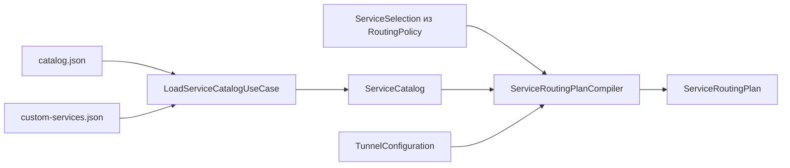

# ServiceCatalog

| | |
|---|---|
| Статус | в работе: домен каталога и своих сервисов (M5-02), компилятор плана (M5-03), встроенный каталог из 15 сервисов (M5-01) и экраны выбора (M5-08) готовы; проверка каждого сервиса на устройстве — M5-10 |
| Платформы | iOS, iPadOS |
| Задачи | M5-01, M5-02, M5-03, M5-08 |
| Таргеты | `ServiceCatalog`, `ServiceCatalogInfrastructure`, `ServiceCatalogPresentation` |

## Назначение

Каталог сервисов для режима «Только выбранные сервисы» (решение D-01): встроенные сервисы (D-15) и свои сервисы пользователя. Компилятор превращает выбор сервисов и конфигурацию туннеля в план маршрутизации: маршруты, домены для `matchDomains`, фиктивные сети и резолверы для движка, а также предупреждения для пользователя. План применяет пакетный туннель ([PacketTunnel](PacketTunnel.md)), трансляцию выполняет движок ([ServiceRouting](ServiceRouting.md)).

## Зависимости

| Тип | Что | Зачем |
|---|---|---|
| Фичи проекта | `AppRouting`, `TunnelConfiguration`, `SharedKernel`; в Presentation ещё `DesignSystemPresentation` | `ServiceIdentifier` и `ServiceSelection`; конфигурация туннеля для компилятора; `DomainName`, `IPNetwork`, `IPNetworkSet`; пустое состояние, вспомогательный цвет, ввод без автоисправлений |
| Системные фреймворки | Foundation (Infrastructure), SwiftUI и Observation (Presentation) | JSON и файлы; экраны |
| Сторонние библиотеки | нет | |

## Принцип работы

### Модель

- `ServiceProfile` — сервис: `ServiceIdentifier`, имя, категория `ServiceCategory` (мессенджеры, соцсети, видео, музыка, ИИ, разработка, свои), иконка `ServiceIcon` (монограмма из одного-двух символов без пробелов и цвет `ServiceTint` в виде `#RRGGBB`, решение D-16), правила `ServiceRules` и `notes` с источниками данных.
- `ServiceRules` — суффиксы доменов и сети. Без единого правила — ошибка `empty`. Суффиксы минимизирует `DomainSuffixSet`: имя, родитель которого тоже есть в наборе, отбрасывается (`t.me` поглощает `a.t.me`). Сети сливает `IPNetworkSet`.
- `CustomService` — свой сервис: идентификатор `custom-<uuid>`, имя и правила. Его `profile` получает категорию `custom`, монограмму из первой буквы имени и нейтральный серый цвет.
- `ServiceCatalog` хранит сервисы без повторов идентификаторов; `services(in:)` отдаёт выбранные в порядке каталога.

### Сценарии

- `LoadServiceCatalogUseCase` читает встроенные сервисы, затем свои.
- `CustomServiceDraft.problems` перечисляет все проблемы черновика, по ним редактор подсвечивает строки на лету:
  - строки доменов и сетей обрезаются, пустые пропускаются;
  - каждая строка разбирается как `DomainName` или `IPNetwork`, иначе `invalidDomain` или `invalidNetwork` с текстом строки;
  - без имени — `emptyName`, без единого правила — `noRules`.
- `SaveCustomServiceUseCase` сохраняет черновик по той же проверке: первая проблема правил — ошибка, новый сервис получает идентификатор, редактируемый заменяется на месте, сбой хранилища — `storageUnavailable`. `CustomServiceDraft(editing:)` строит черновик из сохранённого сервиса.
- `DeleteCustomServiceUseCase` удаляет свой сервис и оставляет остальные.
- `ServiceCatalog.displayNames` — имена сервисов по идентификаторам для деталей туннеля ([TunnelLibrary](TunnelLibrary.md)).
- Выбор хранится в политике туннеля: `RoutingPolicy.replacingServiceSelection(with:)` и `RoutingSectionModel.setServices(_:)` ([AppRouting](AppRouting.md)).

### Компилятор плана

`ServiceRoutingPlanCompiler.compile(selection:catalog:configuration:)` строит `ServiceRoutingPlan`:

- **Маршруты:** сети выбранных сервисов внутри `AllowedIPs` всех пиров и фиктивные сети.
- **Домены для `matchDomains`:** минимизированные суффиксы выбранных сервисов.
- **Фиктивные сети** (`FakeNetworkSelection`):
  - IPv4 — `198.18.0.0/15`; IPv6 — `2001:2::/48`, только если у интерфейса есть адрес IPv6;
  - занятыми считаются адреса интерфейса, DNS из конфигурации и адреса endpoint-ов;
  - если предпочтительная сеть занята, берётся свободная половина, а если заняты обе — предпочтительная, с предупреждением.
- **Виртуальный DNS:** третий адрес фиктивной сети IPv4 (`198.18.0.2`).
- **Резолвер для пересылки:** первый IPv4 DNS из конфигурации, иначе `1.1.1.1`.
- **Предупреждения** (`ServiceRoutingWarning`), по порядку:
  - пустой выбор;
  - сети сервиса вне `AllowedIPs`, с самими сетями;
  - домены выбраны, а `AllowedIPs` без `0.0.0.0/0`: настоящие адреса сервисов могут не попасть на сервер;
  - резолвер для пересылки вне `AllowedIPs`, если выбраны домены: без доменов запросы к нему не идут;
  - конфликт фиктивной сети.

### Хранение

- `BundledServiceCatalogRepository.bundled` читает `Resources/catalog.json` из ресурсов пакета: `{"schemaVersion": 1, "services": […]}`. Поля записи: `id`, `displayName`, `category`, `monogram`, `tint`, `domainSuffixes`, `ipv4Networks`, `ipv6Networks`, `notes`. Неверная запись — `invalidCatalogEntry(id)`; сеть должна быть своего семейства и без битов хоста.
- `FileCustomServiceRepository(directory:)` (actor) хранит свои сервисы в `custom-services.json` (`schemaVersion: 1`). Запись атомарная, с защитой файла `completeUntilFirstUserAuthentication`, чтобы расширение читало его на заблокированном устройстве. Если файла нет, своих сервисов нет. Приложение и пакетный туннель читают один каталог: `Library/Application Support/Splitway` в контейнере App Group.

### Экраны (M5-08)

- `ServicePickerModel` — лист выбора сервисов туннеля:
  - разделы по категориям в постоянном порядке (мессенджеры, соцсети, видео, музыка, ИИ, разработка, свои), внутри — порядок каталога;
  - поиск по имени и по доменам (`localizedStandardContains`);
  - `setSelected(_:id:)` меняет выбор и сразу передаёт его секции маршрутизации редактора;
  - предупреждения: компилятор строит план для конфигурации из редактора, и лист показывает все предупреждения, кроме пустого выбора (о нём говорит секция маршрутизации). Имя сервиса с сетями вне `AllowedIPs` берётся из каталога, а сами сети видны на экране сервиса;
  - свои сервисы: новый сразу выбирается, изменённый заменяется на месте, удалённый пропадает из списка и из выбора;
  - нечитаемый каталог — пустое состояние «Сервисы недоступны».
- `CustomServiceEditorModel` — свой сервис: имя, домены и сети текстом (строки разделяются переводом строки или запятой). Неверные строки показываются под полем сразу, «Сохранить» доступна без проблем, сбой хранилища — предупреждение, и лист не закрывается.
- Представления:
  - `ServicePickerView`: строка «Как это работает и ограничения», предупреждения, разделы с переключателями, поиск, «Добавить сервис»; в контекстном меню и по смахиванию — «Подробнее», а у своих сервисов ещё «Изменить» и «Удалить»;
  - `ServiceDetailView`: иконка, категория, домены, сети, ограничения, для своего сервиса — изменение и удаление;
  - `CustomServiceEditorView` и `ServiceRoutingExplanationView` (раздел 4.5 документа iOS);
  - `ServiceIconView`: монограмма на цвете сервиса, размер растёт с размером шрифта, VoiceOver её не читает.
- Поле названия своего сервиса подписано для VoiceOver явно: метка `TextField` в форме iOS подписью не становится.
- Строки на `en` и `ru` — в `Presentation/Resources/Localizable.xcstrings`. Лист открывает редактор туннеля ([TunnelEditor](TunnelEditor.md)), действия (`ServicePickerActions`) собирает composition root приложения iOS.

### Встроенный каталог (M5-01)

Собран 2026-11-01. Сети взяты только из опубликованных списков, у остальных сервисов — только домены. Источник каждой записи — в её `notes`.

| Сервис | Суффиксы доменов | Сети | Источник сетей |
|---|---|---|---|
| Telegram | `telegram.org`, `t.me`, `telegram.me`, `telegram.dog`, `telesco.pe` | 9 IPv4, 5 IPv6 | `core.telegram.org/resources/cidr.txt` |
| WhatsApp | `whatsapp.com`, `whatsapp.net`, `wa.me` | — | |
| Signal | `signal.org`, `signal.art`, `signal.group`, `signal.link`, `signal.me`, `signal.tube`, `signalcaptchas.org` | — | |
| Instagram | `instagram.com`, `cdninstagram.com`, `ig.me`, `fbcdn.net`, `edge-chat.facebook.com`, `edge-mqtt.facebook.com` | — | |
| Facebook | `facebook.com`, `fbcdn.net`, `fbsbx.com` | — | |
| Threads | `threads.com`, `threads.net`, `cdninstagram.com`, `i.instagram.com`, `edge-chat.facebook.com` | — | |
| YouTube | `youtube.com`, `youtu.be`, `youtube-nocookie.com`, `ytimg.com`, `googlevideo.com`, `youtubei.googleapis.com`, `youtube.googleapis.com`, `yt3.ggpht.com`, `yt3.googleusercontent.com` | — | |
| X | `x.com`, `twitter.com`, `twimg.com`, `t.co`, `pscp.tv` | — | |
| Discord | `discord.com`, `discord.gg`, `discordapp.com`, `discordapp.net`, `discord.media`, `discordsays.com` | — | |
| ChatGPT | `chatgpt.com`, `openai.com`, `oaistatic.com`, `oaiusercontent.com`, `oaistatsig.com` | — | |
| Claude | `claude.ai`, `claude.com`, `anthropic.com`, `claudeusercontent.com`, `claudemcpcontent.com` | 1 IPv4, 1 IPv6 | входящие диапазоны `platform.claude.com/docs/en/api/ip-addresses` |
| Spotify | `spotify.com`, `scdn.co`, `spotifycdn.com` | — | |
| Netflix | `netflix.com`, `nflxvideo.net`, `nflximg.net`, `nflxext.com`, `nflxso.net` | — | |
| LinkedIn | `linkedin.com`, `licdn.com`, `lnkd.in` | — | |
| GitHub | `github.com`, `githubusercontent.com`, `githubassets.com`, `github.dev`, `github.io`, `githubcopilot.com` | 81 IPv4, 2 IPv6 | ключи `web`, `api`, `git` из `api.github.com/meta` |

Домены Telegram, WhatsApp, Signal, Discord, ChatGPT, Claude и GitHub и часть доменов YouTube взяты из документации самих сервисов. Остальные собраны по страницам и клиентам сервисов и помечены в `notes` как неофициальные.

## Публичный API

`ServiceProfile`, `ServiceRules`, `ServiceRulesError`, `ServiceIcon`, `ServiceTint`, `ServiceIconError`, `ServiceCategory`, `ServiceProfileError`, `CustomService`, `CustomServiceDraft`, `CustomServiceError`, `DomainSuffixSet`, `ServiceCatalog`, `ServiceCatalogError`, `ServiceRoutingPlan`, `ServiceRoutingWarning`, `ServiceRoutingPlanCompiler`, `LoadServiceCatalogUseCase`, `SaveCustomServiceUseCase`, `DeleteCustomServiceUseCase`, порты `BundledServiceCatalog` и `CustomServiceRepository`; адаптеры `BundledServiceCatalogRepository`, `FileCustomServiceRepository`; экраны — `ServicePickerModel`, `ServicePickerActions`, `ServicePickerSection`, `ServicePickerRow`, `ServicePickerWarning`, `CustomServiceEditorModel`, `ServicePickerView`.

## Решения

- Правила — суффиксы доменов, а не точные имена: `matchDomains` в iOS сопоставляет запросы по суффиксам.
- Сеть сервиса вне `AllowedIPs` не маршрутизируется: сервер её пакеты не примет. Пользователь видит предупреждение.
- Идентификаторы своих сервисов начинаются с `custom-` и не пересекаются со встроенными.
- Новый свой сервис сразу выбирается: его создают, чтобы направить в туннель.
- Каталог встроен в приложение и меняется с выпуском новой версии. Обновление по сети — бэклог: это был бы сетевой запрос к серверу разработчика (раздел 4.6 документа iOS).

## Спорные решения

| Решение | Альтернативы | Почему так | Когда пересмотреть |
|---|---|---|---|
| Фиктивная сеть IPv6 — `2001:2::/48`, а не ULA, как в первом варианте раздела 4.4 документа iOS | ULA со случайным Global ID (RFC 4193) | Пара к `198.18.0.0/15`: оба блока зарезервированы для тестов производительности (RFC 2544, RFC 5180) и не встречаются ни в интернете, ни в локальных сетях. Префиксы ULA раздают домашние роутеры, и фиктивная сеть могла бы перекрыть адреса локальной сети | Если на устройствах iOS обойдётся с этим блоком иначе, чем с глобальными адресами |
| Голосовые серверы ChatGPT в каталог не входят | Снимок `openai.com/chatgpt-voice.json` (402 адреса Azure) | OpenAI меняет список постоянно: снимок устареет за дни и начнёт отправлять в туннель чужие адреса Azure. Веб и API ChatGPT работают по доменам | Если появится обновление каталога по сети |
| Адреса Azure из `/meta` GitHub входят в каталог | Только собственные сети GitHub | Это официальный список GitHub, и он меняется редко | При каждом обновлении каталога |
| Сервисы Meta делят домены (`fbcdn.net`, `edge-chat.facebook.com`, `cdninstagram.com`) | Только уникальные домены сервиса | Без общих CDN Instagram и Threads не загружают медиа. Выбор Instagram отправляет в туннель и часть трафика Facebook | Нет |
| При полном конфликте остаётся предпочтительная фиктивная сеть | Ошибка компиляции | Пользователь видит предупреждение, а туннель работает для всех адресов, кроме занятых | Если конфликты встретятся на практике |
| Сервис выбирается переключателем, подробности — в контекстном меню и по смахиванию | Строка открывает экран сервиса, выбор — галочкой | Переключатель понятен VoiceOver и выбирает сервис одним нажатием, а экран сервиса нужен редко | Если пользователи не найдут экран сервиса |

## Отступления от правил разработки

Нет.

## Ограничения и известные проблемы

- Сети есть только у Telegram, Claude и GitHub. Остальные сервисы маршрутизируются только по доменам: приложение со своим DNS (DoH, DoT) или с зашитыми адресами пойдёт мимо туннеля (раздел 4.5 документа iOS).
- Звонки WhatsApp, Signal и Discord и голосовой режим ChatGPT идут на адреса, которые приложения получают внутри своего протокола, и мимо туннеля.
- Аудио Spotify раздают узлы Akamai с общим доменом `akamaized.net`, их в каталоге нет: музыка может идти мимо туннеля.
- Netflix может отказать в воспроизведении через адрес VPN.
- `github.io` отправляет в туннель все сайты GitHub Pages.
- Адреса Azure у GitHub со временем меняются, и снимок нужно обновлять.
- Каждый сервис ещё проверяется на устройстве (M5-10), без этого M5-01 не закрыта.

## Тесты

- 35 тестов в `ServiceCatalogTests`: без выбранных доменов нет предупреждения о резолвере; проблемы черновика (все сразу, без правил, без проблем, черновик из сохранённого сервиса), удаление своего сервиса и сбой хранилища, имена сервисов каталога, а также минимизация и порядок суффиксов, совпадение только по суффиксу; правила без пустого набора и со слиянием сетей; цвет и монограмма иконки; загрузка каталога (встроенные перед своими, выбранные в порядке каталога); сохранение своего сервиса (верные правила, пустое имя, неверные домен и сеть, без правил, замена редактируемого); компилятор (маршруты и фиктивная сеть, часть внутри `AllowedIPs` с предупреждением, только самые короткие домены выбранных сервисов, IPv6 только при адресе IPv6, сдвиг фиктивной сети от адресов туннеля, виртуальный DNS внутри фиктивной сети, первый IPv4 DNS туннеля, предупреждения о пустом выборе и о резолвере вне `AllowedIPs`, один план при любом порядке выбора).
- 13 тестов в `ServiceCatalogPresentationTests`: разделы по категориям в порядке каталога, поиск по имени и домену, выбор и снятие с передачей каждого изменения, предупреждения для конфигурации туннеля, новый свой сервис выбран, изменённый заменён на месте, удалённый пропал из выбора, нечитаемый каталог; редактор: нужны имя и правило, неверные строки доменов и сетей, сохранение, тот же идентификатор при изменении, сбой хранилища.
- На iPhone 13 Pro живой тест `LiveServiceRoutingTests` ([PacketTunnel](PacketTunnel.md)) включает все 15 сервисов каталога: основное имя каждого получает фиктивный адрес, соединение с ним идёт через туннель, ChatGPT и Claude видят адрес сервера VPN (2026-11-01). Работа самих приложений сервисов через туннель не проверялась.
- UI-тест `ServicePickerTests` на симуляторе iPhone (прошёл 2026-11-01): новый туннель, режим «Выбранные сервисы», поиск и выбор Telegram, свой сервис с доменом, «2 сервиса выбрано», сохранение и оба сервиса в деталях туннеля; лист выбора и редактор своего сервиса проходят аудит доступности.
- 9 тестов в `ServiceCatalogInfrastructureTests`: все поля записи каталога, запись с неверным доменом называется по `id`, нет каталога, чужая версия схемы; 15 стартовых сервисов по порядку, у каждого есть домены и источник; свои сервисы читаются после записи, нечитаемый документ, пустой список до первой записи.
- `ServiceCatalogTestSupport`: `ServiceCatalogFixtures`, `FixedBundledServiceCatalog`, `InMemoryCustomServiceRepository`, `UnavailableCustomServiceRepository`.

Запуск: `swift test --package-path Packages/SplitwayKit --filter ServiceCatalog`.

## История изменений

| Дата | Изменение | Задача |
|---|---|---|
| 2026-11-01 | Модель сервисов и своих правил, чтение встроенного каталога и хранение своих сервисов | M5-02 |
| 2026-11-01 | Компилятор плана маршрутизации | M5-03 |
| 2026-11-01 | Встроенный каталог из 15 сервисов | M5-01 |
| 2026-11-01 | Лист выбора сервисов, свои сервисы, экран сервиса и экран ограничений, имена сервисов для деталей туннеля | M5-08 |
| 2026-11-01 | Все 15 сервисов каталога проверены на iPhone живым тестом | M5-01 |
