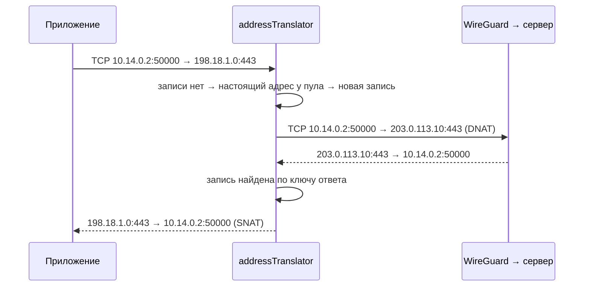

# ServiceRouting

| | |
|---|---|
| Статус | в работе: разбор пакетов, контрольные суммы и трансляция адресов с таблицей соединений готовы (M5-04); пул фиктивных адресов, перехват DNS и обёртка устройства — M5-05 |
| Платформы | iOS, iPadOS |
| Задачи | M5-04 |
| Таргеты | Go-пакет `servicerouting` (`Packages/TunnelCore/go/servicerouting`) |

## Назначение

Режим «Только выбранные сервисы» на iOS и iPadOS (решение D-01, ADR-02). Пакеты к фиктивным адресам выбранных доменов уходят в туннель с настоящим адресом назначения. Ответы возвращаются приложению от того фиктивного адреса, к которому оно подключалось. Схема проверена прототипом [SP-4](spikes/SP-4.md).

## Зависимости

| Тип | Что | Зачем |
|---|---|---|
| Пакеты и фичи проекта | нет; пул, `fdtunnel` и мост подключатся в M5-05 и M5-06 | |
| Системные фреймворки | нет | |
| Сторонние библиотеки | нет, только стандартная библиотека Go (`net/netip`, `encoding/binary`, `sync`) | |

## Принцип работы

- `layoutOf` → `packetLayout` разбирает IPv4 (с опциями) и IPv6 до TCP или UDP без аллокаций. Цепочка расширений IPv6 — hop-by-hop, routing, destination options, fragment и AH, не больше 8 заголовков. Конец IP-пакета берётся из поля длины, данные за ним не читаются. Порты есть, только если заголовок TCP или UDP целиком внутри пакета и пакет — не более поздний фрагмент.
- `replaceAddress` подменяет адрес и пересчитывает контрольные суммы инкрементально (RFC 1624): заголовок IPv4 и TCP или UDP вместе с псевдозаголовком. Отсутствующая сумма UDP в IPv4 (ноль) остаётся нулём, вычисленный ноль уходит как `0xFFFF`.
- `connectionTable` — таблица соединений фиксированной ёмкости, по умолчанию 4096 записей. Записи лежат в заранее выделенном массиве, свободные места — в стеке. Два индекса: ключ исходящего пакета (протокол, локальный адрес и порт, фиктивный адрес и порт) и ключ ответа (протокол, локальный адрес и порт, настоящий адрес и порт). На каждый класс времени жизни — свой список давности.
- `connection` помнит, был ли ответ, FIN с каждой стороны и RST, и по этому выбирает класс.
- `addressTranslator.outbound` (DNAT) и `inbound` (SNAT) работают под одним мьютексом. Настоящий адрес по фиктивному даёт порт `fakeAddressSource`, его реализует пул из M5-05.

Правила:

- Исходящий пакет к адресу вне фиктивных сетей проходит без изменений. К фиктивному адресу без портов (более поздний фрагмент, ICMP, другой протокол) или к адресу, которого пул не знает, — отбрасывается.
- Открытое соединение держит свой настоящий адрес, даже если пул уже сопоставил фиктивному адресу другой.
- Ответ, для которого нет записи, проходит без изменений. Так работают соединения к тем же настоящим адресам по подсетям из каталога: прототип SP-4 без таблицы такие ответы портил.
- Новое соединение, которое совпало бы на проводе с открытым (тот же локальный порт, тот же настоящий адрес и порт, другой фиктивный адрес), отбрасывается, пока открытое живо.

| Класс | Когда | Время жизни без пакетов | Источник |
|---|---|---|---|
| TCP переходное | до первого ответа, после FIN с обеих сторон или после RST | 4 мин | RFC 5382, REQ-5 |
| TCP установленное | после первого ответа | 2 ч 4 мин | RFC 5382, REQ-5 |
| UDP | всегда | 5 мин | RFC 4787, REQ-5 |

Просроченная запись удаляется, когда её находит поиск. Перед открытием соединения удаляются все просроченные записи с конца каждого списка давности. Если места всё равно нет, вытесняется самая давняя запись из всех списков. Новый SYN по закрытому соединению начинает его заново.

## Публичный API

Пока нет: обёртка устройства и мост появятся в M5-05 и M5-06.

## Решения

- Таблица и списки давности построены на индексах в массиве, без указателей. Ни пакет, ни новое соединение не выделяют память, и память ограничена ёмкостью.
- Время берётся из `clock func() time.Time` как монотонное смещение от старта транслятора, в тестах — ручные часы.
- Время жизни взято из RFC 5382 и RFC 4787: если NAT забудет простаивающее соединение раньше, чем ждут приложения, соединение порвётся.
- Пул запрашивается под мьютексом транслятора. Порядок блокировок — транслятор, затем пул, поэтому пул не должен обращаться к транслятору под своей блокировкой.

## Спорные решения

| Решение | Альтернативы | Почему так | Когда пересмотреть |
|---|---|---|---|
| Один мьютекс на транслятор | шардирование таблицы; отдельные блокировки по направлениям | wireguard-go пишет и читает устройство по одной горутине на направление, блокировка без конкуренции стоит десятки наносекунд | если профиль M5-09 покажет ожидание мьютекса |
| Соединение, которое столкнулось бы на проводе, отбрасывается, исходный порт не переписывается | трансляция исходного порта (полный NAPT) | XNU не отдаёт один эфемерный порт двум соединениям, столкновение почти невозможно, а NAPT усложняет таблицу | если столкновения появятся на устройствах |
| Более поздние фрагменты к фиктивным адресам отбрасываются | таблица фрагментов по идентификатору | TCP и QUIC ставят DF, фрагменты к выбранным сервисам почти не встречаются | если найдётся сервис с фрагментированным UDP |
| ICMP не транслируется | трансляция ICMP echo и ошибок со вложенным заголовком | ping фиктивных адресов не нужен, сегменты и так ограничены MTU интерфейса туннеля | если через сервер перестанет работать Path MTU Discovery |

## Отступления от правил разработки

Нет. Горячий путь покрыт бенчмарками с базовой линией `servicerouting/testdata/benchmark-baseline.txt`, проверка — `Scripts/check.sh --bench`. На Mac (Apple M4 Pro) сегмент TCP 1400 байт стоит 74 нс в исходящую сторону и 73 нс во входящую, IPv6 — 80 нс; из них 12,5 нс — копирование пакета в самом бенчмарке. Новое соединение в полной таблице — 277 нс. Аллокаций нет. Прототип SP-4 без таблицы тратил около 22 нс на пакет, таблица добавляет около 40 нс.

## Ограничения и известные проблемы

- Более поздние фрагменты к фиктивным адресам отбрасываются, входящие проходят без подмены, и система их не соберёт.
- ICMP к фиктивным адресам отбрасывается, ICMP-ошибки от настоящих адресов не транслируются.
- Соединение, которое столкнулось бы на проводе с открытым, отбрасывается, пока открытое живо.
- Больше 4096 соединений: вытесняется самое давнее, его ответы перестают транслироваться.
- Таблица живёт в памяти: после перезапуска расширения открытые соединения к фиктивным адресам рвутся.

## Тесты

- `packet_layout_test.go`: IPv4 с опциями и без, IPv6 с цепочкой расширений и с первым фрагментом; адреса, порты и флаги TCP; более поздние фрагменты; отказ на повреждённых заголовках; неполные заголовки TCP и UDP; слишком длинная цепочка расширений; данные после конца IP-пакета.
- `checksum_test.go`: после подмены адреса контрольные суммы совпадают с полным пересчётом отдельной эталонной реализацией (IPv4 и IPv6, TCP и UDP, нагрузка 0–1400 байт чётной и нечётной длины, адрес источника и назначения). Плюс заголовок IPv4 с опциями, отсутствующая сумма UDP, вычисленный ноль UDP (перебор всех 65 536 значений двухбайтовой нагрузки) и поздний фрагмент.
- `address_translator_test.go`: DNAT и SNAT; два фиктивных адреса одного настоящего; ответы без записи; неизвестный фиктивный адрес; пакеты вне фиктивных сетей; пакеты без портов; IPv6; настоящий адрес открытого соединения не меняется; столкновение на проводе; время жизни каждого класса (за секунду до и через секунду после); вытеснение самого давнего; оба направления одновременно (имеет смысл с `-race`).
- `fuzz_test.go`: разбор не выходит за границы пакета; трансляция не паникует и не портит контрольные суммы правильного пакета. Без `-fuzz` прогоняются только начальные примеры.
- `benchmark_test.go`: стоимость пакета и нового соединения.

Запуск в `Packages/TunnelCore/go`: `go test ./servicerouting/`, гонки — `go test -race ./servicerouting/`, fuzz — `go test -run '^$' -fuzz FuzzTranslatorKeepsValidChecksumsValid ./servicerouting/`. Бенчмарки — `Scripts/benchmark.sh`.

## История изменений

| Дата | Изменение | Задача |
|---|---|---|
| 2026-10-31 | Разбор пакетов, инкрементальные контрольные суммы, таблица соединений и трансляция адресов | M5-04 |
