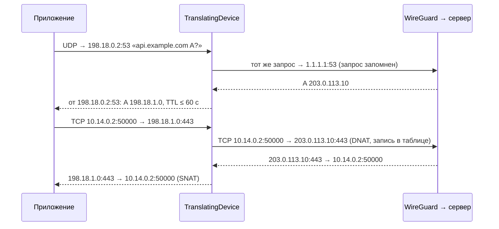

# ServiceRouting

| | |
|---|---|
| Статус | в работе: Go-пакет `servicerouting` готов — разбор пакетов, трансляция адресов с таблицей соединений (M5-04), пул фиктивных адресов, перехват DNS и обёртка устройства (M5-05), план в JSON и смена плана на работающем устройстве (M5-06); подключение в пакетном туннеле — M5-07 |
| Платформы | iOS, iPadOS |
| Задачи | M5-04, M5-05, M5-06 |
| Таргеты | Go-пакет `servicerouting` (`Packages/TunnelCore/go/servicerouting`) |

## Назначение

Режим «Только выбранные сервисы» на iOS и iPadOS (решение D-01, ADR-02). Система отправляет в туннель DNS-запросы выбранных доменов (`matchDomains`) на виртуальный DNS. Пакет пересылает их резолверу через туннель и отвечает фиктивными адресами из служебной подсети. Пакеты к фиктивным адресам уходят в туннель с настоящим адресом назначения, а ответы возвращаются приложению от того фиктивного адреса, к которому оно подключалось. Схема проверена прототипом [SP-4](spikes/SP-4.md).

## Зависимости

| Тип | Что | Зачем |
|---|---|---|
| Пакеты и фичи проекта | нет; пакетом пользуются `fdtunnel` (обёртка на каждом устройстве utun) и мост (`tc_fd_tunnel_set_service_routing`, [TunnelEngine](TunnelEngine.md)) | |
| Системные фреймворки | нет | |
| Сторонние библиотеки | wireguard-go `tun` и `tun/tuntest` (MIT); `golang.org/x/net/dns/dnsmessage` (BSD-3-Clause) | интерфейс устройства и его тестовая реализация; разбор и сборка DNS-сообщений |

## Принцип работы



`TranslatingDevice` оборачивает `tun.Device` для wireguard-go. В `Read` каждый пакет системы проходит через `serviceRouter.outbound`: запрос к виртуальному DNS — перехватчику, остальное — транслятору; отброшенному пакету ставится размер 0, и wireguard-go его пропускает. В `Write` каждый пакет от сервера проходит через `serviceRouter.inbound`: ответ резолвера на наш запрос заменяется переписанным, отброшенный пакет убирается из пачки, остальное транслятор подменяет на месте.

### План и его смена

- `fdtunnel` ставит обёртку на каждое устройство utun, в том числе в режиме «Весь трафик». Пока плана нет, `Read` и `Write` пропускают пакеты без изменений.
- `Apply(plan)` сначала проверяет план. Неверный план — ошибка, и прежний план продолжает работать. Тот же план (`Plan` сравнивается целиком) оставляет пул, таблицу соединений и запомненные запросы. Другой план создаёт новый `serviceRouter`, и пакеты к фиктивным адресам прежнего плана отбрасываются, пока приложение не спросит DNS снова.
- Текущий `serviceRouter` лежит в `atomic.Pointer`: пачка пакетов берёт его один раз, без блокировки, а смены плана упорядочены мьютексом.
- `DecodePlan` разбирает план, который присылает Swift (`ServiceRoutingTranslationEncoder`, [TunnelEngine](TunnelEngine.md)):

  ```json
  {"fakeIPv4Network":"198.18.0.0/15","fakeIPv6Network":"2001:2::/48","upstreamResolver":"10.64.0.1","version":1,"virtualResolver":"198.18.0.2"}
  ```

  Сначала читается только `version`: другая версия или её отсутствие — `ErrUnsupportedPlanVersion`, даже если в документе есть незнакомые поля. Затем документ разбирается строго: неизвестное поле, неверный адрес или сеть — `ErrMalformedPlan`. Без `fakeIPv6Network` план работает только с IPv4. Значения проверяет `Apply`. Swift и Go проверяют один и тот же файл: `testdata/plan.json` и `testdata/plan-without-ipv6.json`.

### Разбор пакетов и контрольные суммы

- `layoutOf` → `packetLayout` разбирает IPv4 (с опциями) и IPv6 до TCP или UDP без аллокаций. Цепочка расширений IPv6 — hop-by-hop, routing, destination options, fragment и AH, не больше 8 заголовков. Конец IP-пакета берётся из поля длины, данные за ним не читаются. Порты есть, только если заголовок TCP или UDP целиком внутри пакета и пакет — не более поздний фрагмент.
- `replaceAddress` подменяет адрес и пересчитывает контрольные суммы инкрементально (RFC 1624): заголовок IPv4 и TCP или UDP вместе с псевдозаголовком. Отсутствующая сумма UDP в IPv4 (ноль) остаётся нулём, вычисленный ноль уходит как `0xFFFF`. Переписанный ответ DNS меняет длину, поэтому его суммы `refreshChecksums` считает заново.

### Трансляция адресов

- `connectionTable` — таблица соединений фиксированной ёмкости, по умолчанию 4096 записей. Записи лежат в заранее выделенном массиве, свободные места — в стеке. Два индекса: ключ исходящего пакета (протокол, локальный адрес и порт, фиктивный адрес и порт) и ключ ответа (протокол, локальный адрес и порт, настоящий адрес и порт). На каждый класс времени жизни — свой список давности. О каждом открытом и удалённом соединении таблица сообщает пулу (`connectionObserver`).
- `addressTranslator.translateOutbound` (DNAT) и `translateInbound` (SNAT) работают под одним мьютексом.
- Исходящий пакет к адресу вне фиктивных сетей проходит без изменений. К фиктивному адресу без портов (более поздний фрагмент, ICMP, другой протокол) или к адресу, которого пул не знает, — отбрасывается.
- Открытое соединение держит свой настоящий адрес, даже если пул уже сопоставил фиктивному адресу другой.
- Ответ, для которого нет записи, проходит без изменений. Так работают соединения к тем же настоящим адресам по подсетям из каталога: прототип SP-4 без таблицы такие ответы портил.
- Новое соединение, которое совпало бы на проводе с открытым (тот же локальный порт, тот же настоящий адрес и порт, другой фиктивный адрес), отбрасывается, пока открытое живо.

| Класс | Когда | Время жизни без пакетов | Источник |
|---|---|---|---|
| TCP переходное | до первого ответа, после FIN с обеих сторон или после RST | 4 мин | RFC 5382, REQ-5 |
| TCP установленное | после первого ответа | 2 ч 4 мин | RFC 5382, REQ-5 |
| UDP | всегда | 5 мин | RFC 4787, REQ-5 |

Просроченная запись удаляется, когда её находит поиск. Перед открытием соединения удаляются все просроченные записи с конца каждого списка давности. Если места всё равно нет, вытесняется самая давняя запись из всех списков. Новый SYN по закрытому соединению начинает его заново.

### Пул фиктивных адресов

- `fakeAddressPool` выдаёт один фиктивный адрес на имя (без учёта регистра) и семейство адресов. Адрес ведёт к настоящему адресу из последнего ответа на это имя. IPv4 берётся из сети плана (по умолчанию `198.18.0.0/15`), IPv6 — из сети IPv6 плана (по умолчанию `2001:2::/48`), если она есть.
- Первые 256 адресов каждой сети зарезервированы: среди них виртуальный DNS. Остальные выдаются по кругу, начиная с `.1.0`: освобождённый адрес снова выдаётся только после полного круга.
- Не больше 8192 имён на семейство. Когда места нет, пул забывает имя с самым давним ответом, у которого нет открытых соединений и последний ответ старше 10 минут. Если такого нет, адрес не выдаётся.

### Перехват DNS

- `dnsInterceptor` пересылает UDP-запрос к виртуальному DNS на резолвер для пересылки (`UpstreamDNS`) и запоминает его по клиенту (адрес и порт) и идентификатору: не больше 512 запросов, ждём ответ 10 с. Запрос по TCP или не на порт 53 отбрасывается.
- Переписывается только ответ резолвера на запомненный запрос; чужой ответ проходит без изменений. Датаграмма от резолвера без целого заголовка UDP или с сообщением короче заголовка DNS отбрасывается.
- `rewriteDNSResponse`:
  - записи A и AAAA заменяются одной записью с фиктивным адресом имени из вопроса, в конце цепочки CNAME; остальные адреса ответа отбрасываются;
  - AAAA без сети IPv6 в плане удаляются, ответ остаётся успешным, и приложение уходит на IPv4;
  - записи HTTPS (65) и SVCB (64) удаляются: в подсказках `ipv4hint` и `ipv6hint` настоящие адреса;
  - остальные записи ответа (CNAME, TXT, MX, SRV…) остаются, TTL всех записей — не больше 60 с;
  - из раздела authority остаются SOA и NS, раздел additional (адреса glue и EDNS) не копируется;
  - если пул не выдал адрес, ответ — `SERVFAIL` без записей: настоящий адрес до приложения не доходит.

## Публичный API

| Тип | Что делает |
|---|---|
| `Plan` | виртуальный DNS (IPv4, среди зарезервированных адресов сети IPv4), резолвер для пересылки (IPv4 вне фиктивной сети), фиктивные сети IPv4 и IPv6 (IPv6 необязательна, в каждой больше 256 адресов, без битов хоста) |
| `NewTranslatingDevice(device)` | оборачивает устройство; до первого плана пакеты проходят без изменений |
| `TranslatingDevice` | `tun.Device` с переопределёнными `Read` и `Write`; `Apply(plan)` включает или меняет план, неверный план — ошибка `errInvalidPlan` с причиной |
| `DecodePlan(document)` | план из JSON версии 1; ошибки `ErrUnsupportedPlanVersion` и `ErrMalformedPlan` |

## Решения

- Таблица и списки давности построены на индексах в массиве, без указателей. Ни пакет, ни новое соединение не выделяют память, и память ограничена ёмкостью. Пул и перехватчик выделяют память только на ответ DNS и новое имя.
- Время берётся из `clock func() time.Time` как монотонное смещение от старта, в тестах — ручные часы.
- Время жизни соединений взято из RFC 5382 и RFC 4787: если NAT забудет простаивающее соединение раньше, чем ждут приложения, соединение порвётся.
- Порядок блокировок — транслятор, затем пул: транслятор спрашивает настоящий адрес и сообщает об открытии и закрытии соединений под своим мьютексом, а пул и перехватчик никогда не обращаются к транслятору.
- Фиктивный адрес — на имя, а не на настоящий адрес: приложение с закэшированным фиктивным адресом продолжает работать, когда CDN отдаёт имени новый адрес.
- Фиктивные адреса после перезапуска расширения не сохраняются (вопрос из SP-4). После перезапуска пул пуст, и пакеты к старым фиктивным адресам отбрасываются, пока приложение не спросит DNS снова: системный резолвер делает это не позже чем через 60 с (TTL ответа). Сохранение потребовало бы записи в файл из расширения на каждый новый ответ и проверки устаревшего состояния при старте.

## Спорные решения

| Решение | Альтернативы | Почему так | Когда пересмотреть |
|---|---|---|---|
| Один мьютекс на транслятор | шардирование таблицы; отдельные блокировки по направлениям | wireguard-go пишет и читает устройство по одной горутине на направление, блокировка без конкуренции стоит десятки наносекунд | если профиль M5-09 покажет ожидание мьютекса |
| Соединение, которое столкнулось бы на проводе, отбрасывается, исходный порт не переписывается | трансляция исходного порта (полный NAPT) | XNU не отдаёт один эфемерный порт двум соединениям, столкновение почти невозможно, а NAPT усложняет таблицу | если столкновения появятся на устройствах |
| Более поздние фрагменты к фиктивным адресам отбрасываются | таблица фрагментов по идентификатору | TCP и QUIC ставят DF, фрагменты к выбранным сервисам почти не встречаются | если найдётся сервис с фрагментированным UDP |
| ICMP не транслируется | трансляция ICMP echo и ошибок со вложенным заголовком | ping фиктивных адресов не нужен, сегменты и так ограничены MTU интерфейса туннеля | если через сервер перестанет работать Path MTU Discovery |
| Один фиктивный адрес на имя и семейство | по адресу на каждую запись A | имени нужен устойчивый адрес, а пул остаётся маленьким; приложение не может само перейти на другой адрес сервиса | если сервис с несколькими адресами окажется недоступен из-за одного мёртвого адреса |
| Полный пул отвечает `SERVFAIL` | отдать настоящий адрес; вытеснить имя с открытыми соединениями | настоящий адрес увёл бы трафик мимо туннеля, а вытеснение сломало бы открытые соединения | если 8192 имён за 10 минут перестанет хватать |
| Пул ищет имя для вытеснения перебором | список давности, как у таблицы | перебор нужен, только когда занято 8192 имени, и стоит микросекунды на один ответ DNS | если профиль покажет перебор |
| Фиктивные адреса не сохраняются после перезапуска расширения | файл в контейнере App Group | перезапуски редки, ответы DNS живут 60 с | если на устройствах перезапуски окажутся частыми |
| Другой план начинает пул и таблицу заново | переносить имена и соединения в новый пул | план зависит только от конфигурации туннеля: выбор сервисов меняет маршруты и `matchDomains`, а план остаётся тем же и пул сохраняется | если план начнёт меняться без смены конфигурации |
| Обёртка стоит на каждом устройстве utun, план приходит отдельно | ставить обёртку, только если план передан при старте | без плана обёртка стоит одно атомарное чтение на пачку пакетов, а план можно заменить на работающем устройстве | если бенчмарк режима «Весь трафик» покажет разницу |
| Документ с другой версией отклоняется целиком | разбирать знакомые поля новой версии | Swift и Go собираются из одного репозитория, и расхождение версий — ошибка сборки, а не совместимость | если ядро начнут обновлять отдельно от приложения |

## Отступления от правил разработки

Нет. Горячий путь покрыт бенчмарками с базовой линией `servicerouting/testdata/benchmark-baseline.txt`, проверка — `Scripts/check.sh --bench`. На Mac (Apple M4 Pro) сегмент TCP 1400 байт стоит 77 нс в исходящую сторону и 78 нс во входящую, IPv6 — 88 нс; из них 12,8 нс — копирование пакета в самом бенчмарке. Новое соединение в полной таблице — 310 нс, из них около 30 нс — сообщения пулу об открытии и закрытии соединений (M5-05). Аллокаций нет. Прототип SP-4 без таблицы тратил около 22 нс на пакет.

## Ограничения и известные проблемы

- Более поздние фрагменты к фиктивным адресам отбрасываются, входящие проходят без подмены, и система их не соберёт.
- ICMP к фиктивным адресам отбрасывается, ICMP-ошибки от настоящих адресов не транслируются.
- Соединение, которое столкнулось бы на проводе с открытым, отбрасывается, пока открытое живо.
- Больше 4096 соединений: вытесняется самое давнее, его ответы перестают транслироваться.
- DNS по TCP не перехватывается. Усечённый ответ (флаг TC) уходит как есть, повтор по TCP не сработает.
- Виртуальный DNS и резолвер для пересылки — только IPv4.
- Фиктивный адрес ведёт к первому адресу последнего ответа: если этот адрес сервиса не отвечает, приложение не перейдёт на другой.
- После перезапуска расширения таблица и пул пусты: открытые соединения к фиктивным адресам рвутся, а старые фиктивные адреса не работают, пока приложение не спросит DNS снова.

## Тесты

- `packet_layout_test.go`: IPv4 с опциями и без, IPv6 с цепочкой расширений и с первым фрагментом; адреса, порты и флаги TCP; более поздние фрагменты; отказ на повреждённых заголовках; неполные заголовки TCP и UDP; слишком длинная цепочка расширений; данные после конца IP-пакета.
- `checksum_test.go`: после подмены адреса контрольные суммы совпадают с полным пересчётом отдельной эталонной реализацией (IPv4 и IPv6, TCP и UDP, нагрузка 0–1400 байт чётной и нечётной длины, адрес источника и назначения). Плюс заголовок IPv4 с опциями, отсутствующая сумма UDP, вычисленный ноль UDP (перебор всех 65 536 значений двухбайтовой нагрузки) и поздний фрагмент.
- `address_translator_test.go`: DNAT и SNAT; два фиктивных адреса одного настоящего; ответы без записи; неизвестный фиктивный адрес; пакеты вне фиктивных сетей; пакеты без портов; IPv6; настоящий адрес открытого соединения не меняется; столкновение на проводе; время жизни каждого класса (за секунду до и через секунду после); вытеснение самого давнего; сообщения пулу об открытии и закрытии; оба направления одновременно (имеет смысл с `-race`).
- `fake_address_pool_test.go`: один адрес на имя, регистр имени, последний ответ, первые адреса после зарезервированных, нет IPv6 без сети IPv6, неизвестный адрес, вытеснение самого давнего имени, освобождённый адрес не выдаётся сразу, круг по маленькой сети, удержание при открытых соединениях и после недавнего ответа, раздельные семейства.
- `dns_response_rewriter_test.go`: фиктивный адрес имени из вопроса; цепочка CNAME с одним адресом в конце; AAAA без IPv6 и с IPv6; удаление HTTPS и SVCB; записи без адресов остаются; раздел additional удаляется; `SERVFAIL` при полном пуле; отказ на запросе и обрезанном сообщении.
- `translating_device_test.go`: сквозной тест на `tuntest` — запрос к виртуальному DNS, ответ с фиктивным адресом, TCP SYN к нему с DNAT и SYN-ACK с SNAT. Плюс отбрасывание запросов по TCP, трафика к неизвестному фиктивному адресу и датаграммы, обрезанной внутри заголовка UDP; чужой и опоздавший ответы остаются без изменений; проверка плана, включая сети с битами хоста. Смена плана: до первого плана пакеты проходят без изменений; тот же план сохраняет фиктивные адреса, другой их забывает, неверный план оставляет прежний.
- `plan_document_test.go`: обе фикстуры Swift разбираются в ожидаемый и верный план; другая версия, новая версия с незнакомыми полями и документ без версии — `ErrUnsupportedPlanVersion`; не JSON, версия строкой, неизвестное поле, неверные адрес и сеть — `ErrMalformedPlan`.
- `fuzz_test.go` и `dns_fuzz_test.go`: разбор не выходит за границы пакета; трансляция не паникует и не портит контрольные суммы правильного пакета; переписывание любого сообщения не паникует и даёт разбираемое сообщение; перехват любого ответа даёт пакет от виртуального DNS с верными суммами. Без `-fuzz` прогоняются только начальные примеры.
- `benchmark_test.go`: стоимость пакета и нового соединения.

Запуск в `Packages/TunnelCore/go`: `go test ./servicerouting/`, гонки — `go test -race ./servicerouting/`, fuzz — `go test -run '^$' -fuzz <имя> ./servicerouting/` для каждой функции `Fuzz…`. Бенчмарки — `Scripts/benchmark.sh`.

## История изменений

| Дата | Изменение | Задача |
|---|---|---|
| 2026-10-31 | Разбор пакетов, инкрементальные контрольные суммы, таблица соединений и трансляция адресов | M5-04 |
| 2026-10-31 | Пул фиктивных адресов, перехват DNS, обёртка устройства для wireguard-go; таблица сообщает пулу об открытых соединениях | M5-05 |
| 2026-11-01 | План в JSON с версией, обёртка на каждом устройстве utun, смена плана на работающем устройстве | M5-06 |
