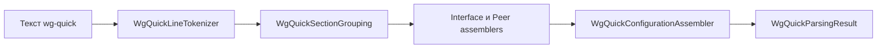

# TunnelConfiguration

| | |
|---|---|
| Статус | завершена (M1) |
| Платформы | shared |
| Задачи | M1-04, M1-05, M1-06, M1-07, M1-08, M1-09 |
| Таргеты | `TunnelConfiguration`, `TunnelConfigurationTestSupport` |

## Назначение

Модель конфигурации WireGuard (интерфейс, пиры, ключи) с инвариантами, разбор формата wg-quick с понятными проблемами по строкам, каноничная запись обратно в текст и режим «Исключить локальные сети».

## Зависимости

| Тип | Что | Зачем |
|---|---|---|
| Фичи проекта | `SharedKernel` | адреса, сети, порты, домены, строгие числа |
| Системные фреймворки | CryptoKit, Foundation | Curve25519 для публичного ключа и генерации ключей; base64 |
| Сторонние библиотеки | нет | |

## Принцип работы

1. `WgQuickLineTokenizer` разбивает текст (CRLF, BOM) на заголовки секций, пары «ключ = значение», комментарии `#` и пустые строки. Текст больше 64 КБ сразу даёт проблему `configurationTooLarge`.
2. `WgQuickSectionGrouping` собирает секции и отмечает ключи вне секций и неизвестные секции. Ключи и секции сравниваются без учёта регистра.
3. `WgQuickInterfaceAssembler` и `WgQuickPeerAssembler` читают значения через `WgQuickSectionValues`: `first` для одиночных ключей и `all` для многозначных (`Address`, `DNS`, `AllowedIPs` через запятую и повтором). Значения превращаются в value objects, каждая ошибка становится `ConfigurationIssue` с номером строки.
4. `WgQuickConfigurationAssembler` создаёт агрегат `TunnelConfiguration` (ровно один интерфейс, уникальные публичные ключи пиров) и добавляет предупреждения модели: нет пиров, у интерфейса нет адресов, пир с ключом интерфейса, пир без `AllowedIPs`.
5. `WgQuickParsingResult` содержит конфигурацию (только если нет ошибок) и все проблемы, отсортированные по строкам.

Ключи wg-quick (`PreUp`, `PostUp`, `PreDown`, `PostDown`, `Table`, `SaveConfig`, `FwMark`) дают предупреждение «не поддерживается, будет проигнорировано». Ключи AmneziaWG (`Jc`, `Jmin`, `Jmax`, `S1`, `S2`, `H1`…`H4`) — ошибку. Неизвестный ключ — тоже ошибка.

Остальные типы:

- **Ключи.** `WireGuardKey` — 32 байта с каноничным base64 и hex. `PrivateKey` вычисляет `PublicKey` через CryptoKit при создании. У `PrivateKey` и `PresharedKey` `description`, `debugDescription` и `Mirror` не раскрывают значение; секрет доступен только через `base64EncodedText` и `hexEncodedText`.
- **Значения.** `MTU` (576…9000), `PersistentKeepalive` (1…65535; `0` и `off` дают `nil`), `Endpoint` (адрес или имя и порт, IPv6 в скобках), `DNSConfiguration` (адреса серверов и домены поиска из одной строки `DNS`), `AllowedIPs` (сети в порядке записи и нормализованное `IPNetworkSet`).
- **Запись.** `WgQuickConfigurationSerializer` пишет секции в постоянном порядке ключей, одну строку на многозначный ключ и пустую строку между секциями.
- **«Исключить локальные сети».** `PrivateNetworkExclusion` заменяет `0.0.0.0/0` на 30 публичных сетей: маршрут по умолчанию минус частные, multicast и зарезервированные диапазоны, как в официальном клиенте. DNS-серверы из исключённых диапазонов остаются доступны маршрутами `/32`. `isApplied` распознаёт применённое исключение, `removing` возвращает маршрут по умолчанию.

## Публичный API

`TunnelConfiguration`, `InterfaceConfiguration`, `PeerConfiguration`, `TunnelConfigurationError`, `TunnelConfigurationWarning`; `PrivateKey`, `PublicKey`, `PresharedKey`, `WireGuardKeyParsingError`; `MTU`, `PersistentKeepalive`, `Endpoint`, `EndpointHost`, `DNSConfiguration`, `AllowedIPs` и их ошибки; `WgQuickConfigurationParser`, `WgQuickParsingResult`, `ConfigurationIssue`, `ConfigurationIssueKind`, `ConfigurationIssueSeverity`, `ConfigurationValueError`, `WgQuickKey`, `WgQuickSection`; `WgQuickConfigurationSerializer`; `PrivateNetworkExclusion`.

## Решения

- Парсер не бросает ошибок: он возвращает результат и полный список проблем, чтобы предпросмотр импорта (M1-16) показал всё сразу.
- Пир в предупреждениях определяется публичным ключом, а не позицией: ключ уникален, позиция меняется.
- Невалидный агрегат создать нельзя: конструкторы value objects и `TunnelConfiguration` бросают типизированные ошибки.

## Спорные решения

| Решение | Альтернативы | Почему так | Когда пересмотреть |
|---|---|---|---|
| Имя модуля `TunnelConfiguration` совпадает с именем главного типа | `TunnelConfigurationKit`, `WireGuardConfiguration` | Фичи называются по главному агрегату; тип находится без квалификации. Записать `TunnelConfiguration.X` для типа из модуля нельзя, пока в Swift нет селекторов модулей | Если квалификация понадобится в адаптерах |
| «Исключить локальные сети» хранится в `AllowedIPs`, а не флагом в `RoutingPolicy` | Флаг и вычисление маршрутов при подключении | Как в официальном клиенте: экспорт даёт тот же конфиг, переключатель восстанавливается по содержимому через `isApplied` | Если понадобится исключение без изменения конфига |
| Ключи генерируют фабрики `PrivateKey.generate()` и `PresharedKey.generate()` | Отдельный `KeyPairGenerator` | Генерация — часть жизненного цикла ключа; отдельный протокол без второй реализации усложнил бы код | Если генерация понадобится вне процесса (Secure Enclave, внешний источник) |
| Фикстуры — Swift-литералы в `TunnelConfigurationTestSupport/Fixtures` | Файлы `.conf` в ресурсах тестов | Ключи подставляются из `SampleKeys` (векторы RFC 7748), а lint запрещает `.conf` вне каталогов `Fixtures`. Литералы не требуют ресурсов SPM | Если фикстур станет слишком много для чтения |
| Конфиг AmneziaWG — ошибка, а не предупреждение | Импорт без параметров обфускации | Без них туннель не установится, а молчаливое отбрасывание вводит в заблуждение | Если появится поддержка AmneziaWG |

## Отступления от правил разработки

Нет.

## Ограничения и известные проблемы

- AmneziaWG не поддерживается; ключи wg-quick игнорируются с предупреждением.
- Доменное имя в `Endpoint` здесь не разрешается — это задача движка (M2).

## Тесты

73 теста в `TunnelConfigurationTests`:

- векторы RFC 7748 и отказ от неканоничного base64 и hex;
- ни одно текстовое представление секретных ключей (`description`, интерполяция, `dump`) не содержит значения;
- табличные тесты value objects;
- инварианты и предупреждения агрегата;
- фикстуры парсера с проверкой номеров строк;
- fuzz-тест на 10 000 итераций;
- round-trip `parse(serialize(x)) == x` для фикстур и для конфигураций `RandomTunnelConfigurationGenerator` с фиксированным seed;
- эталонный набор 30 сетей для исключения локальных сетей.

Запуск: `swift test --package-path Packages/SplitwayKit --filter TunnelConfigurationTests`.

## История изменений

| Дата | Изменение | Задача |
|---|---|---|
| 2026-10-29 | Ключи WireGuard | M1-04 |
| 2026-10-29 | Value objects интерфейса и пира | M1-05 |
| 2026-10-29 | Агрегат `TunnelConfiguration` | M1-06 |
| 2026-10-29 | Парсер wg-quick | M1-07 |
| 2026-10-29 | Сериализатор wg-quick | M1-08 |
| 2026-10-29 | «Исключить локальные сети» | M1-09 |
