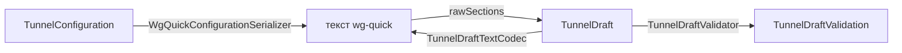

# TunnelEditor

| | |
|---|---|
| Статус | в работе: черновик и экран готовы; подключение созданного с нуля туннеля к настоящему серверу ещё не проверено ([отложенные проверки](../05-tasks/deferred-checks.md)) |
| Платформы | macOS |
| Задачи | M3-06, M3-07, M3-08 (маршрутизация в редакторе), M3-14 (доступность), M4-04 (лист выбора приложений) |
| Таргеты | `TunnelEditor`, `TunnelEditorPresentation` |

## Назначение

Черновик редактирования туннеля: строковые поля имени, интерфейса и пиров, проверка каждого поля доменными value objects, сборка `TunnelConfiguration` и переключение между формой и текстом wg-quick без потери введённого. Экран редактора (`TunnelEditorPresentation`) создаёт туннель с нуля и меняет существующий.

## Зависимости

| Тип | Что | Зачем |
|---|---|---|
| Фичи проекта | `SharedKernel`, `TunnelConfiguration`, `TunnelLibrary`; в `Presentation` — `TunnelConnection`, `TunnelConfigurationPresentation`, `AppRoutingPresentation`, `ApplicationCatalogPresentation`, `DesignSystemPresentation` | правила значений и ключи, разбор и запись wg-quick, «исключить локальные сети»; имя и сохранение туннеля; перезапуск подключения; тексты ошибок; лист выбора приложений; общие компоненты |
| Системные фреймворки | Foundation, SwiftUI, Observation | экран редактора |
| Сторонние библиотеки | нет | |

## Принцип работы

- **Поля.** `TunnelDraft` хранит имя, `InterfaceDraft` (приватный ключ, адреса, порт, MTU, DNS) и список `PeerDraft` (публичный ключ, общий ключ, `AllowedIPs`, endpoint, keepalive) как строки, ровно как их ввёл пользователь. Поле адресуется значением `TunnelDraftField`: `.name`, `.interface(_)` или `.peer(id, _)`; `text(for:)` и `setText(_:for:)` дают экрану одинаковый доступ к любому полю.
- **Существующий туннель.** `init(name:configuration:)` пишет конфигурацию каноничным текстом и читает его как черновик, поэтому поля выглядят так же, как в экспорте.
- **Проверка.** `validation` проверяет каждое поле теми же функциями, что и парсер (`WgQuickValueConversions`). Обязательны только приватный ключ интерфейса и публичный ключ пира, остальные пустые поля означают «не задано». Проблема привязана к полю (`TunnelDraftProblem`): нет значения, неверное имя, неверное значение с ошибкой value object, повтор публичного ключа у второго пира. Конфигурация собирается, только если в полях конфигурации нет проблем; неверное имя её не блокирует.
- **Публичный ключ** интерфейса выводится из приватного на лету; `generatePrivateKey()` создаёт новый ключ.
- **Пиры.** `addPeer()` выдаёт новый `PeerDraftID`, `removePeer(_:)` удаляет. Идентификаторы растут монотонно и не переиспользуются.
- **Исключить локальные сети.** `privateNetworkChoice(forPeer:)` говорит, применимо ли исключение к пиру и включено ли оно; `setExcludesPrivateNetworks(_:forPeer:)` применяет или убирает его через `PrivateNetworkExclusion` с учётом DNS-серверов интерфейса. Для всего туннеля `privateNetworkChoice()` и `setExcludesPrivateNetworks(_:)` работают со всеми пирами, к которым исключение применимо.
- **Текст.** `text` записывает поля в wg-quick как есть, пропуская пустые и склеивая переносы строк. `replaceConfiguration(withText:)` читает пары «ключ = значение» через `WgQuickConfigurationParser.rawSections(of:)` без проверки значений: повторы списковых ключей (`Address`, `DNS`, `AllowedIPs`) склеиваются, у остальных побеждает первый, неизвестные ключи и секции пропускаются.

**Экран.**

- `TunnelEditorFlow` открывает редактор листом: `createTunnel()` — новый туннель с уже созданной парой ключей, `edit(_:)` — существующий. После сохранения лист закрывается, а список перечитывается.
- `TunnelEditorModel` держит черновик и режим (`TunnelEditorMode`: форма или текст). В режиме текста проверка и сохранение идут по черновику, прочитанному из текста, а проблемы разбора показываются списком с номерами строк. «Сохранить» недоступна, пока есть проблемы.
- Приватный ключ существующего туннеля скрыт до нажатия «Показать»; у нового туннеля он виден сразу. Публичный ключ копируется кнопкой: запись в буфер обмена передаёт composition root.
- Сохранение: новый туннель — `CreateTunnelUseCase`; существующий — `UpdateTunnelUseCase`, а изменённое имя — `RenameTunnelUseCase`. Если туннель подключён (`TunnelActivityProbe`), модель сначала спрашивает подтверждение, затем сохраняет, отключает туннель и подключает его снова с новыми настройками. Исключение — новый выбор приложений (`LiveRoutingChange`): если конфигурация не изменилась, а туннель и до, и после в режиме «Выбранные приложения», модель сохраняет туннель и отправляет политику работающему расширению (`ApplyRoutingPolicyUseCase`) без переподключения. Если расширение не применило политику, модель спрашивает о перезапуске, как обычно.
- Ошибки полей показываются прямо под полем текстами `TunnelConfigurationPresentation` (`ConfigurationValueError.message`).
- Каждое поле подписано для VoiceOver своим названием. На крупных размерах шрифта доступности название встаёт над полем. ⌘S сохраняет, Esc отменяет.
- Секция «Маршрутизация» (`RoutingSection` из `AppRoutingPresentation`) стоит после интерфейса: режим, переключатель «Исключить локальные сети» для всего туннеля и блокировка без туннеля. Сохраняется выбранная в ней политика вместе с выбором приложений, даже если сейчас активен «Весь трафик» (решение D-37).
- **Выбор приложений.** В режиме «Выбранные приложения» в секции есть кнопка «Выбрать приложения…». `chooseApplications()` открывает лист `ApplicationPickerView` (фича `ApplicationCatalog`) с текущим выбором секции. Каждое изменение в листе сразу уходит в секцию (`RoutingSectionModel.setApplications(_:)`), а в туннель — при сохранении редактора, поэтому отдельной отмены у листа нет. `TunnelEditorFlow` получает `ApplicationPickerActions` от composition root. Без них кнопки нет (`canChooseApplications`). Работа с листом вынесена в `TunnelEditorModel+SelectionPickers`.

## Публичный API

`TunnelDraft`, `InterfaceDraft`, `PeerDraft`, `PeerDraftID`, `TunnelDraftField`, `InterfaceDraftField`, `PeerDraftField`, `TunnelDraftValidation`, `TunnelDraftProblem`, `TunnelDraftProblemReason`, `PrivateNetworkChoice`; экран — `TunnelEditorFlow`, `TunnelEditorModel`, `TunnelEditorMode`, `TunnelEditorActions`, `TunnelEditorFailure`, модификатор `tunnelEditor(_:)`.

## Решения

- Поля хранятся строками: черновик держит и неверный ввод, а проверка всегда считается заново из текущих строк.
- Правила значений не дублируются: черновик пользуется публичными `WgQuickValueConversions` фичи `TunnelConfiguration`, теми же, что и парсер.
- Форма и текст обмениваются сырыми парами «ключ = значение», а не собранной конфигурацией. Поэтому неверное значение переживает переключение форма → текст → форма.

## Спорные решения

| Решение | Альтернативы | Почему так | Когда пересмотреть |
|---|---|---|---|
| Неверное имя не мешает собрать конфигурацию | Ничего не собирать при любой проблеме | Имя и конфигурация сохраняются раздельно; экран всё равно не даст сохранить, пока есть проблемы | Нет |
| Неизвестные ключи (например, `PostUp`) теряются при переходе текст → форма | Хранить их отдельно и возвращать в текст | Туннель их всё равно не применяет, а импорт предупреждает о них | Если пользователи начнут их редактировать |
| Признак «исключить локальные сети» — перечисление `PrivateNetworkChoice` | `Bool?` | Правило проекта против необязательных булевых значений; три состояния читаются явно | Нет |
| Перезапуск после сохранения — отключить и подключить заново | Повторная установка слота без отключения | Координатор не трогает уже подключённый туннель; расширение применяет новую конфигурацию только при новом старте | Когда расширение научится применять конфигурацию на ходу |
| Проблемы текста — списком с номерами строк под редактором | Отметки прямо в строках `TextEditor` | `TextEditor` не умеет подсвечивать строки; список читается и VoiceOver | Если понадобится свой редактор текста |

## Отступления от правил разработки

Нет.

## Ограничения и известные проблемы

- Значение с символом `#` при переходе форма → текст → форма обрезается: в wg-quick это начало комментария.
- Подключение созданного с нуля туннеля к настоящему серверу ещё не проверено: проверка отложена ([отложенные проверки](../05-tasks/deferred-checks.md)).
- «Создать новую пару ключей» у существующего туннеля меняет его ключ без отдельного подтверждения; сервер нужно будет обновить вручную.

## Тесты

19 тестов в `TunnelEditorTests`:

- живое изменение выбора (3): новый выбор неизменённого туннеля; перезапуск при новой конфигурации или без неё; перезапуск при смене режима;
- поля существующего туннеля и обратная сборка той же конфигурации;
- публичный ключ из приватного, его отсутствие для неверного ключа, генерация ключа;
- добавление и удаление пиров;
- переключение форма → текст → форма без потерь, в том числе неверных значений;
- «исключить локальные сети» туда и обратно, для всех подходящих пиров, недоступность для туннеля с частью сетей;
- проверка каждого поля интерфейса и пира (табличные тесты), обязательное имя, проблема только у неверного пира, повтор публичного ключа.

20 тестов в `TunnelEditorPresentationTests`:

- новый выбор приложений активного туннеля уходит прокси без переподключения; если прокси не применил его, модель спрашивает о перезапуске;
- «Сохранить» недоступна при неверном поле и при неверном тексте;
- создание туннеля с нуля, переименование существующего;
- подтверждение перезапуска подключённого туннеля, отмена, сохранение неподключённого без вопроса;
- переход форма → текст → форма, скрытый приватный ключ, сохранение политики маршрутизации и выбора приложений туннеля, переключённого на «Весь трафик»;
- `TunnelEditorFlow`: новый и существующий туннель, закрытие после сохранения;
- лист выбора приложений: доступен только в режиме выбранных приложений и при каталоге приложений, открывается с текущим выбором, выбранное в нём сохраняется в политике туннеля.

Запуск: `swift test --package-path Packages/SplitwayKit --filter TunnelEditor`.

## История изменений

| Дата | Изменение | Задача |
|---|---|---|
| 2026-10-29 | Черновик редактирования, проверка полей, синхронизация с текстом | M3-06 |
| 2026-10-29 | Экран редактора, сохранение с перезапуском подключения | M3-07 |
| 2026-10-29 | Секция «Маршрутизация», «исключить локальные сети» для всего туннеля | M3-08 |
| 2026-10-29 | Подписи полей для VoiceOver, поля для крупного шрифта, ⌘S и Esc | M3-14 |
| 2026-10-29 | Smoke UI-тест создания туннеля | M3-15 |
| 2026-10-30 | Лист выбора приложений из секции «Маршрутизация» | M4-04 |
| 2026-10-31 | Новый выбор приложений активного туннеля применяется без переподключения | M4-15 |
| 2026-11-01 | Выбор приложений сохраняется и после переключения туннеля на «Весь трафик» (D-37) | M3-08 |
| 2026-11-01 | Новый выбор сервисов активного туннеля тоже применяется без переподключения | M5-07 |
| 2026-11-01 | Лист выбора сервисов | M5-08 |
| 2026-11-02 | Поле формы прячет свою подпись (`labelsHidden`): на Mac подпись стояла дважды, «Имя … Имя … Прага» | M7-07 |
| 2026-11-03 | Убраны iOS и выбор сервисов: лист выбора сервисов, `RoutingPlatform` в редакторе, живая смена выбора сервисов, smoke UI-тест на симуляторах | M8-02 |
