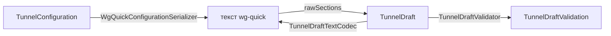

# TunnelEditor

| | |
|---|---|
| Статус | в работе: черновик готов, экран редактора — M3-07 |
| Платформы | shared |
| Задачи | M3-06 |
| Таргеты | `TunnelEditor` |

## Назначение

Черновик редактирования туннеля: строковые поля имени, интерфейса и пиров, проверка каждого поля доменными value objects, сборка `TunnelConfiguration` и переключение между формой и текстом wg-quick без потери введённого. Экран редактора строится поверх черновика в M3-07.

## Зависимости

| Тип | Что | Зачем |
|---|---|---|
| Фичи проекта | `SharedKernel`, `TunnelConfiguration`, `TunnelLibrary` | правила значений и ключи, разбор и запись wg-quick, «исключить локальные сети»; имя туннеля |
| Системные фреймворки | Foundation | |
| Сторонние библиотеки | нет | |

## Принцип работы

- **Поля.** `TunnelDraft` хранит имя, `InterfaceDraft` (приватный ключ, адреса, порт, MTU, DNS) и список `PeerDraft` (публичный ключ, общий ключ, `AllowedIPs`, endpoint, keepalive) как строки, ровно как их ввёл пользователь. Поле адресуется значением `TunnelDraftField`: `.name`, `.interface(_)` или `.peer(id, _)`; `text(for:)` и `setText(_:for:)` дают экрану одинаковый доступ к любому полю.
- **Существующий туннель.** `init(name:configuration:)` пишет конфигурацию каноничным текстом и читает его как черновик, поэтому поля выглядят так же, как в экспорте.
- **Проверка.** `validation` проверяет каждое поле теми же функциями, что и парсер (`WgQuickValueConversions`). Обязательны только приватный ключ интерфейса и публичный ключ пира, остальные пустые поля означают «не задано». Проблема привязана к полю (`TunnelDraftProblem`): нет значения, неверное имя, неверное значение с ошибкой value object, повтор публичного ключа у второго пира. Конфигурация собирается, только если в полях конфигурации нет проблем; неверное имя её не блокирует.
- **Публичный ключ** интерфейса выводится из приватного на лету; `generatePrivateKey()` создаёт новый ключ.
- **Пиры.** `addPeer()` выдаёт новый `PeerDraftID`, `removePeer(_:)` удаляет. Идентификаторы растут монотонно и не переиспользуются.
- **Исключить локальные сети.** `privateNetworkChoice(forPeer:)` говорит, применимо ли исключение и включено ли оно; `setExcludesPrivateNetworks(_:forPeer:)` применяет или убирает его через `PrivateNetworkExclusion` с учётом DNS-серверов интерфейса.
- **Текст.** `text` записывает поля в wg-quick как есть, пропуская пустые и склеивая переносы строк. `replaceConfiguration(withText:)` читает пары «ключ = значение» через `WgQuickConfigurationParser.rawSections(of:)` без проверки значений: повторы списковых ключей (`Address`, `DNS`, `AllowedIPs`) склеиваются, у остальных побеждает первый, неизвестные ключи и секции пропускаются.

## Публичный API

`TunnelDraft`, `InterfaceDraft`, `PeerDraft`, `PeerDraftID`, `TunnelDraftField`, `InterfaceDraftField`, `PeerDraftField`, `TunnelDraftValidation`, `TunnelDraftProblem`, `TunnelDraftProblemReason`, `PrivateNetworkChoice`.

## Решения

- Поля хранятся строками: черновик держит и неверный ввод, а проверка всегда считается заново из текущих строк.
- Правила значений не дублируются: черновик пользуется публичными `WgQuickValueConversions` фичи `TunnelConfiguration`, теми же, что и парсер.
- Форма и текст обмениваются сырыми парами «ключ = значение», а не собранной конфигурацией. Поэтому неверное значение переживает переключение форма → текст → форма.

## Спорные решения

| Решение | Альтернативы | Почему так | Когда пересмотреть |
|---|---|---|---|
| Неверное имя не мешает собрать конфигурацию | Ничего не собирать при любой проблеме | Имя и конфигурация сохраняются раздельно; экран всё равно не даст сохранить, пока есть проблемы | Нет |
| Неизвестные ключи (например, `PostUp`) теряются при переходе текст → форма | Хранить их отдельно и возвращать в текст | Туннель их всё равно не применяет, а импорт предупреждает о них | Если пользователи начнут их редактировать |
| Признак «исключить локальные сети» — перечисление `PrivateNetworkChoice` | `Bool?` | Правило проекта против необязательных булевых значений; три состояния читаются явно | Нет |

## Отступления от правил разработки

Нет.

## Ограничения и известные проблемы

- Значение с символом `#` при переходе форма → текст → форма обрезается: в wg-quick это начало комментария.
- Экран редактора, текстовый режим с отметками строк и сохранение — M3-07.

## Тесты

14 тестов в `TunnelEditorTests`:

- поля существующего туннеля и обратная сборка той же конфигурации;
- публичный ключ из приватного, его отсутствие для неверного ключа, генерация ключа;
- добавление и удаление пиров;
- переключение форма → текст → форма без потерь, в том числе неверных значений;
- «исключить локальные сети» туда и обратно, недоступность для туннеля с частью сетей;
- проверка каждого поля интерфейса и пира (табличные тесты), обязательное имя, проблема только у неверного пира, повтор публичного ключа.

Запуск: `swift test --package-path Packages/SplitwayKit --filter TunnelEditor`.

## История изменений

| Дата | Изменение | Задача |
|---|---|---|
| 2026-10-29 | Черновик редактирования, проверка полей, синхронизация с текстом | M3-06 |
