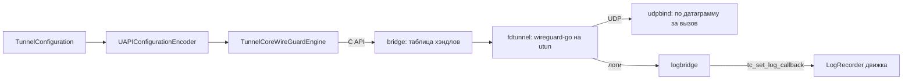

# TunnelEngine

| | |
|---|---|
| Статус | в работе: режимы fd и netstack готовы; проверка на устройствах — M2-08, M2-14 |
| Платформы | shared |
| Задачи | M2-01, M2-02, M2-03, M2-04, M2-13, M4-06, M4-10 (`TunnelEngineTestSupport`), M5-06, M7-03 (`udpbind`) |
| Таргеты | `TunnelEngine` (SplitwayKit); `TunnelCoreAdapter`, `TunnelCoreFramework` (TunnelCore); Go-пакеты `bridge`, `fdtunnel`, `logbridge`, `udpbind`; режим netstack — в [UserspaceNetwork](UserspaceNetwork.md) |

## Назначение

Движок WireGuard: wireguard-go за собственным C API. Swift-часть кодирует конфигурацию в UAPI, разбирает статистику и даёт портам доменные ошибки, ничего не зная о Go.

## Зависимости

| Тип | Что | Зачем |
|---|---|---|
| Фичи проекта | `TunnelConfiguration`, `Diagnostics` (адаптер) | конфигурация туннеля; журнал движка |
| Системные фреймворки | Foundation | |
| Сторонние библиотеки | wireguard-go `b3bc704` (MIT), golang.org/x/sys, x/crypto, x/net; goleak 1.3.0 (MIT) только в тестах | движок, системные вызовы, проверка утечек горутин |

## Принцип работы

- **Кодирование.** `UAPIConfigurationEncoder` превращает `TunnelConfiguration` и endpoint, уже разрезолвленные платформой, в `UAPIConfiguration`. Отдельно он строит обновления для работающего устройства: `endpointUpdate` (только endpoint-ы) и `keepaliveUpdate` (keepalive для пиров без своего, нужен прозрачному прокси, M4-15). Полная конфигурация:
  - ключи в hex, `replace_peers=true` и `replace_allowed_ips=true`;
  - `allowed_ip` без битов хоста;
  - `endpoint` только у разрезолвленных пиров.
- **Защита текста UAPI.** Текст содержит приватный ключ, поэтому `description`, `debugDescription` и `Mirror` его не показывают.
- **Статистика.** `UAPIRuntimeStatisticsParser` читает ответ `get=1`: байты пиров, время последнего рукопожатия (`0` → `nil`) и `errno`. `RuntimeStatistics.hasUnansweredFirstHandshake` говорит, что сервер не отвечает: ни у одного пира не было рукопожатия, а пир уже отправил не меньше трёх попыток (решение D-38). До первого рукопожатия wireguard-go отправляет только попытки по 148 байт, и каждая входит в отправленные байты пира, поэтому три попытки — это 444 байта.
- **Порты.** `WireGuardDeviceEngine` запускает устройство на дескрипторе utun и отдаёт `RunningTunnelInterfaceDevice`. Общий порт `RunningWireGuardDevice` применяет конфигурацию, отдаёт статистику, пересоздаёт сокеты и останавливается. `RunningTunnelInterfaceDevice` добавляет к нему `applyServiceRouting`: выбор сервисов работает только на utun, поэтому порт режима netstack `RunningUserspaceNetwork` этого метода не получает. Порты режима netstack (`UserspaceNetworkEngine` и другие) описаны в [UserspaceNetwork](UserspaceNetwork.md).
- **Выбор сервисов.** `ServiceRoutingTranslation` — то, что нужно движку из плана выбора сервисов: виртуальный DNS, резолвер для пересылки и фиктивные сети IPv4 и IPv6 (IPv6 необязательна). `ServiceRoutingTranslationEncoder` кодирует её в JSON с версией через `Encodable`-документ `ServiceRoutingTranslationDocument`: ключи по алфавиту, без экранирования `/`, сеть IPv6 без значения не пишется. Адаптер передаёт JSON в `tc_fd_tunnel_set_service_routing`, а Go разбирает его в `servicerouting.Plan` ([ServiceRouting](ServiceRouting.md)).
- **Go-сторона.**
  - `fdtunnel` дублирует дескриптор (`unix.Dup`, неблокирующий режим), создаёт `tun.CreateTUNFromFile` и `device.NewDevice` с bind `udpbind`, применяет UAPI и поднимает устройство.
  - `udpbind` — транспорт UDP устройства для Darwin и iOS, где пакетного ввода-вывода нет. Он слушает IPv4 и IPv6 на одном порту, ставит сокетам буферы по 7 МБ, как стандартный bind, и каждым вызовом принимает или отправляет один датаграмм через `ReadFromUDPAddrPort` и `WriteToUDPAddrPort`, без пулов сообщений и адресов. Адрес отправителя IPv4 приходит без префикса IPv6, а чужой тип endpoint отклоняется `ErrWrongEndpointType`.
  - Между utun и wireguard-go `fdtunnel` ставит `servicerouting.TranslatingDevice`. Пока плана нет, пакеты проходят без изменений; `Tunnel.RouteServices` передаёт план обёртке, а неверный план возвращает `ErrConfigurationRejected`.
  - На iOS действует `debug.SetMemoryLimit` (30 МБ) и уменьшенные очереди wireguard-go для `GOOS=ios`.
  - В режиме netstack `usernet` ставит между стеком gVisor и устройством wireguard-go обёртку `coalescingDevice`, которая прореживает исходящие подтверждения TCP ([UserspaceNetwork](UserspaceNetwork.md)).
  - `bridge` хранит устройства обоих режимов в одной таблице хэндлов: Go-указатели в C не попадают. Экспортные функции только преобразуют типы и выполняются внутри `guarded`, поэтому паника превращается в `TCStatusInternalFailure`.
- **Адаптер.** `TunnelCoreWireGuardDevice` владеет хэндлом и останавливает туннель в `deinit`. Строку `tc_tunnel_get_config` он освобождает через `tc_free`, а коды `TCStatus` переводит в `TunnelEngineError`.
- **Логи.** `TunnelCoreLogRouting.route(to:)` направляет логи wireguard-go в `LogRecorder`: verbose → `debug`, error → `error`. Маскирование выполняет `LogEntry`. Если устройство не запустилось, мост пишет причину уровнем error (`tunnel failed to start: …`), а у отклонённой конфигурации — только сам отказ, без подробностей с её значениями.

### C API (`TunnelCore.h`, `TunnelCoreTypes.h`)

| Функция | Назначение |
|---|---|
| `tc_version()` | версия ядра; строку освобождает `tc_free` |
| `tc_free(pointer)` | освобождает строки, выданные ядром |
| `tc_fd_tunnel_start(fd, configuration, &handle)` | запускает устройство на дескрипторе utun; дескриптор вызывающего остаётся открытым |
| `tc_fd_tunnel_set_service_routing(handle, plan)` | передаёт устройству режима fd план выбора сервисов в JSON версии 1. Тот же план сохраняет фиктивные адреса, другой начинает их заново. Неизвестная версия, неверный JSON или неверный план → `TCStatusConfigurationRejected`, и прежний план продолжает работать; хэндл режима netstack → `TCStatusInvalidArgument` |
| `tc_tunnel_update_config(handle, configuration)` | применяет UAPI к работающему устройству |
| `tc_tunnel_get_config(handle, &configuration)` | возвращает состояние в формате `get=1` (содержит приватный ключ); строку освобождает вызывающий |
| `tc_tunnel_bump_sockets(handle)` | пересоздаёт сокеты после смены сети или пробуждения |
| `tc_tunnel_stop(handle)` | останавливает устройство; повторный вызов → `TCStatusUnknownHandle` |
| `tc_set_log_callback(callback, context)` | логи wireguard-go; обратный вызов приходит из любых потоков |

`TCStatus`: `OK`, `InvalidArgument`, `UnknownHandle`, `TunnelInterfaceUnavailable`, `ConfigurationRejected`, `DeviceUnavailable`, `InternalFailure`, а для режима netstack ещё `ConnectionFailed`, `TimedOut`, `LookupFailed`, `NetworkStopped`, `ConnectionClosed`. Функции `tc_tunnel_*` принимают хэндлы обоих режимов; функции `tc_usernet_*` и `tc_connection_*` описаны в [UserspaceNetwork](UserspaceNetwork.md). `TCLogLevel`: `Verbose`, `Error`. Оба перечисления закрытые и объявлены в `TunnelCoreTypes.h`, а Go берёт значения из того же заголовка через cgo.

## Публичный API

- **SplitwayKit:** `UAPIConfigurationEncoder`, `UAPIConfiguration`, `ResolvedEndpoint`, `UAPIRuntimeStatisticsParser`, `UAPIResponseError`, `RuntimeStatistics`, `PeerRuntimeStatistics`, `ServiceRoutingTranslation`, `ServiceRoutingTranslationEncoder`, `WireGuardDeviceEngine`, `RunningWireGuardDevice`, `RunningTunnelInterfaceDevice`, `TunnelEngineError`; порты режима netstack — в [UserspaceNetwork](UserspaceNetwork.md).
- **TunnelCore:** `TunnelCoreWireGuardEngine`, `TunnelCoreUserspaceNetworkEngine` (macOS), `TunnelCoreLogRouting`, `TunnelCoreBuildInfo`.

## Решения

- Endpoint резолвит платформа (NAT64 на iOS), а движок получает только адреса.
- Хэндлы — положительные `int32`. Занятый хэндл повторно не выдаётся, а счётчик растёт монотонно, поэтому остановленный хэндл не совпадёт с новым туннелем.
- Направления логов хранятся до конца процесса: Go может вызвать обратный вызов в момент смены направления, и освобождённый контекст недопустим.

## Спорные решения

| Решение | Альтернативы | Почему так | Когда пересмотреть |
|---|---|---|---|
| Сервер не отвечает, если пир без рукопожатия отправил три попытки (444 байта) | Срок от момента подключения, как 15 с у прозрачного прокси | Туннель с частью сетей без трафика не делает рукопожатий, и срок от подключения дал бы ложное предупреждение; по байтам видно, что попытки были и остались без ответа. Правило опирается на размер попытки рукопожатия из протокола WireGuard | Если wireguard-go начнёт отправлять до рукопожатия что-то ещё |
| Свой bind `udpbind` вместо стандартного `conn.StdNetBind` | Стандартный bind; форк wireguard-go | Стандартный bind готовит пакетный ввод-вывод для Linux, а на Darwin и iOS всё равно шлёт по одному датаграмму. При этом на каждый датаграмм он берёт из пула массив на 128 сообщений и обнуляет его весь, берёт мьютекс и адрес из пула и ходит через `sendmsg` и `recvmsg`. В профиле расширения на iPhone одно обнуление (`putMessages`) заняло 4,4 % CPU. `udpbind` делает то, что делал стандартный bind до пакетной переделки 2023 года, на котором работает официальное iOS-приложение 1.0.16. Стенд из двух устройств wireguard-go в одном процессе: CPU на гигабайт −3,5 % на 150 Мбит/с и −4,7 % на максимуме, пиковая скорость 621 → 655 Мбит/с. Бенчмарк доставки датаграмма — 23,8 против 25,2 мкс, 1 аллокация вместо 4. Форк противоречит правилу о стороннем коде без изменений | Если wireguard-go перестанет готовить пакет сообщений на платформах без пакетного ввода-вывода или Splitway понадобится Linux |
| wireguard-go закреплён на свежем `b3bc704` (2026-10-25) | Выдержанный коммит двухнедельной давности | В нём и предыдущем коммите исправления рукопожатия и разбора пакетов, источник — каноничный репозиторий | При каждом обновлении зависимостей |
| Один файл `fdtunnel/testdata/full.uapi` для Swift-теста кодировщика и Go-теста wireguard-go | Две копии фикстуры | Так доказано, что wireguard-go принимает ровно то, что выдаёт Swift | Если пакеты разъедутся по репозиториям |
| План выбора сервисов — те же общие фикстуры: `servicerouting/testdata/plan.json` и `plan-without-ipv6.json` | Схема JSON и проверка по ней | Swift-тест сравнивает свой JSON с файлом побайтно, Go-тест разбирает тот же файл: контракт проверяют обе стороны без третьего инструмента | Если план начнут читать другие клиенты |
| План приходит отдельным вызовом после старта устройства | План как аргумент `tc_fd_tunnel_start` | Старт не зависит от режима маршрутизации, а план можно заменить на работающем устройстве (M5-07). Пакеты, прочитанные между стартом и планом, проходят без изменений: это микросекунды между двумя вызовами, и запрос к виртуальному DNS в этом окне система повторит | Если на устройстве первые запросы после подключения начнут теряться |
| Успешный старт адаптера в режиме fd не покрыт тестами | Тестовая точка входа на `tuntest` в продакшен-ядре | utun создаёт только root; тестовый код в ядре не нужен, путь проверяется на устройстве (M2-08). Режим netstack проверяется через процесс-пир `testpeer` (M4-06) | Нет |
| `UserspaceNetworkEngine` объявлен в M4-06 | Порт сразу в M2-01 | API режима netstack нельзя угадать без реализации | Нет |

## Отступления от правил разработки

Нет.

## Ограничения и известные проблемы

- Успешный старт, конфигурация и статистика через адаптер проверяются только на устройстве (M2-08, M2-14).
- Ответ `get=1` содержит приватный ключ. Его нельзя писать в журнал; `LogRedactor` его замаскирует, но лучше не передавать вовсе.

## Тесты

- `TunnelEngineTestSupport` даёт фейки режима netstack `InMemoryUserspaceNetwork` и `InMemoryUserspaceConnection`: они записывают запись, кредит и закрытия и отдают данные получателю по команде теста. Ими проверяются насосы `TransparentProxy`.
- 18 тестов в `TunnelEngineTests`: JSON плана выбора сервисов совпадает с фикстурами Go с сетью IPv6 и без неё; сервер не отвечает после трёх попыток рукопожатия, но не раньше и не после ответа хотя бы одного пира; keepalive для пиров без своего и ничего для пиров со своим; снимок UAPI для фикстур, пропуск неразрезолвленных endpoint, `allowed_ip` без битов хоста, скрытие текста UAPI, разбор статистики, `errno`, повреждённые ответы.
- 23 Go-теста режима fd (тесты режима netstack — в [UserspaceNetwork](UserspaceNetwork.md)):
  - рукопожатие и доставка пакета между двумя wireguard-go на `tuntest`;
  - обёртка выбора сервисов стоит на пути пакетов: до плана пакет к фиктивному адресу доходит до второго туннеля, после плана отбрасывается, а пакет к настоящему адресу доходит; неверный план отклоняется;
  - план через мост: применяется к туннелю режима fd; неизвестная версия, неверный JSON и неверный план → `ConfigurationRejected`; неизвестный хэндл; хэндл режима netstack → `InvalidArgument`;
  - wireguard-go принимает фикстуру Swift;
  - неверная конфигурация, дескриптор не utun, закрытый дескриптор, перепривязка сокетов;
  - жизненный цикл хэндлов, уровни логов;
  - описание сбоя запуска: причина видна, а значения отклонённой конфигурации — нет;
  - `goleak`.
- 15 Go-тестов `udpbind` на loopback: IPv4 и IPv6 на одном порту и на заданном порту, приём и отправка в обоих семействах, все датаграммы пакета по порядку, отправитель IPv4 без префикса IPv6, повторное открытие, отказ после закрытия и для чужого endpoint, разбор endpoint, байты для cookie, буферы сокетов. Бенчмарки `BenchmarkBindDeliversADatagram` и `BenchmarkStandardBindDeliversADatagram` сравнивают его со стандартным bind, базовая линия — в `udpbind/testdata`, проверку ведёт `Scripts/benchmark.sh`.
- 7 тестов режима fd в `TunnelCoreAdapterTests`: закрытый дескриптор и файл не utun (дескриптор вызывающего остаётся открытым), таблица `TCStatus` → `TunnelEngineError` (с новыми статусами), маскирование строк движка, версия.

Запуск: `go test ./...` в `Packages/TunnelCore/go`, `swift test --package-path Packages/TunnelCore`.

## История изменений

| Дата | Изменение | Задача |
|---|---|---|
| 2026-10-29 | Кодирование UAPI и разбор статистики | M2-01 |
| 2026-10-29 | C API режима fd, таблица хэндлов | M2-02 |
| 2026-10-29 | `fdtunnel` и `logbridge`, wireguard-go | M2-03 |
| 2026-10-29 | Swift-адаптер | M2-04 |
| 2026-10-29 | Маскирование логов движка | M2-13 |
| 2026-10-30 | `fdtunnel.Start` поднимает и устройство `usernet` на netstack | M4-05 |
| 2026-10-30 | Общая таблица хэндлов для режимов fd и netstack, `recover` в экспортных функциях | M4-06 |
| 2026-10-30 | Фейки режима netstack в `TunnelEngineTestSupport` | M4-10 |
| 2026-10-31 | Режим netstack прореживает подтверждения TCP (подробно — в UserspaceNetwork) | M4-18 |
| 2026-10-30 | Причина сбоя запуска в журнале движка (найдено в системном расширении macOS) | M2-12 |
| 2026-10-31 | `UAPIConfigurationEncoder.keepaliveUpdate` | M4-15 |
| 2026-11-01 | `RuntimeStatistics.hasUnansweredFirstHandshake` (D-38) | M3-03 |
| 2026-11-01 | `tc_fd_tunnel_set_service_routing`, порт `RunningTunnelInterfaceDevice`, JSON плана выбора сервисов с общими фикстурами | M5-06 |
| 2026-11-02 | Bind `udpbind` по одному датаграмму вместо стандартного: меньше CPU на гигабайт на Darwin и iOS | M7-03 |
