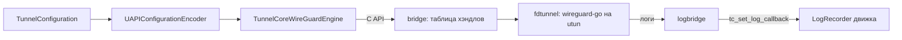

# TunnelEngine

| | |
|---|---|
| Статус | в работе: режим fd готов, режим netstack — M4-06 |
| Платформы | shared |
| Задачи | M2-01, M2-02, M2-03, M2-04, M2-13 |
| Таргеты | `TunnelEngine` (SplitwayKit); `TunnelCoreAdapter`, `TunnelCoreFramework` (TunnelCore); Go-пакеты `bridge`, `fdtunnel`, `logbridge` |

## Назначение

Движок WireGuard: wireguard-go за собственным C API. Swift-часть кодирует конфигурацию в UAPI, разбирает статистику и даёт портам доменные ошибки, ничего не зная о Go.

## Зависимости

| Тип | Что | Зачем |
|---|---|---|
| Фичи проекта | `TunnelConfiguration`, `Diagnostics` (адаптер) | конфигурация туннеля; журнал движка |
| Системные фреймворки | Foundation | |
| Сторонние библиотеки | wireguard-go `b3bc704` (MIT), golang.org/x/sys, x/crypto, x/net; goleak 1.3.0 (MIT) только в тестах | движок, системные вызовы, проверка утечек горутин |

## Принцип работы

- **Кодирование.** `UAPIConfigurationEncoder` превращает `TunnelConfiguration` и endpoint, уже разрезолвленные платформой, в `UAPIConfiguration`:
  - ключи в hex, `replace_peers=true` и `replace_allowed_ips=true`;
  - `allowed_ip` без битов хоста;
  - `endpoint` только у разрезолвленных пиров.
- **Защита текста UAPI.** Текст содержит приватный ключ, поэтому `description`, `debugDescription` и `Mirror` его не показывают.
- **Статистика.** `UAPIRuntimeStatisticsParser` читает ответ `get=1`: байты пиров, время последнего рукопожатия (`0` → `nil`) и `errno`.
- **Порты.** `WireGuardDeviceEngine` запускает устройство на дескрипторе utun. `RunningWireGuardDevice` применяет конфигурацию, отдаёт статистику, пересоздаёт сокеты и останавливается.
- **Go-сторона.**
  - `fdtunnel` дублирует дескриптор (`unix.Dup`, неблокирующий режим), создаёт `tun.CreateTUNFromFile` и `device.NewDevice` со стандартным bind, применяет UAPI и поднимает устройство.
  - На iOS действует `debug.SetMemoryLimit` (30 МБ) и уменьшенные очереди wireguard-go для `GOOS=ios`.
  - `bridge` хранит туннели в таблице хэндлов: Go-указатели в C не попадают. Экспортные функции только преобразуют типы.
- **Адаптер.** `TunnelCoreWireGuardDevice` владеет хэндлом и останавливает туннель в `deinit`. Строку `tc_tunnel_get_config` он освобождает через `tc_free`, а коды `TCStatus` переводит в `TunnelEngineError`.
- **Логи.** `TunnelCoreLogRouting.route(to:)` направляет логи wireguard-go в `LogRecorder`: verbose → `debug`, error → `error`. Маскирование выполняет `LogEntry`.

### C API (`TunnelCore.h`, `TunnelCoreTypes.h`)

| Функция | Назначение |
|---|---|
| `tc_version()` | версия ядра; строку освобождает `tc_free` |
| `tc_free(pointer)` | освобождает строки, выданные ядром |
| `tc_fd_tunnel_start(fd, configuration, &handle)` | запускает устройство на дескрипторе utun; дескриптор вызывающего остаётся открытым |
| `tc_tunnel_update_config(handle, configuration)` | применяет UAPI к работающему устройству |
| `tc_tunnel_get_config(handle, &configuration)` | возвращает состояние в формате `get=1` (содержит приватный ключ); строку освобождает вызывающий |
| `tc_tunnel_bump_sockets(handle)` | пересоздаёт сокеты после смены сети или пробуждения |
| `tc_tunnel_stop(handle)` | останавливает устройство; повторный вызов → `TCStatusUnknownHandle` |
| `tc_set_log_callback(callback, context)` | логи wireguard-go; обратный вызов приходит из любых потоков |

`TCStatus`: `OK`, `InvalidArgument`, `UnknownHandle`, `TunnelInterfaceUnavailable`, `ConfigurationRejected`, `DeviceUnavailable`, `InternalFailure`. `TCLogLevel`: `Verbose`, `Error`. Оба перечисления закрытые и объявлены в `TunnelCoreTypes.h`, а Go берёт значения из того же заголовка через cgo.

## Публичный API

- **SplitwayKit:** `UAPIConfigurationEncoder`, `UAPIConfiguration`, `ResolvedEndpoint`, `UAPIRuntimeStatisticsParser`, `UAPIResponseError`, `RuntimeStatistics`, `PeerRuntimeStatistics`, `WireGuardDeviceEngine`, `RunningWireGuardDevice`, `TunnelEngineError`.
- **TunnelCore:** `TunnelCoreWireGuardEngine`, `TunnelCoreLogRouting`, `TunnelCoreBuildInfo`.

## Решения

- Endpoint резолвит платформа (NAT64 на iOS), а движок получает только адреса.
- Хэндлы — положительные `int32`. Занятый хэндл повторно не выдаётся, а счётчик растёт монотонно, поэтому остановленный хэндл не совпадёт с новым туннелем.
- Направления логов хранятся до конца процесса: Go может вызвать обратный вызов в момент смены направления, и освобождённый контекст недопустим.

## Спорные решения

| Решение | Альтернативы | Почему так | Когда пересмотреть |
|---|---|---|---|
| wireguard-go закреплён на свежем `b3bc704` (2026-10-25) | Выдержанный коммит двухнедельной давности | В нём и предыдущем коммите исправления рукопожатия и разбора пакетов, источник — каноничный репозиторий | При каждом обновлении зависимостей |
| Один файл `fdtunnel/testdata/full.uapi` для Swift-теста кодировщика и Go-теста wireguard-go | Две копии фикстуры | Так доказано, что wireguard-go принимает ровно то, что выдаёт Swift | Если пакеты разъедутся по репозиториям |
| Успешный старт адаптера не покрыт тестами | Тестовая точка входа на `tuntest` в продакшен-ядре | utun создаёт только root; тестовый код в ядре не нужен, путь проверяется на устройстве (M2-08) | Когда появится сборка ядра с тестовыми тегами (M4-06) |
| `UserspaceNetworkEngine` объявляется в M4-06 | Порт сразу в M2-01 | API режима netstack нельзя угадать без реализации | Нет |

## Отступления от правил разработки

Нет.

## Ограничения и известные проблемы

- Успешный старт, конфигурация и статистика через адаптер проверяются только на устройстве (M2-08, M2-14).
- Ответ `get=1` содержит приватный ключ. Его нельзя писать в журнал; `LogRedactor` его замаскирует, но лучше не передавать вовсе.

## Тесты

- 10 тестов в `TunnelEngineTests`: снимок UAPI для фикстур, пропуск неразрезолвленных endpoint, `allowed_ip` без битов хоста, скрытие текста UAPI, разбор статистики, `errno`, повреждённые ответы.
- 15 Go-тестов:
  - рукопожатие и доставка пакета между двумя wireguard-go на `tuntest`;
  - wireguard-go принимает фикстуру Swift;
  - неверная конфигурация, дескриптор не utun, закрытый дескриптор, перепривязка сокетов;
  - жизненный цикл хэндлов, уровни логов;
  - `goleak`.
- 7 тестов в `TunnelCoreAdapterTests`: закрытый дескриптор и файл не utun (дескриптор вызывающего остаётся открытым), таблица `TCStatus` → `TunnelEngineError`, маскирование строк движка, версия.

Запуск: `go test ./...` в `Packages/TunnelCore/go`, `swift test --package-path Packages/TunnelCore`.

## История изменений

| Дата | Изменение | Задача |
|---|---|---|
| 2026-10-29 | Кодирование UAPI и разбор статистики | M2-01 |
| 2026-10-29 | C API режима fd, таблица хэндлов | M2-02 |
| 2026-10-29 | `fdtunnel` и `logbridge`, wireguard-go | M2-03 |
| 2026-10-30 | `fdtunnel.Start` поднимает и устройство `usernet` на netstack | M4-05 |
| 2026-10-29 | Swift-адаптер | M2-04 |
| 2026-10-29 | Маскирование логов движка | M2-13 |
