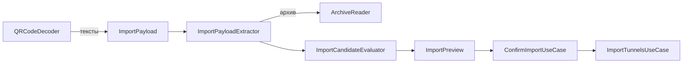

# TunnelImport

| | |
|---|---|
| Статус | в работе: импорт из файлов, архивов, буфера, перетаскиванием, через «Открыть в…» и сканер QR готовы; сканирование камерой и распознавание фото проверяются вручную на iPhone и iPad (M3-05) |
| Платформы | shared; распознавание QR — iOS и iPadOS |
| Задачи | M1-15, M1-16, M1-17, M3-04, M3-05, M3-11 (проверка обратного импорта), M7-01 (входящие копии) |
| Таргеты | `TunnelImport`, `TunnelImportInfrastructure`, `TunnelImportPresentation` |

## Назначение

Превращает то, что дал пользователь (текст из буфера, файл, архив, QR-код на изображении), в предпросмотр кандидатов с каждой найденной проблемой и сохраняет выбранных кандидатов в библиотеку.

## Зависимости

| Тип | Что | Зачем |
|---|---|---|
| Фичи проекта | `SharedKernel`, `TunnelConfiguration`, `TunnelLibrary`; в `Presentation` — `TunnelConfigurationPresentation`, `DesignSystemPresentation` | разбор конфигов, имена туннелей, сохранение; тексты проблем конфигурации; общие компоненты |
| Системные фреймворки | Foundation, Vision, AVFoundation, UIKit / AppKit, CoreTransferable, UniformTypeIdentifiers, SwiftUI; на iOS — VisionKit, PhotosUI | данные файлов; распознавание QR; доступ к камере; буфер обмена; перетаскивание; типы файлов; экраны; сканер камерой; выбор фото |
| Сторонние библиотеки | ZIPFoundation 0.9.20, MIT | чтение `.zip` (решение D-21) |

## Принцип работы

1. `ImportPayload` — `.text`, `.qrCode` или `.file(name:contents:)`. Файл считается архивом, если начинается с сигнатуры ZIP (`PK\3\4`, `PK\5\6`) или называется `*.zip`; иначе он декодируется как UTF-8.
2. Из архива `ArchiveReader` достаёт только файлы конфигураций по правилам `ArchiveEntryPath`: расширение `.conf`; пропускаются `__MACOSX`, скрытые файлы и папки; разделители `/` и `\`. Действуют лимиты `ArchiveImportLimits.standard`: 100 конфигов и 10 МБ распакованных данных.
3. Каждый текст разбирает `WgQuickConfigurationParser`.
   - Имя берётся из имени файла через `TunnelName.derived(fromFileName:)`. Для текста и QR имена по умолчанию передаёт composition root в `ImportFallbackNames`: «Вставленный туннель» и «Отсканированный туннель».
   - Имя делается уникальным среди туннелей библиотеки и уже принятых кандидатов того же импорта.
   - `alreadyImportedAs` называет туннель библиотеки с точно такой же конфигурацией.
4. Источники, из которых ничего не прочитано, попадают в `ImportSourceFailure`: не текст, архив отклонён (повреждён или вне лимитов), в архиве нет конфигов.
5. `ImportSelection` хранит решение пользователя: по умолчанию выбраны все разобранные конфигурации, кроме дубликатов библиотеки. Неразобранную выбрать нельзя. Переименование и снятие выбора сразу пересчитывают итоговые имена: уникальные среди `ImportPreview.existingNames` и выбранных выше.
6. `ConfirmImportUseCase` импортирует выбранное под итоговыми именами через `ImportTunnelsUseCase`, который ещё раз подбирает свободные имена в момент сохранения.
7. Файлы, которые не удалось прочитать, `PrepareImportUseCase` показывает как `ImportSourceFailure` с причиной `unreadable`.

Экраны (`TunnelImportPresentation`):

- `TunnelImportModel` — единая точка входа: файлы из `fileImporter` и «Открыть в…», буфер обмена, перетаскивание. Каждый путь ведёт к одному `ImportPreviewModel`, который показывается листом. Пустой буфер даёт сообщение, а не пустой предпросмотр.
- **Вставка** приходит двумя путями. `importPastedTexts(_:)` получает тексты от системной кнопки вставки, `importClipboard()` сам читает буфер через `ClipboardTextSource`. Пустые элементы вставки пропускаются; если текста нет совсем, показывается то же сообщение о пустом буфере.
  - На iOS и iPadOS способ «Вставить из буфера» в меню «+» и в пустом списке — системная кнопка `PasteButton` (её показывает `TunnelLibrary`). Нажатие на неё само служит разрешением: система отдаёт текст без запроса «Разрешить вставку». Подпись «Вставить», значок и синюю заливку задаёт система, приложение выбирает только форму капсулы.
  - Команда ⇧⌘V с клавиатуры iPad и вставка на macOS читают буфер кодом через `SystemClipboard`.
- `ImportPreviewModel` строит строки `ImportPreviewRow`: имя (то, что набрал пользователь, с пробелами), итоговое имя, выбор, ошибки и предупреждения разбора, дубликат. Кнопка «Импортировать» недоступна, если ничего не выбрано или у выбранного неверное имя. После импорта модель показывает «Импортировано N из M» (M — все найденные конфигурации и нечитаемые источники) и перечитывает список.
- Тексты проблем разбора берутся из `TunnelConfigurationPresentation` (`ConfigurationIssueLabel`).
- **Сканер QR** (iOS и iPadOS) открывается листом из пункта «Сканировать QR-код» меню «+».
  - `QRScannerModel` проверяет, умеет ли устройство сканировать камерой, и доступ к камере через `CameraAccess`:
    - доступ есть — сканирует;
    - доступ ещё не запрашивали — спрашивает;
    - отказ — «Нет доступа к камере» с кнопкой «Открыть Настройки»;
    - ограничение на устройстве — объяснение;
    - сканера нет (симулятор) или камера не запустилась — «Сканирование камерой недоступно».
  - Камера — `DataScannerViewController` из VisionKit с символикой QR. Подсказки, подсветку кода, масштаб жестом и поворот устройства ведёт сам контроллер.
  - Первый распознанный код закрывает лист, следующие распознавания игнорируются. Предпросмотр открывается после того, как лист закрылся (`onDismiss`), поэтому два листа не мешают друг другу. Код приходит как `ImportPayload.qrCode`, источник в предпросмотре — «QR-код».
  - «Выбрать фото» — `PhotosPicker`, ему не нужен доступ к медиатеке. Все QR-коды на фото распознаёт `VisionQRCodeDecoder`, и они вместе идут в предпросмотр. Фото без кода и нечитаемое фото дают сообщение.
  - Описание доступа к камере (`NSCameraUsageDescription`) лежит в `Info.plist` приложения iOS, перевод — в `Apps/iOSApp/InfoPlist.xcstrings`.
- Тип `.conf` — импортированный `com.wireguard.config`, совместимый с `public.plain-text` (`UTType.wireGuardConfiguration` из `TunnelConfigurationPresentation`, общий с экспортом). Приложения объявляют его и `public.zip-archive` в `CFBundleDocumentTypes` (`LSHandlerRank = Alternate`), iOS открывает документы на месте (`LSSupportsOpeningDocumentsInPlace`).

Адаптеры:

- `ZIPArchiveReader` считает реально распакованные байты, а не размеры из заголовков. Он сверяет CRC-32 и пропускает каталоги и символьные ссылки.
- `VisionQRCodeDecoder` выполняет `DetectBarcodesRequest` с символикой QR и возвращает тексты без повторов.
- `SecurityScopedFileReader` читает файлы на своей очереди GCD через `NSFileCoordinator` (файлы iCloud скачиваются), с доступом security-scoped и лимитом 10 МБ на файл (`ImportFileBatch.maximumFileByteCount`).
- **Входящие копии.** Когда другое приложение передаёт файл через «Открыть в…», iOS копирует его во входящую папку приложения: `Documents/Inbox` или `tmp/<bundle ID>-Inbox`. На iOS `TunnelImportAssembly` даёт читателю `ReceivedFileInbox` с контейнером приложения, и прочитанный файл из входящей папки удаляется, даже если импортировать его не удалось. Файлы вне входящей папки и вне контейнера приложения не трогаются. На macOS входящей папки нет ([security.md](../security.md)).
- `SystemClipboard` читает текст буфера обмена. На iOS чтение `UIPasteboard` идёт на своей очереди: пока открыт системный запрос «Разрешить вставку», чтение ждёт ответа и не должно останавливать главный поток. На macOS `NSPasteboard` читается на главном акторе. На iOS его вызывает только команда ⇧⌘V.
- `SystemCameraAccess` сообщает и запрашивает доступ к камере через `AVCaptureDevice`.
- `DroppedImportFile` — `Transferable` для перетаскивания: читает полученный файл тем же `SecurityScopedFileReader`, пока система держит его копию.
- `TunnelImportAssembly` собирает сценарии и адаптеры для composition root.

## Публичный API

`ImportPayload`, `ImportSource`, `ImportFallbackNames`, `ImportPreview`, `ImportPreviewCandidate`, `ImportSelection`, `ImportSourceFailure`, `ImportSourceFailureReason`, `ImportFileBatch`, `PrepareImportUseCase`, `ConfirmImportUseCase`; порты `ImportFileReader`, `ClipboardTextSource`, `CameraAccess` (`CameraAuthorization`); архивы — `ArchiveReader`, `ArchiveReadingError`, `ArchivedConfigurationFile`, `ArchiveEntryPath`, `ArchiveImportLimits`, `ZIPArchiveReader`; QR — `QRCodeDecoder`, `QRCodeDecodingError`, `VisionQRCodeDecoder`; адаптеры `SecurityScopedFileReader`, `SystemClipboard`, `SystemCameraAccess`, `DroppedImportFile`, сборка `TunnelImportAssembly`; экраны — `TunnelImportModel`, `TunnelImportActions`, `TunnelImportAlert`, `ImportPreviewModel`, `ImportPreviewRow`, `ImportSummary`, `QRScannerModel`, `QRScannerState`, `QRPhotoProblem`, модификатор `tunnelImport(_:)`.

## Решения

- Предпросмотр ничего не сохраняет и показывает все проблемы: ошибки и предупреждения парсера, конфликт имени, дубликат, нечитаемые источники.
- Порт архивов объявлен в фиче-потребителе: `ArchiveReader` — здесь, `ArchiveWriter` — в `TunnelLibrary`.
- Входящая копия удаляется сразу после чтения, а не после подтверждения импорта: её содержимое уже в памяти предпросмотра, а при отмене копия больше не нужна. Иначе приватный ключ оставался бы в контейнере приложения до очистки временных файлов системой.
- Окно выбора файлов принимает не только `com.wireguard.config`, но и все типы, которые система этого устройства связывает с расширением `.conf` (`ImportableFileTypes`). Наш тип только импортирован, и если другое приложение (VPN- или прокси-клиент) экспортирует свой тип для `.conf`, iOS отдаёт файлу этот тип. Без этого файлы `.conf` в окне выбора были недоступны (найдено на iPhone 2026-10-30). Разбор всё равно проверяет содержимое.

## Спорные решения

| Решение | Альтернативы | Почему так | Когда пересмотреть |
|---|---|---|---|
| Защита от zip-бомб — счёт распакованных байтов без доверия к заголовкам | Проверка `uncompressedSize` из заголовков | Заголовки подделываются. Распаковка останавливается, когда лимит превышен на один блок (16 КБ) | Нет |
| Лимиты 100 конфигов и 10 МБ на архив | Без лимитов; другие значения | Экспорт официального клиента — единицы файлов по сотне байт, запас на порядки | Если пользователи упрутся в лимит |
| Файл `*.zip` без сигнатуры ZIP читается как архив | Только сигнатура | Тип определяется «по содержимому и расширению». Расширение выражает намерение пользователя, а «архив повреждён» понятнее ошибок разбора | Нет |
| Текст декодируется только как UTF-8 | Автоопределение UTF-16 и однобайтовых кодировок | Клиенты WireGuard пишут UTF-8, BOM обрабатывает парсер | Если придут конфиги в UTF-16 |
| Дубликат — полное равенство конфигурации | Сравнение по публичным ключам | Те же ключи при других `AllowedIPs` — уже другой туннель | Если импортом захотят обновлять туннель |
| QR через Vision; тесты на macOS, а не на симуляторе | `CIDetector`, который работает и в симуляторе | Vision лучше распознаёт фото. В симуляторе iOS Vision не создаёт детектор штрихкодов (`operationFailed`, ревизия 4 требует аппаратного ускорения) | Если симулятор начнёт поддерживать детектор |
| Имена по умолчанию для текста и QR — `ImportFallbackNames` от composition root | Хост из `Endpoint`; строка в Core; одно имя для обоих источников | Core не содержит локализованных строк; «Вставленный туннель» для отсканированного кода сбивал бы с толку | Нет |
| Камера — `DataScannerViewController` из VisionKit, а не `AVCaptureMetadataOutput` из плана M3-05 | Своя `AVCaptureSession` с `AVCaptureMetadataOutput` и слоем предпросмотра | `AVCaptureSession` не `Sendable`: общей сессии очереди захвата и слоя предпросмотра нужны `@unchecked Sendable` или `nonisolated(unsafe)`, которые правила запрещают. `DataScannerViewController` работает на главном акторе и сам ведёт камеру, предпросмотр, поворот и подсказки; его поддерживают все устройства с iOS 26 | Если понадобится управление камерой, которого нет в VisionKit |
| Первый код закрывает сканер, остальные игнорируются | Собирать все коды, пока сканер открыт | Сканер держит в кадре один код (`recognizesMultipleItems = false`); несколько туннелей удобнее импортировать фото или архивом | Нет |
| Посторонний QR-код тоже открывает предпросмотр с ошибкой | Подсказка в сканере и продолжение поиска | Предпросмотр одинаково объясняет ошибку разбора для любого источника | Если пользователи часто будут сканировать посторонние коды |
| `ZIPArchiveReader` и `ZIPArchiveWriter` вместо `ZIPFoundationArchive…` из плана | Имена по библиотеке | Имя описывает формат, а не реализацию | Нет |
| Дубликаты библиотеки по умолчанию не выбраны | Выбирать всё разобранное | Повторный импорт того же архива не должен молча удваивать туннели; пользователь может выбрать дубликат сам | Нет |
| На iOS и iPadOS вставка — системная `PasteButton` в меню «+» и в пустом списке | Чтение буфера кодом по пункту меню с системным запросом «Разрешить вставку» (так было до 2026-11-01) | В симуляторах iOS 27 запрос не появляется: SpringBoard отклоняет его у демона `pasted` (нет права `com.apple.springboard.CFUserNotification`), чтение получает `PBErrorDomain` 13, и приложение сообщало, что вставлять нечего. Системная кнопка передаёт текст по нажатию без запроса и на устройстве, и в симуляторе, а пользователю на один шаг меньше. Прежний довод «`PasteButton` нельзя поместить в меню» не подтвердился: в меню «+» на iOS 27 она работает. Цена — вид: подпись «Вставить» и синюю заливку задаёт система | Если системная кнопка перестанет работать в меню |
| Перетаскивание и «Открыть в…» подключены в корневой сцене приложения | Модификатор фичи | `DroppedImportFile` читает файл и поэтому лежит в Infrastructure, а `Presentation` его не видит | Нет |
| Документы открываются на месте, без копии в `Documents/Inbox` | Копия во входящих | Копия конфига с приватным ключом не остаётся в контейнере приложения | Нет |
| Открытый файл получает уже открытое окно: `handlesExternalEvents` со значением `*` у сцены и у её вида | Отдельная сцена `Window` на macOS | Сцена общая для iOS и macOS, а `handlesExternalEvents(matching:)` работает только с `WindowGroup`. Без модификаторов `WindowGroup` на macOS открывал на каждый файл второе главное окно, и общие листы импорта и редактора показывались в обоих ([SP-3](spikes/SP-3.md)). Если окно закрыто, SwiftUI создаёт его заново | M6-01, если строке меню понадобится единственное окно |

## Отступления от правил разработки

Нет.

## Ограничения и известные проблемы

- `PrepareImportUseCase` сам не ограничивает размер текста: файлы ограничивает `SecurityScopedFileReader`, буфер — система.
- В симуляторе проверены вставка из буфера с переименованием и предупреждением и открытие выбора файлов. Выбор файла, перетаскивание между приложениями на iPad и «Открыть в…» проверяются на устройстве. На macOS открытие файла `.conf` проверено в ВМ (решение D-32) 2026-10-31: при открытом окне, при закрытом окне и при незапущенном приложении получается одно окно с одним листом импорта.
- Вставка системной кнопкой проверена в симуляторе iOS 27.0, в меню «+» и в пустом списке, UI-тестом на симуляторах iPhone и iPad и тем же UI-тестом на iPhone 13 Pro с iOS 27.2 (2026-11-01): текст другого приложения вставляется без запроса. На iOS 26 она не проверялась: симулятора iOS 26 нет.
- Команда ⇧⌘V на iPad читает буфер кодом: на устройстве система спрашивает разрешение, а в симуляторах iOS 27 запрос не показывается, и команда сообщает, что вставлять нечего.
- Два одинаковых кандидата в одном импорте не помечаются дубликатами друг друга, они получают имена «X» и «X 2».
- Зашифрованные записи ZIP отклоняются как нечитаемые.
- Сканирование камерой и распознавание фото проверяются на устройстве: в симуляторе нет сканера камеры, а Vision не создаёт детектор штрихкодов. В симуляторе проверены пункт меню, лист сканера, состояние «Сканирование камерой недоступно», выбор фото и сообщение о нечитаемом фото.
- Настоящего архива официального клиента в фикстурах нет. Совместимость покрыта синтетическими архивами и архивом Finder (`ditto -c -k --sequesterRsrc`) с дескрипторами данных, `__MACOSX` и `.DS_Store`.

## Тесты

- 23 теста в `TunnelImportTests`:
  - правила путей в архиве;
  - текст из буфера с лишними пробелами, QR-код (источник и имя по умолчанию), файл без расширения;
  - архив со смесью валидных и невалидных конфигов, повторный импорт;
  - конфликт имён внутри импорта;
  - файл не текст и не архив, архив сверх лимитов, архив без конфигов, `*.zip` без сигнатуры;
  - подтверждение импорта, в том числе выбранного под новыми именами;
  - имена библиотеки в предпросмотре, нечитаемые файлы;
  - `ImportSelection`: выбор по умолчанию, неразобранную нельзя выбрать, уникальные итоговые имена, освобождение имени, переименование, импорт только выбранного.
- 25 тестов в `TunnelImportInfrastructureTests`:
  - 11 для `ZIPArchiveReader`: обычный архив, вложенные папки, мусор и ссылки, архив Finder, граница и превышение лимитов, заниженный в заголовке размер, испорченная контрольная сумма;
  - 6 для `VisionQRCodeDecoder` на изображениях, которые генерирует CoreImage: один QR, два QR, один QR дважды, без QR, поворот на 30°, данные, которые не являются изображением;
  - 7 для `SecurityScopedFileReader` во временной папке: чтение под именем файла, нет файла, файл больше лимита, удаление копии из обеих входящих папок после чтения и копии, которую нельзя импортировать; файлы вне входящей папки и входящая папка другого контейнера остаются;
  - архив, который выдал экспорт библиотеки (`ZIPArchiveWriter`), импортируется обратно с теми же конфигурациями и именами.
- 26 тестов в `TunnelImportPresentationTests`:
  - типы окна выбора: тип другого приложения для `.conf`, каждый тип один раз, системный тип `.conf` этого Mac;
  - «Импортировать» недоступна без выбора и с неверным именем, итоговые имена, переименование с пробелами, итог «2 из 3» и перечитывание списка;
  - файлы, нечитаемые файлы, буфер, пустой буфер, перетаскивание и выбор файлов ведут к одному предпросмотру;
  - вставленные тексты: предпросмотр, пустые элементы пропускаются, пустая вставка даёт сообщение;
  - сканер: доступ к камере (есть, запрошен и дан, запрошен и не дан, отказ, ограничение), нет сканера, отказ камеры, код только один раз, все коды фото, фото без кода, нечитаемое фото;
  - предпросмотр кода после закрытия сканера и ничего при закрытии без кода.

- Smoke UI-тест `TunnelSmokeTests.testImportsAPastedTunnelAndRenamesIt` на симуляторах iPhone и iPad. Он кладёт в буфер конфигурацию с ключами, созданными во время теста, вставляет её системной кнопкой «Paste» из меню «+», импортирует туннель, открывает детали и редактор и сохраняет новое имя. Перед записью в буфер тест выводит свой процесс на передний план (`SplitwayLaunch.copyToClipboard`): на устройстве iOS не даёт приложению в фоне менять общий буфер, и без этого кнопка вставки оставалась неактивной. В симуляторе этого ограничения нет.

Запуск: `swift test --package-path Packages/SplitwayKit --filter TunnelImport`; UI-тесты — `Scripts/check.sh --ui`.

## История изменений

| Дата | Изменение | Задача |
|---|---|---|
| 2026-10-29 | `ArchiveReader`, `ZIPArchiveReader`, правила и лимиты архивов | M1-15 |
| 2026-10-29 | Предпросмотр и подтверждение импорта | M1-16 |
| 2026-10-29 | `VisionQRCodeDecoder` | M1-17 |
| 2026-10-29 | Экраны импорта, выбор кандидатов, чтение файлов, буфер, перетаскивание, типы документов | M3-04 |
| 2026-10-29 | Сканер QR камерой и с фото, доступ к камере, `ImportPayload.qrCode`, `ImportFallbackNames` | M3-05 |
| 2026-10-29 | Буфер обмена iOS читается не на главном потоке, smoke UI-тест вставки | M3-15 |
| 2026-11-02 | Входящие копии файлов из других приложений удаляются после чтения | M7-01 |
| 2026-10-30 | Окно выбора принимает `.conf` с типом любого приложения | M3-04 |
| 2026-10-31 | Открытый файл получает уже открытое окно, а не второе главное окно | M3-04 |
| 2026-11-01 | Вставка на iOS и iPadOS — системная кнопка без запроса разрешения, `importPastedTexts(_:)` | M3-04 |
