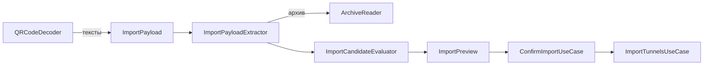

# TunnelImport

| | |
|---|---|
| Статус | в работе: импорт из файлов, архивов, буфера, перетаскиванием и через «Открыть в…» готов; сканер QR — M3-05 |
| Платформы | shared; распознавание QR — iOS и iPadOS |
| Задачи | M1-15, M1-16, M1-17, M3-04 |
| Таргеты | `TunnelImport`, `TunnelImportInfrastructure`, `TunnelImportPresentation` |

## Назначение

Превращает то, что дал пользователь (текст из буфера, файл, архив, QR-код на изображении), в предпросмотр кандидатов с каждой найденной проблемой и сохраняет выбранных кандидатов в библиотеку.

## Зависимости

| Тип | Что | Зачем |
|---|---|---|
| Фичи проекта | `SharedKernel`, `TunnelConfiguration`, `TunnelLibrary`; в `Presentation` — `TunnelConfigurationPresentation`, `DesignSystemPresentation` | разбор конфигов, имена туннелей, сохранение; тексты проблем конфигурации; общие компоненты |
| Системные фреймворки | Foundation, Vision, UIKit / AppKit, CoreTransferable, UniformTypeIdentifiers, SwiftUI | данные файлов; распознавание QR; буфер обмена; перетаскивание; типы файлов; экраны |
| Сторонние библиотеки | ZIPFoundation 0.9.20, MIT | чтение `.zip` (решение D-21) |

## Принцип работы

1. `ImportPayload` — `.text` или `.file(name:contents:)`. Файл считается архивом, если начинается с сигнатуры ZIP (`PK\3\4`, `PK\5\6`) или называется `*.zip`; иначе он декодируется как UTF-8.
2. Из архива `ArchiveReader` достаёт только файлы конфигураций по правилам `ArchiveEntryPath`: расширение `.conf`; пропускаются `__MACOSX`, скрытые файлы и папки; разделители `/` и `\`. Действуют лимиты `ArchiveImportLimits.standard`: 100 конфигов и 10 МБ распакованных данных.
3. Каждый текст разбирает `WgQuickConfigurationParser`.
   - Имя берётся из имени файла через `TunnelName.derived(fromFileName:)`; для текста и QR — `fallbackName`, который передаёт composition root.
   - Имя делается уникальным среди туннелей библиотеки и уже принятых кандидатов того же импорта.
   - `alreadyImportedAs` называет туннель библиотеки с точно такой же конфигурацией.
4. Источники, из которых ничего не прочитано, попадают в `ImportSourceFailure`: не текст, архив отклонён (повреждён или вне лимитов), в архиве нет конфигов.
5. `ImportSelection` хранит решение пользователя: по умолчанию выбраны все разобранные конфигурации, кроме дубликатов библиотеки. Неразобранную выбрать нельзя. Переименование и снятие выбора сразу пересчитывают итоговые имена: уникальные среди `ImportPreview.existingNames` и выбранных выше.
6. `ConfirmImportUseCase` импортирует выбранное под итоговыми именами через `ImportTunnelsUseCase`, который ещё раз подбирает свободные имена в момент сохранения.
7. Файлы, которые не удалось прочитать, `PrepareImportUseCase` показывает как `ImportSourceFailure` с причиной `unreadable`.

Экраны (`TunnelImportPresentation`):

- `TunnelImportModel` — единая точка входа: файлы из `fileImporter` и «Открыть в…», буфер обмена, перетаскивание. Каждый путь ведёт к одному `ImportPreviewModel`, который показывается листом. Пустой буфер даёт сообщение, а не пустой предпросмотр.
- `ImportPreviewModel` строит строки `ImportPreviewRow`: имя (то, что набрал пользователь, с пробелами), итоговое имя, выбор, ошибки и предупреждения разбора, дубликат. Кнопка «Импортировать» недоступна, если ничего не выбрано или у выбранного неверное имя. После импорта модель показывает «Импортировано N из M» (M — все найденные конфигурации и нечитаемые источники) и перечитывает список.
- Тексты проблем разбора берутся из `TunnelConfigurationPresentation` (`ConfigurationIssueLabel`).
- Тип `.conf` — импортированный `com.wireguard.config`, совместимый с `public.plain-text`. Приложения объявляют его и `public.zip-archive` в `CFBundleDocumentTypes` (`LSHandlerRank = Alternate`), iOS открывает документы на месте (`LSSupportsOpeningDocumentsInPlace`).

Адаптеры:

- `ZIPArchiveReader` считает реально распакованные байты, а не размеры из заголовков. Он сверяет CRC-32 и пропускает каталоги и символьные ссылки.
- `VisionQRCodeDecoder` выполняет `DetectBarcodesRequest` с символикой QR и возвращает тексты без повторов.
- `SecurityScopedFileReader` читает файлы на своей очереди GCD через `NSFileCoordinator` (файлы iCloud скачиваются), с доступом security-scoped и лимитом 10 МБ на файл (`ImportFileBatch.maximumFileByteCount`).
- `SystemClipboard` читает текст из `UIPasteboard` или `NSPasteboard` на главном акторе.
- `DroppedImportFile` — `Transferable` для перетаскивания: читает полученный файл тем же `SecurityScopedFileReader`, пока система держит его копию.
- `TunnelImportAssembly` собирает сценарии и адаптеры для composition root.

## Публичный API

`ImportPayload`, `ImportSource`, `ImportPreview`, `ImportPreviewCandidate`, `ImportSelection`, `ImportSourceFailure`, `ImportSourceFailureReason`, `ImportFileBatch`, `PrepareImportUseCase`, `ConfirmImportUseCase`; порты `ImportFileReader`, `ClipboardTextSource`; архивы — `ArchiveReader`, `ArchiveReadingError`, `ArchivedConfigurationFile`, `ArchiveEntryPath`, `ArchiveImportLimits`, `ZIPArchiveReader`; QR — `QRCodeDecoder`, `QRCodeDecodingError`, `VisionQRCodeDecoder`; адаптеры `SecurityScopedFileReader`, `SystemClipboard`, `DroppedImportFile`, сборка `TunnelImportAssembly`; экраны — `TunnelImportModel`, `TunnelImportActions`, `TunnelImportAlert`, `ImportPreviewModel`, `ImportPreviewRow`, `ImportSummary`, модификатор `tunnelImport(_:)`.

## Решения

- Предпросмотр ничего не сохраняет и показывает все проблемы: ошибки и предупреждения парсера, конфликт имени, дубликат, нечитаемые источники.
- Порт архивов объявлен в фиче-потребителе: `ArchiveReader` — здесь, `ArchiveWriter` — в `TunnelLibrary`.

## Спорные решения

| Решение | Альтернативы | Почему так | Когда пересмотреть |
|---|---|---|---|
| Защита от zip-бомб — счёт распакованных байтов без доверия к заголовкам | Проверка `uncompressedSize` из заголовков | Заголовки подделываются. Распаковка останавливается, когда лимит превышен на один блок (16 КБ) | Нет |
| Лимиты 100 конфигов и 10 МБ на архив | Без лимитов; другие значения | Экспорт официального клиента — единицы файлов по сотне байт, запас на порядки | Если пользователи упрутся в лимит |
| Файл `*.zip` без сигнатуры ZIP читается как архив | Только сигнатура | Тип определяется «по содержимому и расширению». Расширение выражает намерение пользователя, а «архив повреждён» понятнее ошибок разбора | Нет |
| Текст декодируется только как UTF-8 | Автоопределение UTF-16 и однобайтовых кодировок | Клиенты WireGuard пишут UTF-8, BOM обрабатывает парсер | Если придут конфиги в UTF-16 |
| Дубликат — полное равенство конфигурации | Сравнение по публичным ключам | Те же ключи при других `AllowedIPs` — уже другой туннель | Если импортом захотят обновлять туннель |
| QR через Vision; тесты на macOS, а не на симуляторе | `CIDetector`, который работает и в симуляторе | Vision лучше распознаёт фото. В симуляторе iOS Vision не создаёт детектор штрихкодов (`operationFailed`, ревизия 4 требует аппаратного ускорения) | Если симулятор начнёт поддерживать детектор |
| Имя для текста и QR — `fallbackName` от composition root | Хост из `Endpoint`; строка в Core | Core не содержит локализованных строк | Нет |
| `ZIPArchiveReader` и `ZIPArchiveWriter` вместо `ZIPFoundationArchive…` из плана | Имена по библиотеке | Имя описывает формат, а не реализацию | Нет |
| Дубликаты библиотеки по умолчанию не выбраны | Выбирать всё разобранное | Повторный импорт того же архива не должен молча удваивать туннели; пользователь может выбрать дубликат сам | Нет |
| Буфер читается кодом по пункту меню, iOS спрашивает разрешение на вставку | `PasteButton` без запроса | `PasteButton` нельзя поместить в меню «+» и в пустое состояние вместе с другими способами | Если появится вставка без запроса в меню |
| Перетаскивание и «Открыть в…» подключены в корневой сцене приложения | Модификатор фичи | `DroppedImportFile` читает файл и поэтому лежит в Infrastructure, а `Presentation` его не видит | Нет |
| Документы открываются на месте, без копии в `Documents/Inbox` | Копия во входящих | Копия конфига с приватным ключом не остаётся в контейнере приложения | Нет |

## Отступления от правил разработки

Нет.

## Ограничения и известные проблемы

- `PrepareImportUseCase` сам не ограничивает размер текста: файлы ограничивает `SecurityScopedFileReader`, буфер — система.
- В симуляторе проверены вставка из буфера с переименованием и предупреждением и открытие выбора файлов. Выбор файла, перетаскивание между приложениями на iPad и «Открыть в…» проверяются на устройстве; приложение macOS собирается, но без подписи не запускается (M0-04).
- Два одинаковых кандидата в одном импорте не помечаются дубликатами друг друга, они получают имена «X» и «X 2».
- Зашифрованные записи ZIP отклоняются как нечитаемые.
- Распознавание фото с QR на устройстве проверяется вручную в M3-05.
- Настоящего архива официального клиента в фикстурах нет. Совместимость покрыта синтетическими архивами и архивом Finder (`ditto -c -k --sequesterRsrc`) с дескрипторами данных, `__MACOSX` и `.DS_Store`.

## Тесты

- 22 теста в `TunnelImportTests`:
  - правила путей в архиве;
  - текст из буфера с лишними пробелами, файл без расширения;
  - архив со смесью валидных и невалидных конфигов, повторный импорт;
  - конфликт имён внутри импорта;
  - файл не текст и не архив, архив сверх лимитов, архив без конфигов, `*.zip` без сигнатуры;
  - подтверждение импорта, в том числе выбранного под новыми именами;
  - имена библиотеки в предпросмотре, нечитаемые файлы;
  - `ImportSelection`: выбор по умолчанию, неразобранную нельзя выбрать, уникальные итоговые имена, освобождение имени, переименование, импорт только выбранного.
- 20 тестов в `TunnelImportInfrastructureTests`:
  - 11 для `ZIPArchiveReader`: обычный архив, вложенные папки, мусор и ссылки, архив Finder, граница и превышение лимитов, заниженный в заголовке размер, испорченная контрольная сумма;
  - 6 для `VisionQRCodeDecoder` на изображениях, которые генерирует CoreImage: один QR, два QR, один QR дважды, без QR, поворот на 30°, данные, которые не являются изображением;
  - 3 для `SecurityScopedFileReader` во временной папке: чтение под именем файла, нет файла, файл больше лимита.
- 11 тестов в `TunnelImportPresentationTests`: «Импортировать» недоступна без выбора и с неверным именем, итоговые имена, переименование с пробелами, итог «2 из 3» и перечитывание списка; файлы, нечитаемые файлы, буфер, пустой буфер, перетаскивание и выбор файлов ведут к одному предпросмотру.

Запуск: `swift test --package-path Packages/SplitwayKit --filter TunnelImport`.

## История изменений

| Дата | Изменение | Задача |
|---|---|---|
| 2026-10-29 | `ArchiveReader`, `ZIPArchiveReader`, правила и лимиты архивов | M1-15 |
| 2026-10-29 | Предпросмотр и подтверждение импорта | M1-16 |
| 2026-10-29 | `VisionQRCodeDecoder` | M1-17 |
| 2026-10-29 | Экраны импорта, выбор кандидатов, чтение файлов, буфер, перетаскивание, типы документов | M3-04 |
