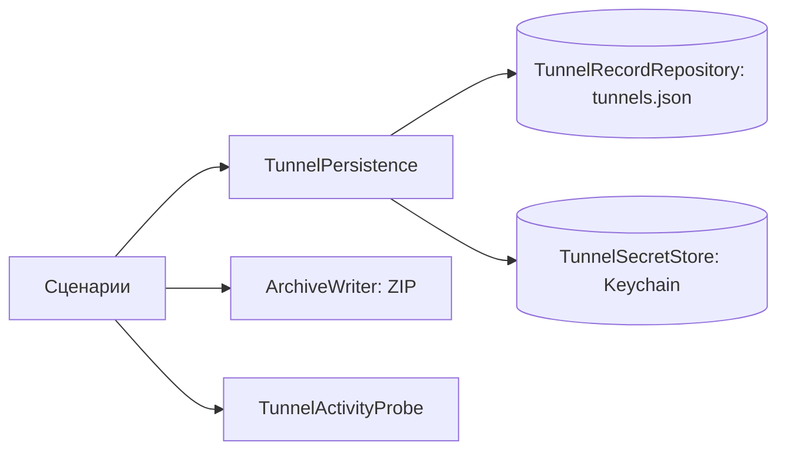

# TunnelLibrary

| | |
|---|---|
| Статус | в работе: Core и хранилища готовы, прогон Keychain на macOS ждёт M0-04, передача секрета в системное расширение — M2-12 |
| Платформы | shared |
| Задачи | M1-11, M1-12, M1-13, M1-14, M1-15 (экспорт в ZIP) |
| Таргеты | `TunnelLibrary`, `TunnelLibraryInfrastructure`, `TunnelLibraryTestSupport` |

## Назначение

Библиотека туннелей пользователя: сущность `Tunnel` и правила имён; сценарии создания, импорта, изменения, переименования, удаления, дублирования, сортировки и экспорта. Метаданные и секреты хранятся раздельно и согласованно.

## Зависимости

| Тип | Что | Зачем |
|---|---|---|
| Фичи проекта | `SharedKernel`, `TunnelConfiguration`, `AppRouting` | часы, конфигурация туннеля, политика маршрутизации |
| Системные фреймворки | Foundation, Security | файлы и JSON; Keychain |
| Сторонние библиотеки | ZIPFoundation 0.9.20, MIT | архив при экспорте (решение D-21) |

## Принцип работы

**Модель.**

- `Tunnel` — id, имя, конфигурация и политика маршрутизации.
- `TunnelRecord` — та же запись без секретов (id, имя, политика), её хранит `TunnelRecordRepository`. Текст конфигурации с ключами хранит `TunnelSecretStore` под id туннеля.
- `TunnelName` — 1…64 символа после обрезки пробелов, без управляющих символов. `derived(fromFileName:)` получает имя из имени файла, `UniqueTunnelNameResolver` подбирает свободное: «Office», «Office 2» (регистр не учитывается).

**Сценарии.**

- Все сценарии работают через `TunnelPersistence`. Сохранение согласованное: если запись метаданных не удалась, секрет откатывается — новый удаляется, прежний восстанавливается.
- `LoadTunnelsUseCase` возвращает туннели в сохранённом порядке и отдельно — нечитаемые записи: нет секрета, секрет повреждён или не разбирается.
- `DeleteTunnelUseCase` сначала останавливает активный туннель через `TunnelActivityProbe`.
- `ExportTunnelsUseCase` выдаёт один конфиг или архив всех туннелей с уникальными именами файлов (`ExportFileNaming`).

**Адаптеры.**

- `FileTunnelRecordRepository` (actor) хранит `tunnels.json` в директории, которую передаёт composition root (контейнер App Group).
  - Запись атомарная, с классом защиты `completeUntilFirstUserAuthentication`.
  - В документе есть версия схемы, старые версии обновляет `JSONDocumentMigrator`: текущая версия равна 1 + число шагов.
  - Повреждённый документ переносится в `tunnels.corrupted-<время UTC>.json`, сценарий получает `corruptedData`, библиотека начинается пустой.
  - Документ более новой версии остаётся на месте, сценарий получает `unsupportedSchemaVersion`.
- `KeychainTunnelSecretStore` хранит generic password в data protection keychain: service `Splitway tunnel configuration`, account — UUID туннеля, `kSecAttrAccessibleAfterFirstUnlockThisDeviceOnly`, без синхронизации. Access group передаёт composition root.
- `ZIPArchiveWriter` пишет архив: deflate, имена в UTF-8, права `0600`.

## Публичный API

- **Модель:** `Tunnel`, `TunnelIdentifier`, `TunnelName`, `TunnelNameError`, `TunnelRecord`, `UniqueTunnelNameResolver`, `ExportedConfigurationFile`.
- **Порты:** `TunnelRecordRepository`, `TunnelSecretStore`, `TunnelActivityProbe`, `ArchiveWriter` и их ошибки `TunnelStorageError`, `TunnelActivityError`, `ArchiveWritingError`.
- **Сценарии:** `LoadTunnelsUseCase` (`TunnelLibrarySnapshot`), `CreateTunnelUseCase`, `ImportTunnelsUseCase` (`ImportCandidate`, `ImportReport`, `ImportFailure`), `UpdateTunnelUseCase`, `RenameTunnelUseCase`, `DeleteTunnelUseCase`, `DuplicateTunnelUseCase`, `ReorderTunnelsUseCase`, `ExportTunnelsUseCase`, ошибка `TunnelLibraryError`.
- **Адаптеры:** `FileTunnelRecordRepository`, `JSONDocumentMigrator`, `JSONDocumentMigrationError`, `KeychainTunnelSecretStore`, `ZIPArchiveWriter`.

## Решения

- В `tunnels.json` никогда нет ключей. Keychain — главная копия секретов на обеих платформах.
- Порты бросают `TunnelStorageError`, сценарии — `TunnelLibraryError`.
- Директорию App Group и access group Keychain передаёт composition root. Адаптеры не знают идентификаторов, а тесты работают во временной директории и с отдельным service.

## Спорные решения

| Решение | Альтернативы | Почему так | Когда пересмотреть |
|---|---|---|---|
| Повреждённый `tunnels.json` переносится в резервную копию, библиотека начинается пустой | Оставлять файл и показывать ошибку при каждом запуске; читать уцелевшие записи | Ошибка показывается один раз, данные не теряются (копия лежит рядом), приложение остаётся рабочим. Частичное чтение потеряло бы нечитаемые записи при следующем сохранении | Когда появится восстановление из копии |
| Ужесточение валидации записей требует миграции схемы | Пропускать записи, не прошедшие проверку | Иначе новая версия приложения сочтёт старые данные повреждёнными целиком | Нет |
| `FileTunnelRecordRepository` вместо `AppGroupTunnelRepository` из плана | `AppGroupTunnelRepository` | Адаптер работает с любой директорией; App Group — выбор composition root | Нет |
| Шаги миграции — массив, текущая версия = 1 + число шагов | Словарь «версия → миграция» | Пропуск версии невозможен по построению | Если понадобятся миграции через версию |
| Шаги миграции работают с `[String: Any]` из `JSONSerialization` | Свой тип `JSONValue`; типизированные документы по версиям | Миграции редки, дерево JSON — стандартный инструмент без нового кода | При первой сложной миграции |
| Секрет хранится как текст wg-quick | Отдельные поля ключей | Один формат для импорта, экспорта и движка | Если понадобится обновлять ключи по отдельности |
| Сохранение секрета: добавление, при `errSecDuplicateItem` — обновление | Удаление и добавление | Нет момента, когда секрета нет | Нет |
| Ошибки Keychain сводятся к `unavailable` без `OSStatus` | Передавать код наверх | Сценарии не различают причины | Когда журнал начнёт записывать ошибки хранилищ (M2) |
| Интеграционные тесты Keychain — в таргете `iOSIntegrationTests` с хост-приложением | Тесты в SPM | Data protection keychain требует entitlements, `swift test` их не даёт | Нет |

## Отступления от правил разработки

Нет.

## Ограничения и известные проблемы

- Прогон тестов Keychain на macOS ждёт Team ID и профиль (M0-04): без entitlements data protection keychain на macOS недоступен.
- Секреты туннелей из повреждённого `tunnels.json` остаются в Keychain без записей.
- Запись `tunnels.json` из нескольких процессов не координируется. Пишет только приложение; расширение и интенты читают, а атомарное переименование защищает читателей.
- Системное расширение macOS работает от root и не видит Keychain пользователя. Копию секрета ему передаёт M2-12.

## Тесты

- 33 теста в `TunnelLibraryTests`: каждый сценарий с фейками из `TunnelLibraryTestSupport`, откаты при сбоях хранилищ, импорт с частичными неудачами и конфликтами имён, удаление активного туннеля, экспорт.
- 20 тестов в `TunnelLibraryInfrastructureTests`:
  - репозиторий во временной директории;
  - эталонный документ версии 1 читается и записывается;
  - повреждённый документ, новая версия схемы, ошибки доступа;
  - мигратор;
  - ZIP-экспорт с именами в UTF-8 и правами `0600`.
- 7 интеграционных тестов Keychain в `iOSIntegrationTests` на симуляторе iPhone: запись, перезапись, удаление, чтение отсутствующего, атрибуты доступности и синхронизации.

Запуск: `swift test --package-path Packages/SplitwayKit --filter TunnelLibrary`. Интеграционные тесты запускает `Scripts/check.sh`.

## История изменений

| Дата | Изменение | Задача |
|---|---|---|
| 2026-10-29 | `Tunnel`, `TunnelName`, уникальные имена | M1-11 |
| 2026-10-29 | Порты и сценарии библиотеки | M1-12 |
| 2026-10-29 | `FileTunnelRecordRepository` и `JSONDocumentMigrator` | M1-13 |
| 2026-10-29 | `KeychainTunnelSecretStore`, интеграционные тесты на симуляторе | M1-14 |
| 2026-10-29 | `ZIPArchiveWriter` | M1-15 |
