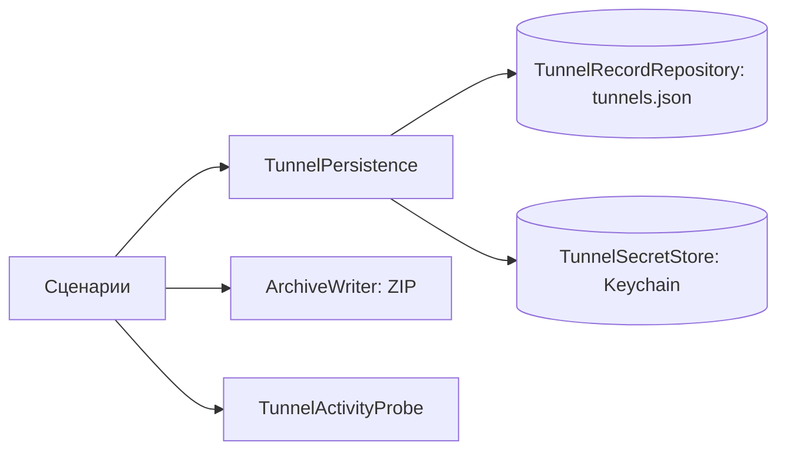

# TunnelLibrary

| | |
|---|---|
| Статус | в работе: Core, хранилища и экран списка готовы; запуск на macOS и прогон Keychain там ждут M0-04, передача секрета в системное расширение — M2-12 |
| Платформы | shared |
| Задачи | M1-11, M1-12, M1-13, M1-14, M1-15 (экспорт в ZIP), M3-02, M3-03, M3-04 (`TunnelName.untitled`), M3-07 (кнопка «Изменить»), M3-09 (подключение и ошибки), M3-11 (экспорт), M3-12 (пункт «Журнал»), M3-13 (пункт «Настройки»), M3-14 (доступность, команды меню), M4-04 (приложения через туннель в деталях) |
| Таргеты | `TunnelLibrary`, `TunnelLibraryInfrastructure`, `TunnelLibraryPresentation`, `TunnelLibraryTestSupport` |

## Назначение

Библиотека туннелей пользователя: сущность `Tunnel` и правила имён; сценарии создания, импорта, изменения, переименования, удаления, дублирования, сортировки и экспорта. Метаданные и секреты хранятся раздельно и согласованно. Слой `Presentation` показывает список туннелей с состоянием подключения, детали туннеля со статистикой и корневую навигацию приложения.

## Зависимости

| Тип | Что | Зачем |
|---|---|---|
| Фичи проекта | `SharedKernel`, `TunnelConfiguration`, `AppRouting`; в `Presentation` — `TunnelConnection`, `AppRoutingPresentation`, `DesignSystemPresentation` | часы и `Ticker`, конфигурация туннеля, политика маршрутизации; состояние слота и подключение; общие компоненты |
| Системные фреймворки | Foundation, Security, SwiftUI, Observation | файлы и JSON; Keychain; экран списка |
| Сторонние библиотеки | ZIPFoundation 0.9.20, MIT | архив при экспорте (решение D-21) |

## Принцип работы

**Модель.**

- `Tunnel` — id, имя, конфигурация и политика маршрутизации.
- `TunnelRecord` — та же запись без секретов (id, имя, политика), её хранит `TunnelRecordRepository`. Текст конфигурации с ключами хранит `TunnelSecretStore` под id туннеля.
- `TunnelName` — 1…64 символа после обрезки пробелов, без управляющих символов; `untitled` — заведомо правильное имя на случай, если локализованное имя по умолчанию не пройдёт проверку. `derived(fromFileName:)` получает имя из имени файла, `UniqueTunnelNameResolver` подбирает свободное: «Office», «Office 2» (регистр не учитывается).

**Сценарии.**

- Все сценарии работают через `TunnelPersistence`. Сохранение согласованное: если запись метаданных не удалась, секрет откатывается — новый удаляется, прежний восстанавливается.
- `LoadTunnelsUseCase` возвращает `TunnelLibrarySnapshot` — записи в сохранённом порядке. Каждая запись `TunnelLibraryEntry` либо читаемый туннель, либо нечитаемая запись: нет секрета, секрет повреждён или не разбирается. Нечитаемая запись остаётся на своём месте.
- `DeleteTunnelUseCase` сначала останавливает активный туннель через `TunnelActivityProbe`.
- `ExportTunnelsUseCase` выдаёт один конфиг или архив всех туннелей с уникальными именами файлов (`ExportFileNaming`). Туннели, чью конфигурацию не удаётся прочитать, в архив не попадают, а `ExportedArchive.skippedTunnels` называет их.

**Адаптеры.**

- `FileTunnelRecordRepository` (actor) хранит `tunnels.json` в директории, которую передаёт composition root (контейнер App Group).
  - Запись атомарная, с классом защиты `completeUntilFirstUserAuthentication`.
  - В документе есть версия схемы, старые версии обновляет `JSONDocumentMigrator`: текущая версия равна 1 + число шагов.
  - Повреждённый документ переносится в `tunnels.corrupted-<время UTC>.json`, сценарий получает `corruptedData`, библиотека начинается пустой.
  - Документ более новой версии остаётся на месте, сценарий получает `unsupportedSchemaVersion`.
- `KeychainTunnelSecretStore` хранит generic password в data protection keychain: service `Splitway tunnel configuration`, account — UUID туннеля, `kSecAttrAccessibleAfterFirstUnlockThisDeviceOnly`, без синхронизации. Access group передаёт composition root.
- `ZIPArchiveWriter` пишет архив: deflate, имена в UTF-8, права `0600`.
- `TunnelLibraryAssembly` собирает граф фичи для composition root: директория хранения и access group Keychain приходят снаружи, проба активности — из `TunnelConnection`. Хранилища она отдаёт и сборке импорта.

**Экран списка.**

- `TunnelListModel` (`@MainActor`, `@Observable`) объединяет записи библиотеки и `SlotState` в строки `TunnelRow`: имя, `TunnelRowStatus`, режим маршрутизации и имена приложений, которые идут через туннель (`routedApplicationNames`, по имени, как в Finder).
  - Статус берётся из слота только для туннеля, который в нём записан; остальные — «Отключён».
  - Нечитаемая запись — строка «Конфигурация недоступна»: её можно удалить и переставить, но не подключить и не дублировать.
- Действия модели: переключить подключение, удалить с подтверждением (`TunnelDeletionRequest`, предупреждает, если туннель подключён), дублировать, переставить. Перестановка применяется сразу и сохраняется через `ReorderTunnelsUseCase`; при ошибке список перечитывается.
- Ошибки сценариев показываются через `TunnelListAlert`. Отказ подключения показывается объяснением из `TunnelConnectionPresentation` с кнопкой действия: «Открыть Настройки» (iOS) или «Изменить туннель».
- **Подключение.** После нажатия переключателя строка сразу показывает «Подключение…», пока система не сообщит состояние, — в том числе пока открыт системный запрос на добавление VPN. Повторное нажатие в это время отключает туннель: координатор пропускает оставшиеся шаги подключения.
- **Перед первым подключением**, пока системного слота ещё нет, модель объясняет, что устройство попросит добавить конфигурацию VPN, и подключает только после «Продолжить». Объяснение показывается один раз за запуск приложения.
- `TunnelLibraryRootView` — `NavigationSplitView`: список в боковой колонке, детали туннеля справа. На iPhone SwiftUI сворачивает его в стек. Корень загружает библиотеку и наблюдает за слотом, пока виден.
- Переходы в другие фичи — к редактору туннеля, журналу и настройкам — задаёт composition root через `TunnelLibraryNavigation`. В меню «⋯» панели списка — «Журнал», «Экспортировать все туннели» и «Настройки». Пункт «Настройки» есть, только если передан его обработчик: на macOS настройки открываются из меню приложения.
- Способы добавления туннеля (`TunnelAdditionMethod`) и их обработчик передаёт composition root через `TunnelAdditionOptions`. Меню «+» и кнопки пустого состояния показывают только переданные способы.
- **Доступность.** VoiceOver читает строку туннеля одной фразой (имя, режим, статус) и отдельным переключателем. На крупных размерах шрифта доступности переключатель уходит под текст.
- **Команды меню** `TunnelLibraryCommands` (строка меню macOS и iPadOS):
  - способы добавления: ⌘N — создать, ⌘O — импорт файла, ⇧⌘V — вставить из буфера;
  - ⌥⌘L — журнал;
  - на iPad ⌘, — настройки.

  В деталях туннеля ⌘E открывает редактор.

**Экспорт.**

- `TunnelExportModel` экспортирует один туннель («Экспортировать…» в контекстном меню строки) или все («Экспортировать все туннели» в меню панели). Перед каждым экспортом показывается предупреждение о приватных ключах.
- Файл предлагается под именем туннеля (`Office.conf`), архив — «Туннели Splitway.zip». Сохраняет его системный `fileExporter` с документом `ExportedDataDocument` из `DesignSystemPresentation`: на iOS и iPadOS — выбор места в Файлах, на macOS — `NSSavePanel`.
- Если в архив попали не все туннели, после сохранения модель называет пропущенные.

**Детали туннеля.**

- Экран показывает переключатель, статус, время подключения (таймер SwiftUI от `connectedSince`), режим маршрутизации, в режиме выбранных приложений — раздел «Приложения через туннель» и раздел на каждого пира: публичный ключ, endpoint, последнее рукопожатие, принято и отправлено.
- `TunnelDetailModel` строит `PeerStatisticsRow` для пиров конфигурации и сопоставляет с ними статистику по публичному ключу. Давность рукопожатия `HandshakeRecency` считается по `WallClock`: целые секунды, рукопожатие «из будущего» даёт ноль, отсутствие — «ещё не было».
- `trackStatistics(isTunnelRunning:)` опрашивает расширение на каждый тик `Ticker` из `SharedKernel` (`RepeatingTicker`, раз в секунду), пока экран виден. Экран перезапускает опрос, когда меняется `reportsStatistics` статуса строки: у неработающего туннеля опроса нет, а статистика стирается.
- Ответ, пришедший после остановки опроса, отбрасывается. Ошибка опроса стирает статистику и показывает «Статистика сейчас недоступна».
- Нечитаемая запись открывает те же детали без пиров.
- Если подключение не удалось, детали показывают объяснение отказа.
- Кнопка с карандашом «Изменить туннель» в деталях читаемого туннеля передаёт его обработчику `TunnelLibraryNavigation.editTunnel`, который задаёт composition root (редактор — фича `TunnelEditor`).

## Публичный API

- **Модель:** `Tunnel`, `TunnelIdentifier`, `TunnelName`, `TunnelNameError`, `TunnelRecord`, `UniqueTunnelNameResolver`, `ExportedConfigurationFile`.
- **Порты:** `TunnelRecordRepository`, `TunnelSecretStore`, `TunnelActivityProbe`, `ArchiveWriter` и их ошибки `TunnelStorageError`, `TunnelActivityError`, `ArchiveWritingError`.
- **Сценарии:** `LoadTunnelsUseCase` (`TunnelLibrarySnapshot`, `TunnelLibraryEntry`), `CreateTunnelUseCase`, `ImportTunnelsUseCase` (`ImportCandidate`, `ImportReport`, `ImportFailure`), `UpdateTunnelUseCase`, `RenameTunnelUseCase`, `DeleteTunnelUseCase`, `DuplicateTunnelUseCase`, `ReorderTunnelsUseCase`, `ExportTunnelsUseCase`, ошибка `TunnelLibraryError`.
- **Адаптеры:** `FileTunnelRecordRepository`, `JSONDocumentMigrator`, `JSONDocumentMigrationError`, `KeychainTunnelSecretStore`, `ZIPArchiveWriter`, сборка `TunnelLibraryAssembly`.
- **Экспорт:** `ExportedArchive`; экран — `TunnelExportModel`, `TunnelExportRequest`, `ExportedDocument`, `ExportedDocumentKind`, `TunnelExportProblem`.
- **Экран:** `TunnelListModel`, `TunnelRow`, `TunnelRowStatus`, `TunnelDeletionRequest`, `TunnelListAlert`, `TunnelLibraryActions`, `TunnelConnectionActions`, `TunnelAdditionMethod`, `TunnelAdditionOptions`, `TunnelLibraryNavigation`, `TunnelLibraryCommands`, `TunnelLibraryRootView`; детали — `TunnelDetailModel`, `PeerStatisticsRow`, `PeerActivity`, `HandshakeRecency`, `TunnelStatisticsPolling`.

## Решения

- В `tunnels.json` никогда нет ключей. Keychain — главная копия секретов на обеих платформах.
- Порты бросают `TunnelStorageError`, сценарии — `TunnelLibraryError`.
- Директорию App Group и access group Keychain передаёт composition root. Адаптеры не знают идентификаторов, а тесты работают во временной директории и с отдельным service.
- Корень наблюдает за слотом сам, а не список: на iPhone список уходит со стека, когда открыты детали, и его `task` отменился бы.
- Правка туннеля в деталях — кнопка с карандашом «Изменить туннель», а не текст «Изменить»: на iPad рядом видна кнопка «Изменить» списка для перестановки, и две одинаковые кнопки путали бы и пользователя, и VoiceOver.
- Вью вызывают асинхронные действия через `Task.immediate`: перестановка и снятие запроса на удаление выполняются синхронно в обработчике жеста, и `List` не возвращает строку на прежнее место.
- Кнопка удаления в свайпе — без роли `destructive`, с красным цветом: роль `destructive` заставляет `List` сразу анимировать удаление строки, хотя пользователь ещё не подтвердил его. В контекстном меню роль остаётся.
- Диалог подтверждения привязан к своей строке (`deletionRequest(for:)`), поэтому на iPad и в iOS 26 всплывающее окно указывает на удаляемый туннель.

## Спорные решения

| Решение | Альтернативы | Почему так | Когда пересмотреть |
|---|---|---|---|
| Повреждённый `tunnels.json` переносится в резервную копию, библиотека начинается пустой | Оставлять файл и показывать ошибку при каждом запуске; читать уцелевшие записи | Ошибка показывается один раз, данные не теряются (копия лежит рядом), приложение остаётся рабочим. Частичное чтение потеряло бы нечитаемые записи при следующем сохранении | Когда появится восстановление из копии |
| Ужесточение валидации записей требует миграции схемы | Пропускать записи, не прошедшие проверку | Иначе новая версия приложения сочтёт старые данные повреждёнными целиком | Нет |
| `FileTunnelRecordRepository` вместо `AppGroupTunnelRepository` из плана | `AppGroupTunnelRepository` | Адаптер работает с любой директорией; App Group — выбор composition root | Нет |
| Шаги миграции — массив, текущая версия = 1 + число шагов | Словарь «версия → миграция» | Пропуск версии невозможен по построению | Если понадобятся миграции через версию |
| Шаги миграции работают с `[String: Any]` из `JSONSerialization` | Свой тип `JSONValue`; типизированные документы по версиям | Миграции редки, дерево JSON — стандартный инструмент без нового кода | При первой сложной миграции |
| Секрет хранится как текст wg-quick | Отдельные поля ключей | Один формат для импорта, экспорта и движка | Если понадобится обновлять ключи по отдельности |
| Сохранение секрета: добавление, при `errSecDuplicateItem` — обновление | Удаление и добавление | Нет момента, когда секрета нет | Нет |
| Ошибки Keychain сводятся к `unavailable` без `OSStatus` | Передавать код наверх | Сценарии не различают причины | Когда журнал начнёт записывать ошибки хранилищ (M2) |
| Интеграционные тесты Keychain — в таргете `iOSIntegrationTests` с хост-приложением | Тесты в SPM | Data protection keychain требует entitlements, `swift test` их не даёт | Нет |
| Один `NavigationSplitView` на всех устройствах | `NavigationStack` на iPhone и `NavigationSplitView` на iPad и Mac, как в плане M3-02 | В компактной ширине SwiftUI сам сворачивает его в стек; второй вариант навигации дублировал бы код и ломался бы в Slide Over | Если появятся экраны, которым нужен свой стек на iPhone |
| Способы добавления туннеля передаёт composition root | Кнопки импорта прямо в фиче | Импорт и редактор — другие фичи (`TunnelImport`, `TunnelEditor`), а набор способов зависит от платформы (QR только на iOS). Пока способов нет, кнопок нет, а не пустых действий | Нет |
| Модель деталей отдаёт давность рукопожатия значением, а текст строит Foundation | Готовая строка «2 мин назад» в модели | Тест проверяет расчёт по `FixedWallClock` без зависимости от языка; формат длительности (`Duration.UnitsFormatStyle`) локализует система | Нет |
| Опрос по тикам `Ticker`, а не `Task.sleep` в модели | `Clock` в модели | Тест управляет тиками вручную (`ManualTicker`) и проверяет остановку опроса без ожиданий; `RepeatingTicker` в `SharedKernel` — единственное место со `sleep` | Нет |
| Публичный ключ — строкой `IdentifierRow` в одну строку с уменьшением шрифта | Перенос по строкам | При переносе система вставляла дефис, которого в ключе нет | Нет |
| Экспорт сохраняется через `fileExporter` и на iOS | Share sheet, как в плане M3-11 | Пользователь явно выбирает, куда положить файл с приватными ключами; share sheet легко отправляет его в любое приложение. На macOS `fileExporter` и есть `NSSavePanel` | Если пользователи попросят отправку прямо в мессенджер |
| Экспорт всех пропускает нечитаемые туннели | Отказ от всего экспорта | Одна повреждённая запись не должна мешать сохранить остальные; пропущенные названы после сохранения | Нет |
| Сообщения об ошибках и объяснение системного запроса показывает корень, а не список | Модификаторы на списке | На iPhone список уходит со стека, пока открыты детали, и его сообщения не показались бы | Нет |

## Отступления от правил разработки

Нет.

## Ограничения и известные проблемы

- Прогон тестов Keychain на macOS ждёт Team ID и профиль (M0-04): без entitlements data protection keychain на macOS недоступен.
- Секреты туннелей из повреждённого `tunnels.json` остаются в Keychain без записей.
- Запись `tunnels.json` из нескольких процессов не координируется. Пишет только приложение; расширение и интенты читают, а атомарное переименование защищает читателей.
- Системное расширение macOS работает от root и не видит Keychain пользователя. Копию секрета ему передаёт M2-12.
- Экран списка проверен в симуляторах iPhone и iPad: светлая и тёмная тема, русский язык, псевдолокализация, удаление, дублирование, перестановка, ошибка подключения. Приложение macOS собирается, но без подписи с ограниченными entitlements не запускается (M0-04).
- В симуляторе NetworkExtension не работает (`IPC failed`), поэтому подключение там всегда заканчивается сообщением об ошибке. Смена статуса и опрос статистики проверены тестами моделей, живая статистика на устройстве — в M2-14.

## Тесты

- 36 тестов в `TunnelLibraryTests`: каждый сценарий с фейками из `TunnelLibraryTestSupport`, откаты при сбоях хранилищ, импорт с частичными неудачами и конфликтами имён, удаление активного туннеля, экспорт, пропуск нечитаемых туннелей при экспорте, порядок нечитаемых записей.
- 20 тестов в `TunnelLibraryInfrastructureTests`:
  - репозиторий во временной директории;
  - эталонный документ версии 1 читается и записывается;
  - повреждённый документ, новая версия схемы, ошибки доступа;
  - мигратор;
  - ZIP-экспорт с именами в UTF-8 и правами `0600`.
- 7 интеграционных тестов Keychain в `iOSIntegrationTests` на симуляторе iPhone: запись, перезапись, удаление, чтение отсутствующего, атрибуты доступности и синхронизации.
- 42 теста в `TunnelLibraryPresentationTests`:
  - модель списка: строки и состояние слота, нечитаемые записи на своих местах, пустое состояние только после загрузки, конфигурация только читаемого туннеля, имена приложений через туннель по алфавиту и пустой список для всего трафика;
  - подтверждение удаления, в том числе для подключённого туннеля, отмена, привязка к строке;
  - перестановка через `ReorderTunnelsUseCase`, дублирование;
  - подключение: переключение, ошибка, «Подключение…» сразу после нажатия, отключение повторным нажатием, объяснение системного запроса и отказ от него;
  - экспорт: предупреждение каждый раз, имя файла туннеля и архива, пропущенные туннели после сохранения, неудачный экспорт;
  - статусы строк: каждое `ConnectionState`, тон, активность, наличие статистики, время подключения;
  - модель деталей: пиры до статистики, давность рукопожатия по `FixedWallClock`, рукопожатие «из будущего», трафик, причина недоступности, опрос до ухода с экрана, нет опроса у отключённого туннеля, поздний ответ.

Запуск: `swift test --package-path Packages/SplitwayKit --filter TunnelLibrary`. Интеграционные тесты запускает `Scripts/check.sh`.

## История изменений

| Дата | Изменение | Задача |
|---|---|---|
| 2026-10-29 | `Tunnel`, `TunnelName`, уникальные имена | M1-11 |
| 2026-10-29 | Порты и сценарии библиотеки | M1-12 |
| 2026-10-29 | `FileTunnelRecordRepository` и `JSONDocumentMigrator` | M1-13 |
| 2026-10-29 | `KeychainTunnelSecretStore`, интеграционные тесты на симуляторе | M1-14 |
| 2026-10-29 | `ZIPArchiveWriter` | M1-15 |
| 2026-10-29 | Экран списка, корневая навигация, сборка фичи; записи снимка в сохранённом порядке | M3-02 |
| 2026-10-29 | Детали туннеля и опрос статистики | M3-03 |
| 2026-10-29 | Мгновенное «Подключение…», объяснение системного запроса, понятные ошибки подключения | M3-09 |
| 2026-10-29 | Экспорт одного и всех туннелей с предупреждением о ключах | M3-11 |
| 2026-10-29 | Пункт «Журнал», переходы через `TunnelLibraryNavigation`; `Ticker` переехал в `SharedKernel`, документ экспорта — в `DesignSystemPresentation` | M3-12 |
| 2026-10-29 | Пункт «Настройки» в меню «⋯» на iOS и iPadOS | M3-13 |
| 2026-10-29 | Строка для VoiceOver и крупного шрифта, команды меню и сочетания клавиш | M3-14 |
| 2026-10-30 | Раздел «Приложения через туннель» в деталях | M4-04 |
