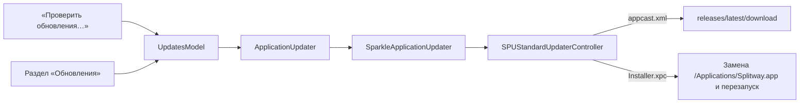

# Updates

| | |
|---|---|
| Статус | завершена: обновление 1.1 (473) → 1.1 (474) проверено в тестовой ВМ 2026-11-03 |
| Платформы | macOS |
| Задачи | M8-08, M8-09, M8-10 |
| Таргеты | `Updates`, `UpdatesInfrastructure`, `UpdatesPresentation`, `UpdatesTestSupport` |

## Назначение

Splitway обновляется сам через Sparkle 2 (решение D-52). Пользователь проверяет обновления командой «Проверить обновления…» или разделом «Обновления» в настройках. Автоматическая проверка раз в день включается только с его согласия, новую версию Sparkle ставит по кнопке и перезапускает приложение.

## Зависимости

| Тип | Что | Зачем |
|---|---|---|
| Фичи проекта | `DesignSystemPresentation`; раздел показывает `SettingsPresentation` | Оформление раздела |
| Системные фреймворки | SwiftUI, Observation, Combine (только в адаптере) | Команда, раздел, наблюдение за свойствами Sparkle |
| Сторонние библиотеки | Sparkle 2.10.1, MIT (с уведомлениями bsdiff, sais-lite, ed25519), только в `UpdatesInfrastructure` и только у приложения | Лента обновлений, проверка подписей, установка вне песочницы |

## Принцип работы

- `ApplicationUpdater` (Core) — порт: текущее состояние `UpdaterState` (проверяет ли автоматически, можно ли проверить сейчас), поток изменений, переключение автоматической проверки и проверка по запросу.
- `UpdatesModel` (Presentation) следит за состоянием порта. Команда в меню приложения и кнопка в настройках недоступны, пока Sparkle занят проверкой.
- `SparkleApplicationUpdater` (Infrastructure) создаёт `SPUStandardUpdaterController` при запуске приложения и наблюдает за `automaticallyChecksForUpdates` и `canCheckForUpdates` через KVO-издатели Combine.
- Точка сборки создаёт модель, только если в `Info.plist` `SplitwayStartsUpdater = YES`. Это `SPLITWAY_STARTS_UPDATER` из `project.yml`: `YES` в Release и `NO` в Debug. Сборки разработки, в том числе в тестовой ВМ, Sparkle не запускают и вопросов не задают.
- Лента — `appcast.xml` в каждом релизе GitHub, её пишет `Scripts/release.sh` (`Scripts/lib/appcast.sh`): номер сборки, версия, минимальная macOS, заметки из `docs/releases/<версия>.md` в Markdown на английском и русском, образ с подписью EdDSA. Скрипт подписывает и проверяет ленту ключом из связки ключей (account `splitway`).
- После установки новая версия при запуске запрашивает замену системного расширения ([SystemExtension](SystemExtension.md)), и система ставит его с унаследованным одобрением.

## Публичный API

`ApplicationUpdater`, `UpdaterState`; `UpdatesModel`, `UpdatesCommands`, `UpdatesSection`; `SparkleApplicationUpdater`.

## Решения

- `Info.plist`: `SUFeedURL` и `SUPublicEDKey` из `project.yml`, `SUEnableInstallerLauncherService`, `SUVerifyUpdateBeforeExtraction`, `SURequireSignedFeed`. `SUEnableAutomaticChecks` не задан: Sparkle сам спрашивает согласие при втором запуске.
- Права приложения: `network.client` и `com.apple.security.temporary-exception.mach-lookup.global-name` для `$(PRODUCT_BUNDLE_IDENTIFIER)-spks` и `-spki`, как требует Sparkle для приложений в песочнице.
- Постоянный адрес ленты — `releases/latest/download/appcast.xml`: GitHub отдаёт файл последнего релиза, и выпуск не требует коммита в `master`.
- Ключ подписи создан `generate_keys --account splitway`. ACL элемента разрешает расшифровку только `generate_keys` и `sign_update` этой версии Sparkle (по `cdhash`), поэтому раннер CI подписывает без вопросов, а другие процессы получают запрос macOS.
- Заметки в ленте встроены, а не ссылкой: подписанная лента защищает и их, отдельная подпись файла заметок не нужна.

## Спорные решения

| Решение | Альтернативы | Почему так | Когда пересмотреть |
|---|---|---|---|
| Сеть получает само приложение (`network.client`) | XPC-загрузчик Sparkle (`SUEnableDownloaderService`) | Загрузчик Sparkle с версии 2.6 работает вне песочницы, а заметки при нём показывает устаревший WebView. Право сети у приложения в песочнице уже, чем у процесса без песочницы | Если Sparkle изолирует загрузчик в готовой сборке |
| Подписанная лента и проверка до распаковки | Только подпись образа | Защищают заметки, номера версий и распаковку от подмены. Цена — зависимость от ключа: без него обновления встанут на 20 дней, дальше поможет смена ключа через подпись Developer ID | Если ключ потерян |
| Модель создаётся только в Release | Всегда, но не запускать проверки в Debug | Сборки разработки не видят ленту (их номер сборки — время сборки, он больше любого выпуска) и не задают вопросов в тестовой ВМ | Если понадобится проверять обновление на сборке разработки |
| `Downloader.xpc` остаётся в бандле Sparkle | Удалять его фазой сборки | Сервис не включён, запустить его может только само приложение. Удаление потребовало бы переподписывать фреймворк в сборке | Если появится повод уменьшить бандл |

## Отступления от правил разработки

Нет.

## Ограничения и известные проблемы

- Версии 1.0 и 1.0.1 Sparkle не содержат: на 1.1 пользователь переходит вручную.
- После обновления Sparkle (новая версия `sign_update`) первая подпись спросит доступ к ключу в связке ключей: владелец разрешает один раз, иначе задание выпуска в CI ждёт ответа.
- Ключ подписи нельзя восстановить: резервную копию владелец делает сам (`generate_keys --account splitway -x <файл>`, [шаги владельца](../05-tasks/release-steps.md)).
- Если открыто знакомство с приложением, замену расширения после обновления запросит мастер, а не запуск: так устроено `activateSystemExtensionOnLaunch` ([Onboarding](Onboarding.md)).
- Обновление при подключённом туннеле не проверялось: расширение перезапускается, и туннель переподключается заново ([отложенные проверки](../05-tasks/deferred-checks.md)).

## Тесты

7 тестов `UpdatesModelTests` с `FakeApplicationUpdater`: ничего не предлагается до ответа порта; состояние автоматической проверки; включение и выключение; проверка по запросу и отказ, пока Sparkle занят; модель следует за потоком состояний.

Адаптер Sparkle — тонкая обёртка, unit-тестов у него нет. Поток целиком проверен в тестовой ВМ 2026-11-03:
- 1.1 (473) из нотаризованного DMG нашла подписанную ленту 1.1 (474) на локальном сервере (адрес ленты переопределён ключом `SUFeedURL` в настройках приложения);
- скачала и проверила образ, заменила себя без пароля и перезапустилась;
- расширение заменилось на 474 с унаследованным одобрением;
- при втором запуске Sparkle спросил согласие, выбор виден в настройках, выключение сохраняется;
- строки на русском на месте.

`ThirdPartyNoticeCoverageTests` требует запись о лицензии Sparkle в настройках.

Запуск: `swift test --package-path Packages/SplitwayKit --filter Updates`.

## История изменений

| Дата | Изменение | Задача |
|---|---|---|
| 2026-11-03 | Sparkle 2.10.1 в приложении, команда и раздел настроек, подписанная лента в каждом релизе, политика конфиденциальности и модель угроз | M8-08, M8-09, M8-10 |
