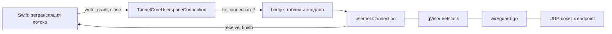

# UserspaceNetwork

| | |
|---|---|
| Статус | в работе: Go-пакет `usernet`, мост C и адаптер Swift готовы; сравнение с замерами SP-3 — после спайка |
| Платформы | macOS |
| Задачи | M4-05, M4-06 |
| Таргеты | Go-пакеты `usernet`, `bridge` (функции `tc_usernet_*` и `tc_connection_*`), `internal/testpeer` и утилита `testpeer`; порты в `TunnelEngine` (SplitwayKit); адаптер в `TunnelCoreAdapter` (TunnelCore) |

## Назначение

WireGuard в пространстве пользователя для режима «Только выбранные приложения» на macOS. Вместо системного интерфейса `utun` пакеты туннеля идут в gVisor netstack внутри процесса расширения. Прозрачный прокси открывает через него TCP-соединения и UDP-сокеты к адресатам в туннеле, а DNS-прокси резолвит имена через DNS туннеля.

## Зависимости

| Тип | Что | Зачем |
|---|---|---|
| Пакеты и фичи проекта | `fdtunnel`; `TunnelEngine`, `TunnelConfiguration`, `SharedKernel` | жизненный цикл устройства wireguard-go; порты, UAPI, `MTU`, адреса и имена |
| Системные фреймворки | нет | |
| Сторонние библиотеки | wireguard-go `tun/netstack` (MIT); gVisor `v0.0.0-20250503011706-39ed1f5ac29c` (Apache-2.0); `github.com/google/btree` v1.1.2 (Apache-2.0) и `golang.org/x/time` v0.7.0 (BSD-3-Clause) — зависимости gVisor | стек TCP/IP в процессе |

## Принцип работы

### Go-пакет `usernet`

- `Start(Options{Addresses, DNSServers, MTU}, uapi, logger)`:
  - `netstack.CreateNetTUN` создаёт стек с адресами интерфейса и DNS туннеля;
  - `fdtunnel.Start` поднимает на нём устройство wireguard-go со стандартным bind, то есть с настоящими UDP-сокетами к endpoint-ам.

  `Apply`, `Configuration` и `BumpSockets` идут к устройству.
- `DialTCP(context, адрес)` подключается через туннель. Тайм-аут задаёт контекст вызывающего, на его истечение приходит ошибка с `context.DeadlineExceeded`. `DialUDP(адрес)` открывает подключённый UDP-сокет к одному адресату. Ошибки подключения оборачиваются в `ErrDialFailed`.
- `LookupHost(context, имя)` резолвит имя через DNS-серверы туннеля резолвером netstack (A и AAAA). Завершающая точка полного имени срезается, иначе резолвер netstack добавил бы вторую. Ошибка — `ErrLookupFailed`.
- `Connection` — одно соединение или сокет:
  - `StartReceiving(receiver, ReceiveOptions{ReadBuffer, InitialCredit})` запускает горутину чтения в буфер вызывающего. Пустой буфер — `ErrEmptyReadBuffer`, второй запуск — `ErrAlreadyReceiving`. Каждый прочитанный блок уходит в `Receiver.Receive`; буфер переиспользуется, поэтому получатель копирует данные.
  - Кредитное окно: горутина читает, только пока кредит положителен, и вычитает прочитанное. `Grant(n)` возвращает кредит, когда Swift обработал байты. Окно может уйти в минус не больше чем на один буфер: UDP-датаграмму нельзя читать частями.
  - `Receiver.Finish(err)` приходит ровно один раз и последним. `nil` означает упорядоченный конец: конец потока от удалённой стороны, локальное закрытие или остановку сети. Иначе там ошибка соединения.
  - Закрытие:

    | Метод | TCP | UDP |
    |---|---|---|
    | `CloseWrite` | FIN | ничего |
    | `CloseRead` | перестать читать | то же, что `Close` |
    | `Close` | закрыть соединение | закрыть сокет |

    Блокированная запись при `Close` возвращает ошибку.
- `Stop()` закрывает все соединения, ждёт, пока завершатся все горутины чтения, и останавливает устройство. Повторный вызов ничего не делает. После остановки `DialTCP` и `DialUDP` возвращают `ErrNetworkStopped`.

### Мост C (`bridge`)

- Устройства обоих режимов лежат в одной таблице хэндлов (`handleTable[runningDevice]`): `fdtunnel.Tunnel` и `usernet.Network` умеют `Apply`, `Configuration`, `BumpSockets` и `Stop`. Поэтому `tc_tunnel_update_config`, `tc_tunnel_get_config`, `tc_tunnel_bump_sockets` и `tc_tunnel_stop` работают и с сетью `usernet`.
- Соединения лежат в своей таблице хэндлов. `tc_connection_close(..., Both)` закрывает соединение и освобождает хэндл, `Write` и `Read` закрывают одну сторону.
- Приём: `tc_connection_start_receiving` выделяет буфер чтения через `malloc`, и горутина читает прямо в эту память C. В обратный вызов уходит указатель на неё, а не на память Go. Буфер освобождается после `finish`.
- Каждая экспортная функция, включая функции режима fd, выполняется внутри `guarded`: паника превращается в `TCStatusInternalFailure` и не пересекает границу cgo.
- Код режима netstack собирается только для macOS (`//go:build !ios`). В слайсы iOS не попадают ни `usernet`, ни gVisor, и пакетный туннель iOS не платит памятью за их `init`.

| Функция | Назначение |
|---|---|
| `tc_usernet_start(configuration, addresses, dnsServers, mtu, &handle)` | запускает сеть; адреса и DNS — строки, по адресу на строку |
| `tc_usernet_dial_tcp(network, address, port, timeoutMilliseconds, &connection)` | подключается через туннель, блокирует до подключения или тайм-аута |
| `tc_usernet_dial_udp(network, address, port, &connection)` | открывает UDP-сокет к адресату |
| `tc_usernet_lookup_host(network, name, timeoutMilliseconds, &addresses)` | резолвит имя через DNS туннеля; адреса по одному на строку, строку освобождает `tc_free` |
| `tc_connection_start_receiving(connection, callbacks, readByteCount, initialCredit)` | запускает приём; `callbacks` — `receive`, `finish` и `context` |
| `tc_connection_write(connection, bytes, length, &writtenLength)` | блокирующая запись без копирования на стороне C |
| `tc_connection_grant(connection, byteCount)` | возвращает кредит окна |
| `tc_connection_close(connection, closing)` | `Write`, `Read` или `Both` |

Новые `TCStatus`: `ConnectionFailed`, `TimedOut`, `LookupFailed`, `NetworkStopped`, `ConnectionClosed`. `TCConnectionClosing`: `Write`, `Read`, `Both`.

### Порты и адаптер Swift

- Порты в `TunnelEngine`:
  - `UserspaceNetworkEngine.startNetwork(configuration:interface:)` запускает сеть по `UAPIConfiguration` и `UserspaceNetworkInterface` (адреса, DNS, `MTU`).
  - `RunningUserspaceNetwork` расширяет `RunningWireGuardDevice` методами `dialTCP(to:timeout:)`, `openUDP(to:)` и `lookUpAddresses(of:timeout:)`.
  - `UserspaceConnection`: `startReceiving(into:readByteCount:initialCredit:)`, `write(_:)`, `grant(_:)`, `close(_:)`.
  - `UserspaceConnectionReceiver`: `receive(_:)` и `finish(_:)`.

  Ошибки — `UserspaceNetworkError`. Все вызовы синхронные и блокирующие: их делают с выделенных очередей ретрансляции, а не с кооперативного пула.
- Адаптер в `TunnelCoreAdapter` (только macOS):
  - `TunnelCoreUserspaceNetworkEngine` передаёт адреса строками;
  - `TunnelCoreUserspaceNetwork` для операций устройства использует `TunnelCoreWireGuardDevice` с тем же хэндлом;
  - `TunnelCoreUserspaceConnection` закрывает соединение в `deinit`.
- Получатель живёт в `UserspaceConnectionReceiverBox`. `Unmanaged.passRetained` удерживает его до `finish`, а обратный вызов `finish` его отпускает. Если приём не запустился, адаптер отпускает получателя сам.
- `UserspaceNetworkError(status:releasedHandle:)` переводит `TCStatus` в ошибку. Неизвестный хэндл значит остановленную сеть для операций сети и закрытое соединение для операций соединения. Тайм-аут `Duration` уходит в C целыми миллисекундами с ограничением диапазоном `Int32`.

## Публичный API

- Go: `Start`, `Options`, `Network` (`Apply`, `Configuration`, `BumpSockets`, `Stop`, `DialTCP`, `DialUDP`, `LookupHost`), `Connection` (`StartReceiving`, `Write`, `Grant`, `CloseRead`, `CloseWrite`, `Close`), `Receiver`, `ReceiveOptions`; ошибки `ErrInterfaceUnavailable`, `ErrNetworkStopped`, `ErrDialFailed`, `ErrLookupFailed`, `ErrEmptyReadBuffer`, `ErrAlreadyReceiving`.
- C: функции и типы из таблицы выше.
- Swift: `UserspaceNetworkEngine`, `RunningUserspaceNetwork`, `UserspaceConnection`, `UserspaceConnectionReceiver`, `UserspaceNetworkInterface`, `UserspaceNetworkDestination`, `UserspaceConnectionClosing`, `UserspaceNetworkError`; адаптер `TunnelCoreUserspaceNetworkEngine`.

## Решения

- Устройство поднимает `fdtunnel.Start`: он принимает любой `tun.Device`, поэтому код UAPI и запуска общий с пакетным туннелем.
- Реестр соединений знает все горутины чтения, а `Stop` дожидается их (`sync.WaitGroup`). Горутина не переживает остановку сети, и goleak это проверяет. Новая горутина не стартует после начала остановки, поэтому `WaitGroup` не получает `Add` во время `Wait`.
- `Finish(nil)` при локальном закрытии: ошибку «соединение закрыто», которую возвращает чтение, вызвал сам Swift, и сообщать о ней нечего.
- UDP — подключённый сокет на адресата, как задумано в M4-07: адресатов одного потока ведёт `UDPAssociationTable`.
- Буфер приёма передаёт вызывающий. Мост читает прямо в память C, и данные не копируются между Go и C.

## Спорные решения

| Решение | Альтернативы | Почему так | Когда пересмотреть |
|---|---|---|---|
| Тестовый пир — отдельная утилита `testpeer`, которую тесты Swift запускают процессом | Функция `tc_test_start_loopback_peer` с тегом `testpeer` в том же ядре, как задумано в M4-06 | Тесты Swift линкуют тот же xcframework, что и приложение. Пир в ядре попал бы в продакшен, а вторая сборка ядра в том же процессе означала бы два рантайма Go. Пир не связан с ядром и по-прежнему поднимает в Go настоящий WireGuard с эхо-серверами | Если SwiftPM научится подменять бинарную цель для тестов |
| Кредит может уйти в минус на один буфер | Читать не больше остатка кредита | UDP-датаграмму нельзя читать по частям, а одно правило для TCP и UDP проще. Перерасход ограничен размером буфера | Если окно окажется слишком грубым для медленных потоков |
| Буфер чтения выделяется на соединение | Пул буферов на время чтения | Горутина держит буфер, пока ждёт данные в `Read`, и пул не сократил бы память простаивающих соединений | Если профиль памяти M4-16 покажет, что буферы заметны на фоне буферов netstack |
| `Stop` нельзя вызывать из `Receive` или `Finish` | Не ждать горутины в `Stop` | Ожидание гарантирует, что после `Stop` обратных вызовов нет | Нет |
| Порты синхронные | `async` API с переходом на очередь внутри адаптера | Насосы M4-10 работают на выделенных очередях и ждут ответа Go в любом случае. Переход в Swift Concurrency на каждом блоке стоил бы задержки на горячем пути | Если вызовы понадобятся из actor-ов сессии: тогда обёртка над очередью в сессии |

## Отступления от правил разработки

Нет. Экспортные функции C и передача указателя на память C в обратный вызов — граница cgo, а не горячий путь Swift.

## Ограничения и известные проблемы

- Цель по скорости задаст спайк SP-3. Базовая линия на Apple M4 Pro — 95 МБ/с (около 760 Мбит/с) отправки по TCP через два netstack-пира в одном процессе. В замер входят шифрование и стек обоих концов.
- Проверка «не читать без кредита» детерминированно покрыта только на уровне окна. В соединении проверено, что после `Grant` чтение продолжается.
- Интеграционным тестам Swift нужна собранная утилита `Packages/TunnelCore/Artifacts/testpeer`. Её собирает `Scripts/check.sh`, а вручную — `Packages/TunnelCore/Scripts/build-test-peer.sh`. Без неё тесты падают с подсказкой.

## Тесты

- 14 Go-тестов в `usernet`. Клиент `usernet` и пир `internal/testpeer` работают в одном процессе и связаны через loopback; ключи создаются при запуске. Внутри netstack пира работают эхо TCP и UDP, приёмник TCP без ответа и DNS-сервер на `golang.org/x/net/dns/dnsmessage`.
  - TCP и UDP туда и обратно;
  - half-close: эхо 32 КиБ и упорядоченный конец потока;
  - DNS через туннель, полное имя с точкой;
  - тайм-аут подключения к адресу, который не принимает ни один пир;
  - отказ в подключении к закрытому порту;
  - закрытие во время блокированной записи: запись завершается ошибкой, приём — тихо;
  - продолжение приёма после `Grant`, отказ для пустого буфера и второго запуска;
  - 1000 параллельных соединений;
  - `Stop` закрывает все соединения и не даёт открыть новые;
  - кредитное окно: ожидание кредита и освобождение при закрытии.
- 9 новых Go-тестов в `bridge`: операции устройства по хэндлу сети, неверные адреса, соединение и датаграмма через мост, отказ и тайм-аут, DNS, остановка сети с закрытием соединений, сетевые операции с чужим или неизвестным хэндлом, паника → `InternalFailure`.
- 11 новых тестов в `TunnelCoreAdapterTests`:
  - через процесс `testpeer`: TCP и UDP туда и обратно, half-close с концом потока, отказ в подключении, DNS через туннель, остановка сети завершает приём и запрещает запись;
  - таблица `TCStatus` → `UserspaceNetworkError`, хэндл, освобождённый сетью или соединением, конец приёма, миллисекунды тайм-аута.

`TestMain` пакетов проверяет отсутствие утёкших горутин (goleak). Тесты Go проходят и с `-race`.

Бенчмарк `BenchmarkUploadThroughTheTunnel` — отправка блоками по 64 КиБ.

Запуск: `go test ./...` в `Packages/TunnelCore/go`; бенчмарк — `go test -run '^$' -bench . ./usernet/`; Swift — `Packages/TunnelCore/Scripts/build-test-peer.sh` и `swift test --package-path Packages/TunnelCore`.

## История изменений

| Дата | Изменение | Задача |
|---|---|---|
| 2026-10-30 | Пакет `usernet`: устройство на netstack, TCP и UDP, DNS через туннель, кредитное окно | M4-05 |
| 2026-10-30 | Мост C, порты и адаптер Swift, процесс-пир для тестов Swift, `recover` в экспортных функциях | M4-06 |
