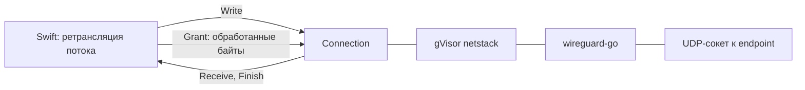

# UserspaceNetwork

| | |
|---|---|
| Статус | в работе: Go-пакет `usernet` готов; сравнение с замерами SP-3 — после спайка; мост C и адаптер Swift — M4-06 |
| Платформы | macOS |
| Задачи | M4-05 |
| Таргеты | Go-пакет `usernet` в `Packages/TunnelCore/go` |

## Назначение

WireGuard в пространстве пользователя для режима «Только выбранные приложения» на macOS. Вместо системного интерфейса `utun` пакеты туннеля идут в gVisor netstack внутри процесса расширения. Прозрачный прокси открывает через него TCP-соединения и UDP-сокеты к адресатам в туннеле, а DNS-прокси резолвит имена через DNS туннеля.

## Зависимости

| Тип | Что | Зачем |
|---|---|---|
| Пакеты проекта | `fdtunnel` | жизненный цикл устройства wireguard-go: UAPI, `Up`, `BindUpdate`, `Close` |
| Системные фреймворки | нет | |
| Сторонние библиотеки | wireguard-go `tun/netstack` (MIT); gVisor `v0.0.0-20250503011706-39ed1f5ac29c` (Apache-2.0); `github.com/google/btree` v1.1.2 (Apache-2.0) и `golang.org/x/time` v0.7.0 (BSD-3-Clause) — зависимости gVisor | стек TCP/IP в процессе |

## Принцип работы

- `Start(Options{Addresses, DNSServers, MTU}, uapi, logger)`:
  - `netstack.CreateNetTUN` создаёт стек с адресами интерфейса и DNS туннеля;
  - `fdtunnel.Start` поднимает на нём устройство wireguard-go со стандартным bind, то есть с настоящими UDP-сокетами к endpoint-ам.

  `Apply`, `Configuration` и `BumpSockets` идут к устройству.
- `DialTCP(context, адрес)` подключается через туннель. Тайм-аут задаёт контекст вызывающего, на его истечение приходит ошибка с `context.DeadlineExceeded`. `DialUDP(адрес)` открывает подключённый UDP-сокет к одному адресату. Ошибки подключения оборачиваются в `ErrDialFailed`.
- `LookupHost(context, имя)` резолвит имя через DNS-серверы туннеля резолвером netstack (A и AAAA). Завершающая точка полного имени срезается, иначе резолвер netstack добавил бы вторую. Ошибка — `ErrLookupFailed`.
- `Connection` — одно соединение или сокет:
  - `StartReceiving(receiver, ReceiveOptions{ReadByteCount, InitialCredit})` запускает горутину чтения. Каждый прочитанный блок уходит в `Receiver.Receive`; буфер переиспользуется, поэтому получатель копирует данные.
  - Кредитное окно: горутина читает, только пока кредит положителен, и вычитает прочитанное. `Grant(n)` возвращает кредит, когда Swift обработал байты. Окно может уйти в минус не больше чем на один блок `ReadByteCount`: UDP-датаграмму нельзя читать частями.
  - `Receiver.Finish(err)` приходит ровно один раз и последним. `nil` означает упорядоченный конец: конец потока от удалённой стороны, локальное закрытие или остановку сети. Иначе там ошибка соединения.
  - Закрытие:

    | Метод | TCP | UDP |
    |---|---|---|
    | `CloseWrite` | FIN | ничего |
    | `CloseRead` | перестать читать | то же, что `Close` |
    | `Close` | закрыть соединение | закрыть сокет |

    Блокированная запись при `Close` возвращает ошибку.
- `Stop()` закрывает все соединения, ждёт, пока завершатся все горутины чтения, и останавливает устройство. Повторный вызов ничего не делает. После остановки `DialTCP` и `DialUDP` возвращают `ErrNetworkStopped`.

## Публичный API

`Start`, `Options`, `Network` (`Apply`, `Configuration`, `BumpSockets`, `Stop`, `DialTCP`, `DialUDP`, `LookupHost`), `Connection` (`StartReceiving`, `Write`, `Grant`, `CloseRead`, `CloseWrite`, `Close`), `Receiver`, `ReceiveOptions`; ошибки `ErrInterfaceUnavailable`, `ErrNetworkStopped`, `ErrDialFailed`, `ErrLookupFailed` и ошибки `fdtunnel` для конфигурации и устройства.

## Решения

- Устройство поднимает `fdtunnel.Start`: он принимает любой `tun.Device`, поэтому код UAPI и запуска общий с пакетным туннелем.
- Реестр соединений знает все горутины чтения, а `Stop` дожидается их (`sync.WaitGroup`). Горутина не переживает остановку сети, и goleak это проверяет. Новая горутина не стартует после начала остановки, поэтому `WaitGroup` не получает `Add` во время `Wait`.
- `Finish(nil)` при локальном закрытии: ошибку «соединение закрыто», которую возвращает чтение, вызвал сам Swift, и сообщать о ней нечего.
- UDP — подключённый сокет на адресата, как задумано в M4-07: адресатов одного потока ведёт `UDPAssociationTable`.

## Спорные решения

| Решение | Альтернативы | Почему так | Когда пересмотреть |
|---|---|---|---|
| Кредит может уйти в минус на один блок | Читать не больше остатка кредита | UDP-датаграмму нельзя читать по частям, а одно правило для TCP и UDP проще. Перерасход ограничен `ReadByteCount` | Если окно окажется слишком грубым для медленных потоков |
| Буфер чтения выделяется на соединение | Пул буферов на время чтения | Горутина держит буфер, пока ждёт данные в `Read`, и пул не сократил бы память простаивающих соединений | Если профиль памяти M4-16 покажет, что буферы заметны на фоне буферов netstack |
| `Stop` нельзя вызывать из `Receive` или `Finish` | Не ждать горутины в `Stop` | Ожидание гарантирует, что после `Stop` обратных вызовов нет. Мост M4-06 вызывает `Stop` не из обратного вызова | Нет |

## Отступления от правил разработки

Нет.

## Ограничения и известные проблемы

- Цель по скорости задаст спайк SP-3. Базовая линия на Apple M4 Pro — 95 МБ/с (около 760 Мбит/с) отправки по TCP через два netstack-пира в одном процессе. В замер входят шифрование и стек обоих концов.
- Проверка «не читать без кредита» детерминированно покрыта только на уровне окна. В соединении проверено, что после `Grant` чтение продолжается.
- C API и адаптер Swift — M4-06.

## Тесты

12 Go-тестов в `usernet`. Два устройства wireguard-go с netstack работают в одном процессе и связаны через loopback; ключи создаются при запуске. Внутри netstack второго пира работают эхо TCP и UDP, приёмник TCP без ответа и DNS-сервер на `golang.org/x/net/dns/dnsmessage`.

- TCP и UDP туда и обратно;
- half-close: эхо 32 КиБ и упорядоченный конец потока;
- DNS через туннель, полное имя с точкой;
- тайм-аут подключения к адресу, который не принимает ни один пир;
- отказ в подключении к закрытому порту;
- закрытие во время блокированной записи: запись завершается ошибкой, приём — тихо;
- продолжение приёма после `Grant`;
- 1000 параллельных соединений;
- `Stop` закрывает все соединения и не даёт открыть новые;
- кредитное окно: ожидание кредита и освобождение при закрытии.

`TestMain` проверяет отсутствие утёкших горутин (goleak). Тесты проходят и с `-race`.

Бенчмарк `BenchmarkUploadThroughTheTunnel` — отправка блоками по 64 КиБ.

Запуск: `go test ./usernet/` в `Packages/TunnelCore/go`; бенчмарк — `go test -run '^$' -bench . ./usernet/`.

## История изменений

| Дата | Изменение | Задача |
|---|---|---|
| 2026-10-30 | Пакет `usernet`: устройство на netstack, TCP и UDP, DNS через туннель, кредитное окно | M4-05 |
