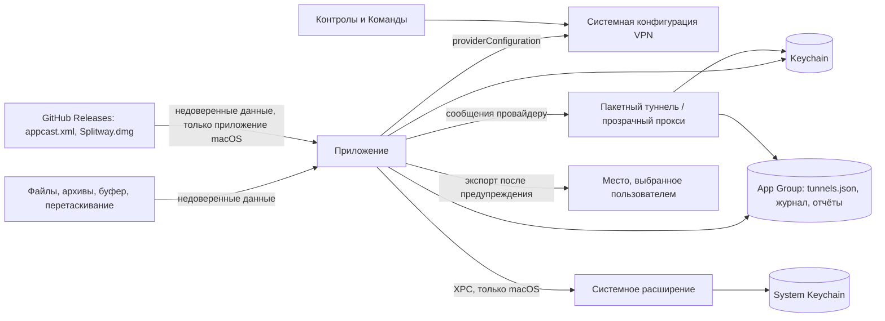

# Безопасность: модель угроз и аудит

Документ описывает, что Splitway защищает, где проходят границы доверия, какие угрозы учтены и чем они закрыты. В конце — итоги аудита по задаче M7-01 (2026-11-02) и принятые риски. Защита трафика (утечки мимо туннеля, DNS, IPv6) здесь не разбирается: её проверяют тесты утечек M4-17, M5-10 и M7-05 и решение D-30.

## 1. Активы

| Актив | Где хранится | Защита |
|---|---|---|
| Приватный ключ и ключ PresharedKey: текст конфигурации wg-quick целиком | Keychain. Приложение — data protection keychain пользователя: service `Splitway tunnel configuration`, account — UUID туннеля, `kSecAttrAccessibleAfterFirstUnlockThisDeviceOnly`, без синхронизации, группа доступа команды `…splitway.shared`. Системное расширение — копия в System Keychain (решение D-33) | Читают только процессы Splitway с группой доступа команды; на Mac копию в System Keychain — ещё root и администраторы |
| Ключи во время работы | Память приложения (импорт, правка, экспорт), расширения и движка wireguard-go | Песочница процессов |
| Ключи в экспортированных файлах | Место, которое выбрал пользователь | Предупреждение перед каждым экспортом; ZIP с правами `0600` |
| Метаданные туннелей: имена, порядок, выбранные приложения и сервисы | `tunnels.json` в контейнере App Group | Класс защиты `completeUntilFirstUserAuthentication`; ключей нет |
| История подключений: время подключений и отключений, ошибки, имена туннелей | Журнал `diagnostics.log` (до 2 МБ) и отчёты MetricKit (до 20) в App Group, те же строки в системном журнале | Остаётся на устройстве; пользователь сам решает, отправлять ли отчёт (решение D-22), и может очистить журнал |
| Адрес сервера | `serverAddress` системной конфигурации VPN, виден в Настройках | Не секрет |
| Ключ подписи обновлений (EdDSA, Sparkle) | Связка ключей входа владельца на Mac выпуска: service `https://sparkle-project.org`, account `splitway`; резервная копия — у владельца | ACL элемента разрешает расшифровку только `generate_keys` и `sign_update` этой версии Sparkle (по `cdhash`), остальным процессам macOS показывает запрос. Открытый ключ — `SUPublicEDKey` в `Info.plist` |

## 2. Границы доверия

| Граница | По ту сторону | Что пересекает | Защита |
|---|---|---|---|
| Импорт | Любой файл, архив, текст из буфера или перетаскивания, файл из другого приложения | Текст конфигурации | Файл не больше 10 МБ (размер проверяется до чтения). Архив: не больше 100 конфигураций и 10 МБ распакованных данных — бюджет списывается во время распаковки, поэтому заниженный в заголовке размер не помогает; контрольная сумма сверяется. Из архива берутся только имена файлов, пути не используются. Строгий разбор wg-quick: ключи со скриптами (`PostUp` и другие) дают предупреждение и не исполняются — исполнять их нечем. Импорт только после предпросмотра и подтверждения |
| Сообщения провайдеру | Приложение, которое владеет конфигурацией VPN | `runtimeStatistics`, `applyRoutingPolicy`, `healthCheck` | Отправить может только владелец конфигурации — это гарантирует система. Конверт с версией: мусор и чужая версия получают отказ, обработчик не вызывается. Ответ ждётся не дольше 3 с ([ProviderMessaging](features/ProviderMessaging.md)) |
| Системная конфигурация VPN | Система, Настройки, расширения | `providerConfiguration`, `serverAddress` | В `providerConfiguration` только id туннеля и снимок политики маршрутизации |
| XPC (macOS) | Любой локальный процесс может подключиться к Mach-сервису расширения | Текст конфигурации для System Keychain | `setConnectionCodeSigningRequirement`: `anchor apple generic`, Team ID и bundle ID приложения; Team ID и bundle ID проверяются при сборке требования, подставить своё условие нельзя. Конверт с версией, мусор получает отказ ([SecretDelivery](features/SecretDelivery.md)) |
| App Group | Приложение и расширения одной команды | Метаданные, журнал, отчёты, свои сервисы | Ключей нет |
| Keychain | Процессы с группой доступа команды | Текст конфигурации | Атрибуты из раздела 1 |
| Буфер обмена | Любое приложение | Публичный ключ | Приложение кладёт в буфер только публичный ключ; вставка — командой ⇧⌘V |
| Экспорт | Место, которое выбрал пользователь | Конфигурация или ZIP; журнал; отчёт о сбое | Предупреждение о приватных ключах перед экспортом туннелей. Журнал и отчёт маскируются. Копия неудачного или отменённого экспорта удаляется из временной папки |
| Контролы и Команды | Пункт управления, «Команды», Siri | Подключить или отключить туннель | Конфигурацию не возвращают |
| Обновления (macOS) | GitHub и всё, что между Mac и GitHub | Лента `appcast.xml` и образ новой версии | Sparkle 2 принимает ленту только с подписью EdDSA (`SURequireSignedFeed`), проверяет подпись EdDSA образа до распаковки (`SUVerifyUpdateBeforeExtraction`) и подпись Developer ID нового приложения. Автоматическая проверка — только с согласия пользователя. Приложению для этого даны `network.client` и временное исключение `mach-lookup` для установщика Sparkle (решение D-52) |

## 3. Угрозы и меры

| Угроза | Мера | Остаётся |
|---|---|---|
| Другой процесс пользователя на Mac | Элемент Keychain доступен только приложениям с группой доступа команды; XPC проверяет подпись клиента; сообщения провайдеру принимаются только от владельца конфигурации | Файлы в контейнере группы — журнал с именами туннелей и `tunnels.json` — могут читать процессы пользователя вне песочницы. Ключей там нет. Подмена `tunnels.json` может изменить политику маршрутизации, но не раскрывает ключи |
| Администратор Mac | — | Читает System Keychain (решение D-33) |
| Вредный файл или архив | Лимиты размера, бюджет распаковки, строгий разбор, без скриптов, подтверждение перед импортом | — |
| Ключ в журнале, отчёте или системном журнале | `LogRedactor` маскирует ключи-токены (43 символа base64 с `=`, 64 шестнадцатеричные цифры) и значения после `PrivateKey`, `PresharedKey`, `private_key`, `preshared_key` до записи и при чтении. Типы ключей скрывают значение в `description`, `debugDescription` и `Mirror` | Ключ, разорванный пробелами или в другой кодировке, маска не узнает. Поэтому код не пишет в журнал тексты конфигураций, а тест-сканер проверяет и этот случай |
| Временные копии ключей | Копия отменённого экспорта удаляется. Перетаскивание читает системную временную копию, которую система убирает сама | — |
| Буфер обмена после вставки | Приложение не меняет чужой буфер | Конфигурация, которую пользователь сам скопировал для вставки, остаётся в буфере, пока он её не заменит. Приватный ключ, скопированный вручную из редактора, живёт в буфере по правилам системы |
| Ключи в памяти | — | `String` и `Data` с ключами не затираются после использования, как и в официальных клиентах WireGuard |
| Подменённое обновление | Подписи EdDSA ленты и образа и подпись Developer ID нового приложения; HTTPS до GitHub | Нужны оба ключа: подписи обновлений и Developer ID. Кто украдёт оба и получит доступ к релизам, выпустит своё обновление |

## 4. Аудит 2026-11-02

| Пункт задачи | Итог | Как проверено |
|---|---|---|
| Атрибуты Keychain | Соответствуют разделу 1 | `KeychainTunnelSecretStore` и `SystemKeychainSecretStore` в коде. Интеграционные тесты Keychain работали на симуляторе iPhone и ушли вместе с iOS (решение D-45), их перенос на Mac — задача M8-07 |
| Требования к подписи XPC | Только приложение нашей команды с нашим bundle ID | Тесты `ClientCodeRequirement` (неверный Team ID и bundle ID, кавычки и пробелы отклоняются); в тестовой ВМ 2026-10-30 ([SP-5](features/spikes/SP-5.md)) |
| Ключей нет в журнале, `providerConfiguration`, `UserDefaults` и отчётах о сбоях | Нет | Тест-сканер `SecretLeakScanTests` проверял это на симуляторах iPhone и iPad до решения D-45, его перенос на Mac — задача M8-07 (раздел 7). Тесты маскирования в `LogRedactor`, записях журнала и отчёте о сбое |
| Предупреждения при экспорте | Перед каждым экспортом одного туннеля и всех туннелей | `TunnelExportModelTests` |
| Время жизни ключей в буфере обмена | Приватных ключей приложение в буфер не кладёт: кнопка в редакторе копирует только публичный ключ, поэтому `expirationDate` и `localOnly` не нужны | Код: единственная запись в буфер — `SystemClipboard.copy` из «Скопировать публичный ключ» |
| Zip-бомбы и огромные файлы | Лимиты из раздела 2 | Тесты `ZIPArchiveReader` (граница и превышение лимитов, заниженный в заголовке размер, испорченная контрольная сумма) и `SecurityScopedFileReader` (файл больше лимита) |
| Проверка сообщений провайдеру | Чужая версия и мусор получают явный отказ | Тесты `ProviderMessageDispatcher` и кодеков `ProviderMessaging` |

**Найдено и исправлено:**

1. **Копия отменённого экспорта.** SwiftUI `fileExporter` записывает экспортируемый файл во временную папку приложения (`tmp/<UUID>/<имя>`) ещё до того, как откроется окно выбора места. После сохранения система копию убирает, а после отмены копия с приватными ключами оставалась. Теперь при экспорте без сохранения `TemporaryExportCopies` удаляет из временной папки файлы ровно с экспортированным содержимым и пустую папку от них ([TunnelLibrary](features/TunnelLibrary.md)). Проверено на симуляторе iPad: до исправления копия оставалась после отмены, после исправления её нет.

В M7-02 то же удаление получил экспорт журнала: ключей в журнале нет, но в нём история подключений. Порт `AbandonedExportCopies` переехал в `SharedKernel`, реализация `TemporaryExportCopies` осталась в `TunnelLibraryInfrastructure`, и composition root отдаёт её обеим моделям экспорта.

## 5. Принятые риски

| Риск | Почему принят | Когда пересмотреть |
|---|---|---|
| Ключ доступен после первой разблокировки (`AfterFirstUnlock`) | Без этого туннель не подключится с экрана блокировки, из Пункта управления и при подключении по требованию | Если появится режим «только при разблокированном устройстве» |
| System Keychain на Mac читают администраторы | Решение D-33: root-расширению нужна своя копия, Keychain пользователя ему недоступен | Если Apple даст системному расширению доступ к Keychain пользователя |
| Файлы приложения macOS в контейнере группы видят процессы пользователя вне песочницы | Ключей там нет: журнал хранит имена туннелей, время событий и ошибки, ограничен 2 МБ, пользователь может его очистить. Шифрование журнала потребовало бы ключа в Keychain и общей схемы для приложения и root-расширения — сложность не оправдана (решено в M7-02) | Если в журнал начнут попадать адреса или имена сайтов |
| Снимок экрана с открытым редактором | Снимок лежит в песочнице приложения под защитой данных; пользователь видит ключ в редакторе намеренно | Если пользователи попросят скрывать экран в фоне |
| Конфигурация остаётся в буфере после вставки | Буфер принадлежит пользователю: стирать его без спроса неожиданно | Если появится явная настройка «очищать буфер после импорта» |
| Вставленный текст не ограничен по размеру | Вставляет сам пользователь системной кнопкой или командой, а не чужое приложение | Если вставка большого текста начнёт мешать работе |
| Ключи в памяти не затираются | Swift не гарантирует затирание `String`; так же устроены официальные клиенты | — |
| Приложение macOS выходит в сеть (`network.client`) и обращается к установщику Sparkle вне песочницы | Без этого Sparkle не проверит и не поставит обновление; загрузчик Sparkle вне песочницы был бы шире (D-52). Ключей в запросах нет | Если обновления уйдут из приложения |
| Потеря ключа подписи обновлений | Лента и образ без подписи не пройдут проверку: через 20 дней Sparkle покажет обновление по одной подписи Developer ID, и ключ можно сменить. Резервную копию хранит владелец | Если ключ потерян |

## 6. Приватность: манифесты и политика

Каждый бандл несёт `PrivacyInfo.xcprivacy`: `NSPrivacyTracking` = `false`, домены отслеживания и собираемые данные пустые. Причины для API с обязательным объяснением соответствуют тому, что реально линкует бинарник бандла (M7-02, 2026-11-02):

| Бандл | Категория и причина | Откуда вызовы |
|---|---|---|
| `Splitway.app` | `FileTimestamp` — `C617.1`; `UserDefaults` — `CA92.1` | `stat` размера сегментов журнала в контейнере App Group; ZIPFoundation; флаг онбординга и аргумент временного хранилища в `UserDefaults` приложения |
| Системное расширение | `FileTimestamp` — `C617.1`; `SystemBootTime` — `35F9.1` | журнал; Go-рантайм TunnelCore (`fstat`, `fstatat`, `mach_absolute_time` для таймеров) |

У ZIPFoundation свой манифест (`FileTimestamp` — `0A2A.1`), он лежит в её ресурсном бандле внутри каждого нашего бандла.

**Как проверено.** Символы и селекторы Objective-C всех исполняемых файлов подписанного архива iOS и Release-сборки macOS сопоставлены со списком API Apple: у каждого бандла заявлены ровно используемые категории, лишних и пропущенных нет. API дискового пространства (`statfs` и другие) и активных клавиатур не используются. Отчёт о приватности Xcode строится только в интерфейсе Organizer (Generate Privacy Report): консольного инструмента у Xcode нет.

**macOS.** Apple требует причины только для iOS, iPadOS, tvOS, visionOS и watchOS. Каталог приложений Mac раньше читал дату изменения `Info.plist` чужих приложений для своего кэша (`FileSystemApplicationScanner`), и ни одна причина Apple это не покрывала. Теперь кэш сравнивает `generationIdentifierKey` и дат чужих файлов не читает (SP-10).

**Политика конфиденциальности** — [privacy-policy.ru.md](privacy-policy.ru.md) и [privacy-policy.en.md](privacy-policy.en.md): данные не собираются и не передаются, что хранится на устройстве и как это стереть. Объявление о данных до начала работы показывает онбординг («Ваши данные остаются у вас»). Политика публикуется на сайте продукта (задача M8-04).

## 7. Как проверять

- `SecretLeakScanTests` работал в `iOSIntegrationTests` на симуляторе iPhone и ушёл вместе с iOS (решение D-45). Его перенос на Mac — задача M8-07: файл со случайными ключами импортируется в настоящий Keychain и App Group, туннель ставится в слот, журнал экспортируется, затем тест ищет ключи во всех файлах контейнеров и в `UserDefaults`.
- Вручную на Mac: поиск ключа тестового туннеля в `~/Library/Containers/com.facelessdiplomat.splitway` и `~/Library/Group Containers/8625S77CSU.com.facelessdiplomat.splitway`.
- Модульные тесты: `SecurityScopedFileReaderTests`, `TemporaryExportCopiesTests`, `TunnelExportModelTests`, тесты `LogRedactor`, `ZIPArchiveReader`, `ClientCodeRequirement` и `ProviderMessageDispatcher`.
